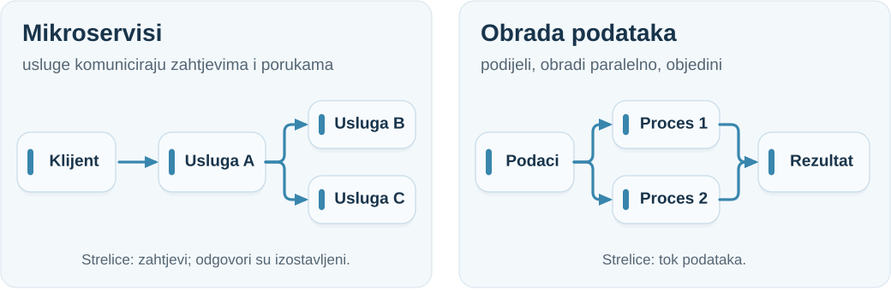
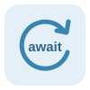
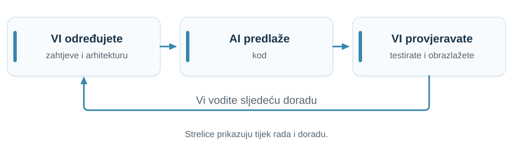
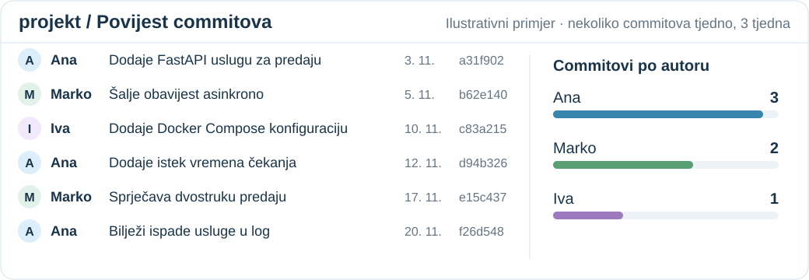
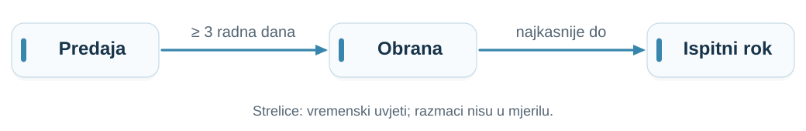
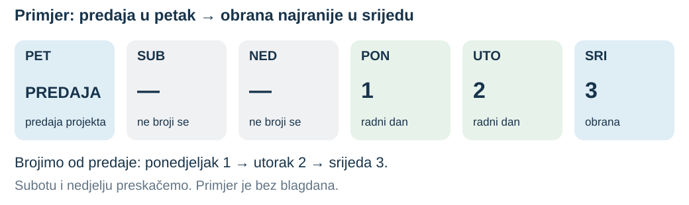
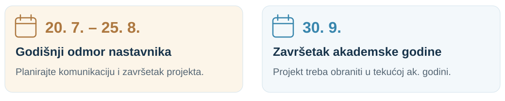
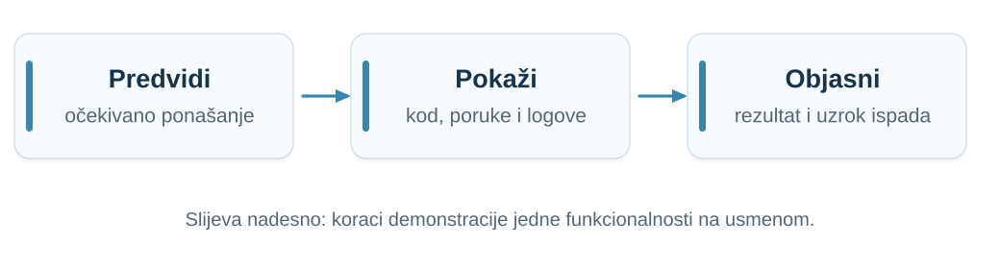
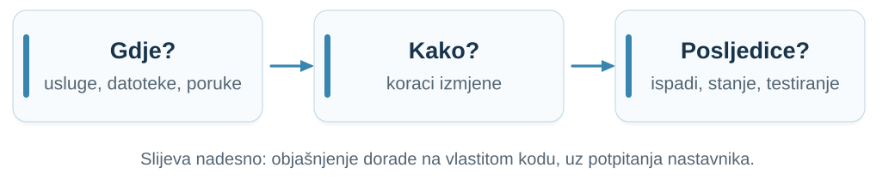

## Prisutnost i sudjelovanje {.stock-slide}

:::: {.columns}
::: {.column width="52%"}
**Dolazak nije obvezan.**

Ako dolazite, aktivno sudjelujte:

- Postavljajte pitanja.
- Uspoređujte alternative.
- Objasnite svoje odluke.

Evidentirajte prisutnost QR kodom na sljedećem slajdu.
:::
::: {.column width="43%"}
{fig-alt="Nastavnik objašnjava ideje na ploči."}

:::
::::

::: {.notes}
Vrijeme: 00:30–01:30 min (1 minuta).

Objasnite da dolazak nije obvezan. Pozovite prisutne studente da se evidentiraju QR kodom ili poveznicom na sljedećem slajdu. Potaknite pitanja, sudjelovanje u raspravi i obrazlaganje vlastitih odluka.
:::

<!-- attendance-slide -->

## Što predavanje daje, a AI i snimka ne daju? {.value-slide}

AI dobro objašnjava pojmove, a sva su predavanja snimljena. **Ako samo slušate, snimka vam je jednako dobra.** Uživo dobivate ovo:

::: {.value-grid}
::: {.card}
**Odgovor na vaše pitanje**

Zabunu ispravljamo dok nastaje, na vašem primjeru.
:::
::: {.card}
**Prioriteti**

Što je bitno za projekt i obranu, a što je samo zanimljivo.
:::
::: {.card}
**Razmišljanje naglas**

Kako se rješava problem bez gotovog odgovora, s kompromisima i greškama.
:::
::: {.card}
**Rasprava s kolegama**

Isti problem, više obranjivih rješenja. Obrana traži upravo to.
:::
:::

::: {.notes}
Vrijeme: 02–03 min (1 minuta).

- Budite iskreni: AI i snimke dobro pokrivaju objašnjenje pojmova. Predavanje vrijedi kad je interaktivno.
- Pitati: što ste zadnji put naučili od AI-ja, a što ste ipak morali nekoga pitati?
- Prijelaz: različiti studenti dolaze iz različitih razloga.
:::

## Različiti studenti, različiti razlozi {.value-slide}

| Ako ste… | Predavanje vam daje… |
|:---|:---|
| **samouki, s AI-jem i snimkama** | provjeru razumijete li zaista; dođite barem kad zapnete |
| **netko kome treba ritam** | strukturu tjedna i manje gradiva za kraj semestra |
| **tihi, ne volite pitati naglas** | slušanje bez pritiska; pitanja možete postaviti u Google Chatu |
| **zaposleni ili s obvezama** | snimke i materijale kao punu zamjenu |
| **usmjereni na ocjenu** | način razmišljanja koji se traži na obrani |

**Dođite kad vam to nešto daje. Ako dođete, sudjelujte.**

::: {.notes}
Vrijeme: 03–03:30 min (30 sekundi).

- Nitko nije kažnjen zbog nedolaska; dolazak nije obvezan.
- Tihim studentima ponudite Google Chat kao jednako vrijedan kanal za pitanja.
:::

## Nastavnici i obveze na kolegiju

| Dio nastave | Nastavnik |
|:---|:---|
| Predavanja | izv. prof. dr. sc. Nikola Tanković |
| Vježbe | Luka Blašković, mag. inf. |

**Obveze za predavanja i vježbe organizirane su zasebno.**

Pratite zahtjeve objavljene za svaki dio nastave.

::: {.notes}
Vrijeme: 03:30–04 min (30 sekundi).

Predstavite Nikolu kao nastavnika na predavanjima, a Luku kao nastavnika na vježbama. Objasnite da studenti trebaju pratiti obveze objavljene za svaki dio nastave.
:::

## Čime se kolegij bavi {.stock-slide}

:::: {.columns}
::: {.column width="48%"}
**Razumjeti koncepte. Izgraditi sustave. Objasniti svoje odluke.**

- Sudionici, poruke i zajedničko stanje
- Ispadi, redoslijed i koordinacija
- Kroz razvoj sustava (rola *Solution architect/engineer*)
:::
::: {.column width="47%"}
{.server-photo fig-alt="Redovi povezanih poslužiteljskih ormara u podatkovnom centru tvrtke imgix."}

:::
::::

::: {.notes}
Vrijeme: 04–05 min (1 minuta).

Povežite razumijevanje teorije s izgradnjom raspodijeljenih sustava kroz praktične programske zadatke. Pitajte studente koje raspodijeljene aplikacije već koriste.
:::

## Teme kolegija

| Cjelina | Glavna pitanja |
|:---|:---|
| Arhitekture i komunikacija komponenti | Tko s kim komunicira? Gdje može doći do ispada? |
| Vrijeme, replikacija i konsenzus | Što se dogodilo prvo? O čemu se možemo usuglasiti? |
| Oporavak, tijekovi rada i skaliranje | Kako se oporaviti i povećati kapacitet? |
| Sigurnost i procjena arhitekture | Koja jamstva sustav može pružiti i pod kojim pretpostavkama? |

::: {.notes}
Vrijeme: 05–06 min (1 minuta).

Ukratko predstavite redoslijed tema i povežite svaku cjelinu s glavnim pitanjem. Prvo tehničko predavanje započinje istekom vremena čekanja pri predaji projekta.
:::

## Informacije o kolegiju i pomoć {.stock-slide}

:::: {.columns}
::: {.column width="63%"}
**Materijali za kolegij**

[E-Učenje](https://moodle.srce.hr/) · [Web-stranica kolegija](https://ntankovic.unipu.hr/rs)

<a class="recording-link" href="https://www.youtube.com/playlist?list=PLIeA2EYS12RVaj1GdVP4fkNrLiK5k6VD-">Sva su predavanja snimljena. Pogledajte snimke.</a>

**Prije pitanja:** pregledajte materijale za kolegij.

**Google Chat: „FIPU RS”** prvo je mjesto za sva pitanja. Izbjegavajte e-poštu.
:::
::: {.column width="32%"}
{fig-alt="Student prati nastavu na internetu uz knjige i bilješke."}

:::
::::

::: {.notes}
Vrijeme: 06–07 min (1 minuta).

Uputite studente na E-Učenje, web-stranicu kolegija i povezani popis snimki na YouTubeu. Sva su predavanja snimljena pa studenti mogu ponovno pogledati objašnjenja prije postavljanja pitanja. Najprije trebaju pregledati materijale. Za sva pitanja o kolegiju prvo koristite Google Chat, grupu „FIPU RS”; e-pošta nije preporučeni kanal. Za tehnička pitanja tražite očekivani rezultat, stvarni rezultat i mali primjer kojim se problem može ponoviti.
:::

## Od predavanja do praktičnog rada {.visual-slide .project-work-slide}

**Dva tipična projekta:**

{width=1040 fig-alt="Mikroservisi: klijent šalje zahtjev usluzi A, a ona uslugama B i C. Obrada podataka: podaci se dijele na dva procesa koji rade paralelno, a njihovi se rezultati objedinjuju."}

<strong>Rad na projektu:</strong> Postavi problem → Predloži rješenje → Implementiraj → Testiraj i doradi

::: {.notes}
Vrijeme: 07–08 min (1 minuta).

Ovaj postupak opisuje rad na projektu, a vrijedi i za zadatke na vježbama. Najprije odredite problem i očekivano ponašanje, predložite rješenje, implementirajte ga te testiranjem provjerite i doradite. Po potrebi vratite se na ranije korake.

Dva tipična tipa projekta: mikroservisi (sinkrona i asinkrona komunikacija usluga) i raspodijeljena obrada podataka (podjela posla na procese i objedinjavanje rezultata). Prikazi su primjeri, ne obvezna arhitektura projekta. Povežite pojmove s predavanja s implementacijom.
:::

## Priprema za projekt {.prerequisites-slide}

Budite spremni koristiti i objasniti:

:::: {.tech-grid}
::: {.tech-card}
{fig-alt="Python"}

**Python**

kolekcije, funkcije, moduli i klase
:::

::: {.tech-card}
{fig-alt="asyncio: petlja događaja"}

**Konkurentnost**

`asyncio`, dretve i procesi
:::

::: {.tech-card}
{fig-alt="FastAPI"}

**Web-servisi**

FastAPI, `httpx` i Uvicorn
:::

::: {.tech-card}
{fig-alt="Docker"}

**Kontejneri**

Docker Compose i Swarm
:::
::::

- **Alati Pythona:** sažeti zapisi kolekcija (comprehensions), lambda izrazi, imenovani argumenti i zadane vrijednosti
- **Ovisnosti projekta:** instalacija paketa, popis ovisnosti i svaka korištena biblioteka

::: {.notes}
Vrijeme: 08–09 min (1 minuta).

Koristite ovaj popis za pripremu. Kolekcije uključuju rječnike, liste, skupove, n-torke i imenovane n-torke. Studenti trebaju razumjeti metode klasa, asinkrone funkcije i datetime ondje gdje ih koriste. Povežite pripremu s pravilima uporabe AI-ja: uporaba alata ne uklanja odgovornost za razumijevanje njegova izlaza i ovisnosti.
Konkurentnost uključuje `async` / `await` te skupove dretvi i procesa; orkestracija se odnosi na Docker Swarm. Ikone su pojednostavljene oznake, ne službeni logotipi.
Izvor: stranica kolegija, odjeljak „Potrebna znanja programskog jezika Python”, pregledano 2026-09-17: https://fiputreca.notion.site/Raspodijeljeni-sustavi-544564d5cc9e48b3a38d4143216e5dd6.
:::

## Nadogradnja aplikacije za diplomski rad {.thesis-slide}

Uz odobrenje nastavnika aplikaciju možete po želji nadograđivati za **RITR** (5. godina) i **diplomski rad** (kraj studija). Dodani rad mora biti **jasno razgraničen**.

::: {.thesis-grid}
::: {.card}
**RITR · 6 ECTS**

≈ **180 sati** rada na dodanom dijelu.
:::
::: {.card}
**Diplomski rad · 30 ECTS**

≈ **900 sati** rada. Nadogradnja mora odgovarati tom opsegu.
:::
:::

- Svaki rad ima **vlastiti repozitorij**.
- U README-u navedite **što je napravljeno prije, što kasnije i za koji kolegij ili rad**.

::: {.notes}
- Nastavnikova uputa, 2026-10-14 (preneseno iz BA uvoda): nadogradnja je po želji i uz odobrenje nastavnika; RITR je na 5. godini, diplomski rad na kraju studija. Svaki rad ima zaseban repozitorij s jasnim napomenama o tome što je napravljeno prije, što kasnije i za što. Isti rad ne vrednuje se dvaput; procjenjuje se samo dodani dio.
- Sati prema Zakonu o visokom obrazovanju i znanstvenoj djelatnosti (NN 119/22), čl. 67. st. 2.: „Jedan ECTS bod predstavlja 30 sati procijenjenog prosječno utrošenog studentskog rada pri ostvarivanju ishoda učenja.” Dakle 6 ECTS ≈ 180 h, 30 ECTS ≈ 900 h. Važeći UNIPU Pravilnik o studiranju (2019. i izmjene do 2021.) ne propisuje broj sati po bodu.
:::

## Uporaba AI-ja i vaša odgovornost {.visual-slide}

**AI je dopušten.** Koristite tehnologije obrađene na predavanjima ili odobrene od profesora.

{width=1040 fig-alt="Vi određujete zahtjeve i arhitekturu, AI predlaže kod, a vi provjeravate, testirate i obrazlažete odluke. Vi vodite sljedeću doradu."}

Razumijte **svaku liniju koda**. Obrazložite svaki izbor, alternative i kompromise.

**Arhitektura je skup informiranih odluka. Dokažite svoje.**

::: {.notes}
Vrijeme: 09–10 min (1 minuta).

Studenti smiju koristiti AI, ali ga moraju usmjeriti na tehnologije obrađene na predavanjima ili odobrene od profesora. Odgovorni su za razumijevanje svakog dijela nastalog koda i moraju pokazati da su sami vodili arhitekturne odluke.
Zatražite od studenta da objasni bilo koji dio koda i poveže ga s arhitekturnom odlukom. Pitajte zašto je odabrao određenu tehnologiju ili granicu usluge, koje je alternative razmotrio i koje posljedice ili kompromisi proizlaze iz izbora. Studenti moraju moći samostalno raspravljati o odlukama i obrazložiti ih.
:::

## Preporučeni AI alati {.ai-tools-slide}

:::: {.ai-tools-grid}
::: {.ai-tool}
{fig-alt="Claude"}

**[Claude Code](https://code.claude.com/docs/en/overview)**

Rad na kodu projekta, objašnjenja i provjere.
:::
::: {.ai-tool}
{fig-alt="Claude"}

**[Claude Design](https://claude.com/product/design)**

Ideje za sučelje i interaktivni prototipovi.
:::
::: {.ai-tool}
{fig-alt="Codex"}

**[Codex](https://learn.chatgpt.com/docs/code-review)**

Razumijevanje promjena i pregled koda.
:::
::::

::: {.open-models}
**Otvoreni modeli za istraživanje**

[Qwen3-Coder](https://github.com/QwenLM/Qwen3-Coder) · [DeepSeek-Coder-V2](https://github.com/deepseek-ai/DeepSeek-Coder-V2)

Modeli s dostupnim težinama za preuzimanje; za pokretanje trebaju odgovarajući alat i računalo. Licence ovise o modelu.
:::

**Alat predlaže — vi provjeravate i objašnjavate.**

::: {.notes}
Vrijeme: 10–11 min (1 minuta).

- Razlikujte alat i model: alat povezuje rad na projektu s modelom; model sam po sebi nije razvojno okruženje.
- Otvoreni modeli su primjeri za istraživanje, ne obvezna instalacija ili rang-lista. Dostupne težine (open weights) nisu isto što i potpuna otvorenost podataka i postupka treniranja. DeepSeek ima zasebnu licencu modela.
- Izbor AI alata ne mijenja pravilo o odobrenju projektnih tehnologija.
- Izvori, provjereni 2026-10-07 za kolegij Web aplikacije: [Claude Code](https://code.claude.com/docs/en/overview), [Claude Design](https://www.anthropic.com/news/claude-design-anthropic-labs), [Codex](https://learn.chatgpt.com/docs/code-review), [Qwen3-Coder](https://github.com/QwenLM/Qwen3-Coder), [DeepSeek-Coder-V2](https://github.com/deepseek-ai/DeepSeek-Coder-V2).
:::

## Commitovi i individualni doprinos {.contribution-slide}

Na projektu radite **kontinuirano**: **nekoliko commitova tjedno** kroz najmanje **2–3 tjedna**, uz provjeru autentičnosti. Prati se **rad svakog člana**.

{width=1040 fig-alt="Izmišljeni primjer šest commitova od 3. do 20. studenoga, nekoliko tjedno: Ana tri, Marko dva, Iva jedan. Uz svaki commit vidljivi su autor, opis promjene i datum."}

**Budite spremni objasniti vlastite promjene.** Broj commitova sam po sebi ne pokazuje kvalitetu doprinosa.

::: {.notes}
Vrijeme: 11–12 min (1 minuta).

- Timski rezultat ne zamjenjuje individualno razumijevanje. Pitajte kako bi svaki član pokazao što je napravio i zašto.
- Projekt izrađen u nekoliko dana ili s jednim commitom ne zadovoljava traženi način rada.
- Izvorni BPMN još navodi commit svakih 1–2 dana; vrijedi blaže pravilo: nekoliko commitova tjedno, najmanje 2–3 tjedna rada.
- Ilustracija je izmišljena: imena, datumi i hashevi nisu iz stvarnog repozitorija. Broj commitova nije kriterij ocjene; pregledava se sadržaj promjena.
:::

## Kako položiti kolegij (BPMN) {.exam-process}

{height=560 .lightbox fig-alt="Izvorni BPMN hodogram polaganja kolegija: projekt, bodovi s vježbi, predaja, oslobođenje od usmenog, obrana, unos ocjene i ponovna prijava."}

::: {.notes}
Vrijeme: 12–14 min (2 minute).

Kliknite sliku za povećanje. Objasnite paralelno grananje (+), isključivi odabir (X) i strelice koje označavaju redoslijed.
Za oslobođenje je potrebno najmanje 50% bodova s vježbi i projekt bez spornih dijelova; nastavnik ipak može pozvati bilo kojeg studenta na usmeni ispit. Oslobođenje vrijedi do kraja akademske godine. Bez oslobođenja, obrana mora biti najmanje 3 radna dana nakon predaje projekta i najkasnije na prijavljeni ispitni rok. Negativna ocjena vraća studenta na prijavu ispita. Rad na projektu zahtijeva nekoliko commitova tjedno kroz najmanje 2–3 tjedna; provjerava se njihova autentičnost. Napomena: izvorni hodogram još navodi commit svakih 1–2 dana; vrijedi novo pravilo (nastavnik, 2026-10-13). Prag od 50% odnosi se na oslobođenje, a ne na ukupnu ocjenu kolegija.
Izvor: hodogram_rs.png koji je nastavnik dostavio 2026-09-17.
:::

## Predaja, oslobođenje i obrana {.visual-slide}

{width=1040 fig-alt="Obrana je najmanje 3 radna dana nakon predaje i najkasnije na ispitni rok."}

**Termin obrane:** [ntankovic.unipu.hr/termin](https://ntankovic.unipu.hr/termin) — termini se otvaraju 10 dana unaprijed.

::: {.exemption-summary}
**Oslobođenje od usmenog:** najmanje 50 % bodova s vježbi, projekt bez spornih dijelova i odobrenje nastavnika. Vrijedi do kraja akademske godine; nastavnik i dalje može pozvati bilo koga na usmeni. Prijavite ispitni rok i naznačite oslobođenje.
:::

::: {.notes}
Vrijeme: 14–15 min (1 minuta).

Ponovite pravila iz BPMN-a. Rad na projektu i prikupljanje bodova s vježbi odvijaju se paralelno. Dovršite projekt prema uputama i predajte sve tražene materijale na službeno mjesto za predaju. Rad uključuje nekoliko commitova tjedno kroz najmanje 2–3 tjedna, uz provjeru autentičnosti; projekt izrađen u nekoliko dana ili s jednim commitom ne zadovoljava navedeni način rada.
Prag od 50% bodova s vježbi uvjet je za oslobođenje od usmenog ispita, a ne formula za ukupnu ocjenu. Nastavnik odlučuje o oslobođenju i zadržava pravo pozvati bilo kojeg studenta na usmeni ispit. Prijava ispitnog roka obvezna je na oba puta. Oslobođeni studenti moraju naznačiti oslobođenje. Termine rezervirajte na https://ntankovic.unipu.hr/termin; postaju dostupni 10 dana unaprijed. Uz oslobođenje slijedi unos ocjene u ISVU. Bez oslobođenja treba rezervirati obranu, obraniti projekt i pristupiti usmenom ispitu. Pozitivan ishod vodi unosu ocjene u ISVU na dan obrane, a negativan ponovnoj prijavi ispitnog roka.
Izvor: hodogram_rs.png koji je nastavnik dostavio i pojasnio 2026-09-17.
:::

## Rok predaje: brojite radne dane {.submission-slide}

Obrana je najmanje **3 radna dana nakon predaje**, a najkasnije na ispitni rok.

{width=1040 fig-alt="Kalendarski primjer: predaja u petak, subota i nedjelja ne broje se, ponedjeljak je prvi, utorak drugi, a srijeda treći radni dan, kada je obrana najranije moguća. Primjer je bez blagdana."}

::: {.notes}
Vrijeme: 15–15:30 min (30 sekundi).

- Naglasite radne dane: tri radna dana nisu tri kalendarska dana.
- Planirajte predaju unatrag od ispitnog roka i ostavite vremena za provjeru projekta.
- Primjer je bez blagdana; blagdani se ne broje kao radni dani.
:::

## Ako projekt ne obranite ove godine {.academic-year-slide}

{width=1040 fig-alt="Godišnji odmor nastavnika: od 20. srpnja do 25. kolovoza. Akademska godina završava 30. rujna."}

Ako projekt ne obranite do završetka akademske godine, **30. 9.**:

- ponovno prijavljujete projekt
- izrađujete **novi projekt samostalno** i branite ga

**Prijedlog novog projekta odobrava nastavnik.**

::: {.notes}
Vrijeme: 15:30–16:30 min (1 minuta).

- Razlikujte neuspješan pojedinačni izlazak na ispit od projekta neobranjenog tijekom akademske godine; neuspješan izlazak ne znači odmah novu temu.
- Akademska godina završava 30. rujna. Godišnji odmor nastavnika traje od 20. srpnja do 25. kolovoza.
- 30. rujna nije zajamčeni ispitni termin, a godišnji odmor nije službena promjena rasporeda ispitnih rokova.
- Izvor: datumi i pravilo preuzeti iz uvodnog predavanja kolegija Web aplikacije; nastavnik je 2026-10-12 potvrdio da vrijede i za ovaj kolegij.
:::

## Pripremite se objasniti svoj projekt {.visual-slide}

{width=1040 fig-alt="Predvidi očekivano ponašanje, pokaži kod, poruke i logove, objasni rezultat i uzrok ispada."}

Pratite **zahtjev → usluge i poruke → stanje → odgovor**.

Pokažite logove usluga, relevantan kod te uobičajeni slučaj i slučaj ispada.

**Obrazložite jednu odluku u dizajnu i njezin kompromis.**

::: {.notes}
Vrijeme: 16:30–17:30 min (1 minuta).

- Primjer isteka vremena čekanja: kako biste objasnili je li predaja projekta prihvaćena?
- Student predviđa ponašanje, pokazuje kod i logove usluga te objašnjava opaženi rezultat.
- Na testnim podacima može pokazati ispad usluge, spor odgovor ili ponovljeni zahtjev. Odaberite primjer koji projekt doista podržava.
- Uspješna demonstracija sama po sebi ne objašnjava razloge arhitekturnih odluka.
:::

## Dorada projekta: objasnite izmjenu {.visual-slide .design-change-slide}

{width=1040 fig-alt="Tri koraka: gdje bi išla izmjena u uslugama, datotekama i porukama; kako biste je proveli; koje su posljedice za ispade, stanje i testiranje."}

::: {.question-grid}
::: {.question-card}
Kako biste dodali **ponovni pokušaj** pri isteku vremena?
:::
::: {.question-card}
Gdje biste dodali **novu uslugu** i kako bi komunicirala s ostalima?
:::
::: {.question-card}
Što se mijenja ako pokrenete **dvije replike** usluge?
:::
:::

**Pokažite mjesta u svom kodu i obrazložite kompromise.** Nastavnik postavlja potpitanja.

::: {.notes}
Vrijeme: 17:30–18:30 min (1 minuta).

- Umjesto izmjene koda uživo student objašnjava doradu na vlastitom projektu: gdje bi izmjena išla, kako bi je proveo i koje su posljedice.
- Zašto: pitanje za izmjenu uživo lako se prepiše u AI alat. Objašnjenje uz vlastiti kod i potpitanja pokazuje stvarno razumijevanje.
- Potpitanja: što ako usluga ne odgovori, što ako se zahtjev ponovi, kako biste provjerili da izmjena radi?
- Po potrebi student manju izmjenu može pokazati u kodu, bez AI alata.
- Primjeri nisu pitanja koja će svaki student dobiti; pitanja se biraju prema projektu.
:::

## Prije prvog tehničkog predavanja

Trebate znati:

- Gdje pronaći potvrđena pravila i materijale za kolegij
- Koje su vaše obveze i kako će se vrednovati
- Gdje postaviti pitanja

Slijedi: **pri prijenosu projekta od 20 MB istekne vrijeme čekanja. Trebate li ga poslati ponovno?**

::: {.notes}
Vrijeme: 18:30–20 min (1,5 minuta).

Preostalo vrijeme iskoristite za pitanja o obvezama, vrednovanju i traženju pomoći. Završite pitanjem o isteku vremena čekanja kojim započinje prvo tehničko predavanje.
:::
