## Nakon predaje: istek čekanja (timeout) {.example-slide}

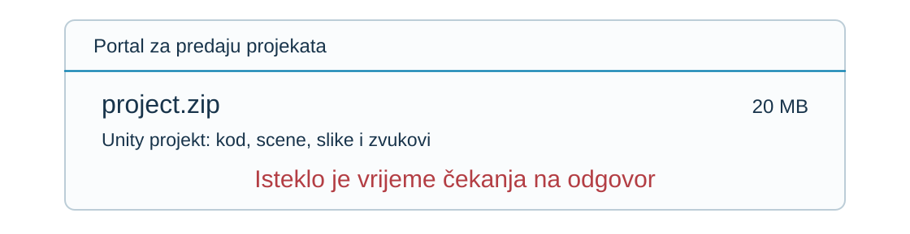{fig-alt="Portal prikazuje Unity ZIP od 20 MB i istek vremena čekanja, bez potvrde prihvaćanja." height=260px}

**Je li portal prihvatio vaš projekt za nastavnika?**

::: {.answer-chips}
[**A** Da]{.answer-chip .answer-a}
[**B** Ne]{.answer-chip .answer-b}
[**C** Još ne znamo]{.answer-chip .answer-c}
:::

::: {.notes}
- **Priča:** Otvaramo napetost: student vidi timeout i ne zna je li predao; na to odgovaramo cijelo predavanje.

- Zamišljeni portal: prijavljeni student šalje Unity ZIP (kod, scene, resursi).

- Prihvaćeno = cijeli projekt + trajni zapis; napredak prijenosa nije potvrda.

- Glasanje (30 s); pitati dvoje za razlog. Ostaviti otvorene gubitak zahtjeva, ispad i gubitak odgovora.

- Odgovor C; vratiti se nakon slijedova. Ponavljanje može stvoriti duplikate.

Izvori: [Kleppmann, Distributed Systems](https://www.cl.cam.ac.uk/teaching/2122/ConcDisSys/dist-sys-notes.pdf).
:::

## Što trebamo znati da bismo odgovorili?

- Koje komponente obrađuju predaju?
- Kako komuniciraju i dijele posao?
- Što može prestati raditi dok ostali dijelovi nastavljaju?
- Što bi ponovni pokušaj učinilo sigurnim?
- Koje pretpostavke opravdavaju naše zaključke?

**Pratimo tijek predaje našeg projekta kroz komponente portala.**

**Predznanje:** osnove programiranja, procesa i mreža.

::: {.notes}
- **Priča:** Jedno pitanje razbijamo u pet manjih koja čine plan predavanja.

- Glasanje ostaje neriješeno: što se dogodilo unutar portala?

- Put: komponente → dijeljenje rada → djelomični ispadi → sigurno ponavljanje → pretpostavke.

- Pitati: tko zna rok, a tko zna je li projekt pohranjen?
:::

## Sustav za predaju projekata {.use-case-slide}

**Tko zna rok? Tko zna je li projekt pohranjen?**

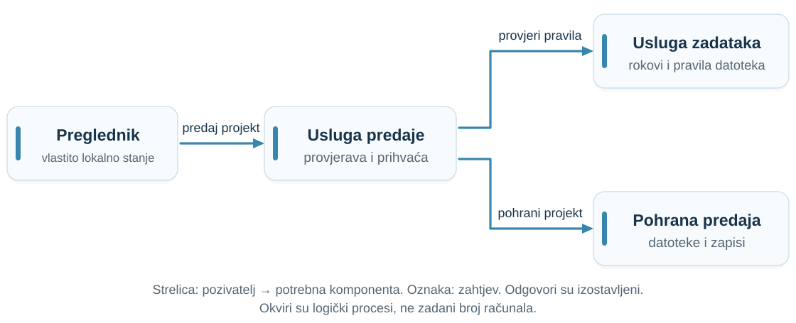{fig-alt="Studentski klijent šalje projekt usluzi za predaju; ona provjerava pravila i pohranjuje projekt." height=400px}

Svaki proces ima **lokalno stanje (local state)**. Strelica znači **„poziva i ovisi o”**.

::: {.notes}
- **Priča:** Otvaramo „crnu kutiju” portala: više procesa, svaki zna samo svoj dio.

- Pratiti pozivatelj → ovisnost; oznake su zahtjevi. Odgovori izostavljeni.

- Usluga zadataka: rokovi/pravila. Pohrana: projekt + prihvaćeni zapis.

- Pitati što svaki proces zna lokalno.

- Logički procesi, ne nužno zasebna računala; isti domaćin dijeli ispade.

Izvori: [van Steen and Tanenbaum, Distributed Systems](https://www.distributed-systems.net/index.php/books/ds4/); [Waldo et al., A Note on Distributed Computing](https://waldo.scholars.harvard.edu/publications/note-distributed-computing).
:::

## Što sustav čini raspodijeljenim?

**Za jednu predaju više programa surađuje razmjenom poruka.**

::: {.definition number="1.1"}
**Raspodijeljeni sustav (distributed system)** čine komponente koje se neovisno izvršavaju te komuniciraju i koordiniraju razmjenom poruka radi zajedničkog cilja.
:::

Prepoznajte sudionike, njihovo lokalno stanje i poruke.

Jedan naziv **usluge (service)** može skrivati mnogo procesa koji surađuju.

::: {.notes}
- **Priča:** Imenujemo ono što smo upravo vidjeli: neovisne komponente koje surađuju porukama.

- Proces = program u izvođenju; čvor u modelu može biti proces ili računalo.

- Prepoznati sudionike, poruke i cilj.

- Nepovezani programi na različitim računalima ne moraju činiti raspodijeljenu aplikaciju.

- Jedan naziv usluge može skrivati više procesa.

Izvori: [van Steen and Tanenbaum, Distributed Systems](https://www.distributed-systems.net/index.php/books/ds4/); [Waldo et al., A Note on Distributed Computing](https://waldo.scholars.harvard.edu/publications/note-distributed-computing).
:::

## Raspodijeljeni sustav ili ne? {.exercise-slide .classification-exercise}

**Prepoznajte komponente, poruke i zajednički cilj.**

| Primjer | Odgovor i razlog |
|:---|:---|
| Preglednik, API i baza na istom računalu | [**Da, prema našoj definiciji:** zasebni procesi koordiniraju se porukama, ali dijele ispad računala.]{.fragment fragment-index=1} |
| Računala renderiraju različite kadrove istog filma | [**Da:** koordiniraju rad radi dovršetka jednog filma.]{.fragment fragment-index=2} |
| Tri nepovezana prijenosnika na istom Wi-Fiju | [**Ne:** zajednička mreža ne znači zajednički zadatak.]{.fragment fragment-index=3} |
| Dretve se koordiniraju samo dijeljenom memorijom | [**Ne, prema našoj definiciji:** sama konkurentnost nije dovoljna.]{.fragment fragment-index=4} |
| API i izvršni kontejner na jednom prijenosniku | [**Da, prema našoj definiciji:** poruke koordiniraju posao; oba dijele ispad računala.]{.fragment fragment-index=5} |
| Tri MPI procesa računaju prosječnu temperaturu | [**Da:** proces 0 dijeli podatke; svi računaju zbroj i broj; ostali vraćaju rezultate, a proces 0 ih spaja.]{.fragment fragment-index=6} |

::: {.notes}
- **Priča:** Provjeravamo razumijevanje definicije na rubnim primjerima.

- Otkrivati odgovor tek nakon studentske procjene.

- Isti domaćin odgovara našoj definiciji, ali dijeli ispade; strože definicije traže više računala.

- Dretve samo s dijeljenom memorijom ne zadovoljavaju kriterij razmjene poruka.

- MPI: proces 0 zadrži dio i pošalje dva; spaja zbrojeve i brojnosti, ne prosjeke.
:::

## Zašto raspodijeliti posao?

| Razlog | Primjer |
|:---|:---|
| **Komponente su fizički odvojene** | Studenti predaju s raznih mjesta; senzori, mobiteli i korisnici diljem svijeta |
| **Potreban je veći kapacitet** | Tisuće predaja pred rok; više računala dijeli posao |
| **Sustav mora preživjeti ispade** | Kopije usluge i podataka (redundancija); rad se nastavlja kad jedna stane |

**Zato je gotovo svaki današnji informacijski sustav raspodijeljen.**

::: {.notes}
- **Priča:** Ako je to teže, zašto to radimo? Tri razloga zbog kojih je gotovo svaki sustav raspodijeljen.

- Tri glavna razloga: geografska odvojenost, kapacitet, otpornost na ispade.

- Pitati: koji od tri razloga vrijedi za aplikacije koje već koristite? Čak i jednostavna web-aplikacija ima preglednik, poslužitelj i bazu u odvojenim procesima.

- Dodatni ciljevi: dijeljenje resursa, otvorenost (dogovorena sučelja) i transparentnost (jedan portal skriva raspored komponenti).

- Cijena: ovisnosti, koordinacija i oporavak. Slijedi Facebook kao primjer kapaciteta, zatim opterećenje našeg portala pred rok.

Izvori: [van Steen and Tanenbaum, Distributed Systems](https://www.distributed-systems.net/index.php/books/ds4/); [Waldo et al., A Note on Distributed Computing](https://waldo.scholars.harvard.edu/publications/note-distributed-computing).
:::

## Facebook: rast mijenja arhitekturu {.example-slide .facebook-scale}

{width=50px fig-alt="Logotip Facebooka"} **Više korisnika, zahtjeva i podataka.**

| Datum | Mjesečno aktivni korisnici Facebooka (MAU) |
|:---|---:|
| Listopad 2012. | **1,00 milijarda** |
| Prosinac 2019. | **2,50 milijardi** |
| Prosinac 2023. | **3,07 milijardi** |

**Vertikalno skaliranje (scale up):** snažnije računalo.  
**Horizontalno skaliranje (scale out):** više računala dijeli posao.

Od Q1 2024. Facebook ne objavljuje zasebne dnevne/mjesečne brojke. Noviji podaci za Metine aplikacije mjere nešto drugo.

::: {.notes}
- **Priča:** Razlog kapaciteta na stvarnim brojkama: rast tjera arhitekturu na više računala.

- Rast (20 s); scale up/out (25 s); cijena koordinacije (15 s).

- MAU nije broj istodobnih korisnika ni zahtjeva u sekundi.

- 2023. je posljednji zasebni Facebook MAU u nizu; Meta Family mjeri drugo.

- Razlozi uključuju rast, dostupnost i geografiju. Mehanizmi: predavanje 11.

Izvori: [2012 milestone](https://about.fb.com/news/2012/10/one-billion-people-on-facebook/); [2019 results](https://investor.atmeta.com/investor-news/press-release-details/2020/Facebook-Reports-Fourth-Quarter-and-Full-Year-2019-Results/default.aspx); [2023 results](https://investor.atmeta.com/investor-news/press-release-details/2024/Meta-Reports-Fourth-Quarter-and-Full-Year-2023-Results-Initiates-Quarterly-Dividend/default.aspx); [reporting change](https://investor.fb.com/files/doc_financials/2023/q4/META-Q4-2023-Prepared-Remarks.pdf); [Facebook engineering on scaling](https://engineering.fb.com/2010/07/21/core-infra/scaling-facebook-to-500-million-users-and-beyond/).
:::

## Moraju li svi čekati jednu predaju?

**Veliko sveučilište. Mnogo studenata. Jedan rok.**

::: {.submission-flow aria-label="Koraci obrade predaje slijeva nadesno"}
1. Primi ZIP
2. Provjeri pravila
3. Raspakiraj i skeniraj
4. Pohrani
5. Prihvati
:::

Pretpostavimo da jedna predaja zahtijeva **20 minuta obrade**.

Jedan izvršitelj završava posao prije sljedećeg: **3 posla/sat**.

**Mogu li drugi studenti slati projekte? Mogu li drugi poslovi napredovati?**

::: {.notes}
- **Priča:** Vraćamo se u portal: što kad tisuće studenata predaju pred rok?

- Objasniti pet koraka; 20 minuta je pretpostavka.

- 3 posla/sat vrijedi za jednog izvršitelja i uzastopnu obradu jednakih poslova.

- Pitati (30 s): mogu li prijenosi čekati u zasebnom redu? Može li drugi posao napredovati dok prvi čeka?

- Slijedi: preklapanje i istodobno izvršavanje.

Izvori: [van Steen and Tanenbaum, Distributed Systems](https://www.distributed-systems.net/index.php/books/ds4/); [Waldo et al., A Note on Distributed Computing](https://waldo.scholars.harvard.edu/publications/note-distributed-computing).
:::

## Više predaja može napredovati zajedno {.retry-overlap}

**Dvije predaje: A čeka pohranu. Može li B napredovati?**

Izvršitelj može promijeniti zadatak pri čekanju ili ustupanju izvršavanja, uz poštovanje ovisnosti.

:::: {.columns}
::: {.column width="42%"}
::: {.definition number="1.2"}
**Konkurentnost (concurrency):** više je zadataka u tijeku tijekom razdoblja koja se preklapaju.
:::

::: {.definition number="1.3"}
**Paralelizam (parallelism):** više se zadataka izvršava istodobno.
:::
:::
::: {.column width="58%"}
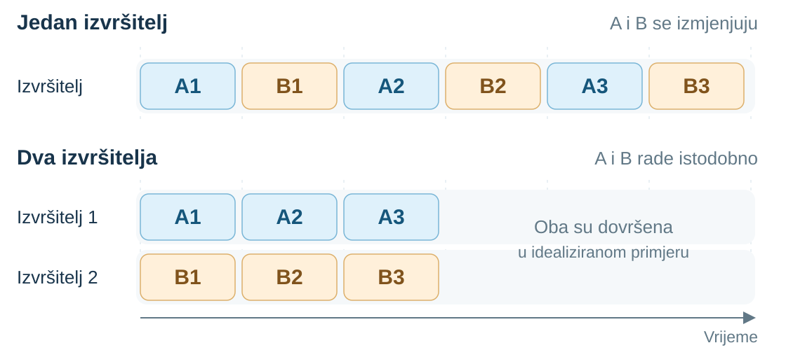{fig-alt="Jedan izvršitelj izmjenjuje dijelove A i B; dva ih izvršavaju istodobno." width=100%}
:::
::::

::: {.notes}
- **Priča:** Odgovor je preklapanje i istodobnost: uvodimo konkurentnost i paralelizam.

- Pratiti jednog izvršitelja koji izmjenjuje A/B, zatim dva istodobna izvršitelja.

- Objašnjenje u paru (45 s): konkurentnost i paralelizam.

- Poštovati ovisnosti. Preklapanje može povećati iskorištenost; paralelizam propusnost.

- Ne jamče brži pojedinačni posao; oboje je moguće na jednom računalu.

Izvori: [van Steen and Tanenbaum, Distributed Systems](https://www.distributed-systems.net/index.php/books/ds4/); [Waldo et al., A Note on Distributed Computing](https://waldo.scholars.harvard.edu/publications/note-distributed-computing).
:::

## Bavljenje zadacima i njihovo izvršavanje {.example-slide}

„**Konkurentnost (concurrency)** znači **baviti se** mnogim stvarima odjednom.

**Paralelizam (parallelism)** znači **raditi** mnogo stvari odjednom.”

— [Rob Pike, *Concurrency is not Parallelism*](https://go.dev/talks/2012/waza.slide), prijevod

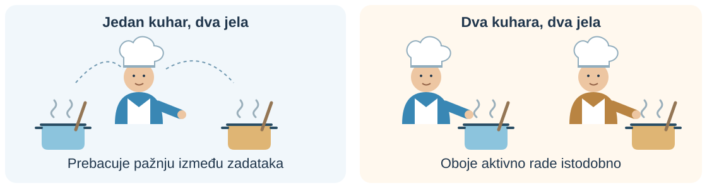{height=240px fig-alt="Jedan kuhar izmjenjuje pažnju između dva jela; dva kuhara mogu raditi istodobno."}

**Paralelno izvršavanje jest konkurentno; konkurentni zadaci ne moraju biti paralelni.**

::: {.notes}
- **Priča:** Učvršćujemo razliku slikom koja se pamti.

- Jedan kuhar mijenja pažnju; dva mogu raditi istodobno.

- Analogija opisuje aktivnu pažnju; hrana se može grijati bez nje.

- Pitati: konkurentnost na jednoj jezgri? Da. Paralelno izvršavanje jest konkurentno.

- Poštovati ovisnosti; utrke mijenjaju ishode. Izmjena: čekanje, ustupanje ili prekid raspoređivača.
:::

## Lokalni pozivi i udaljeni zahtjevi

**Provjera roka prelazi na drugi poslužitelj. Što se mijenja za pozivatelja?**

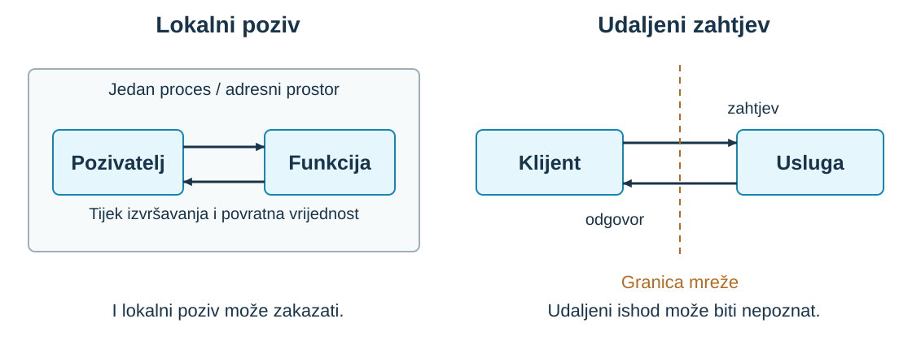{fig-alt="Lokalni poziv ostaje u procesu; udaljeni zahtjev i odgovor prelaze mrežu." height=350px}

Lokalni poziv (**local call**) · udaljeni zahtjev (**remote request**)

::: {.notes}
- **Priča:** Kad posao prijeđe na drugo računalo, poziv postaje poruka preko mreže; tu počinju problemi.

- Pratiti zahtjev i odgovor preko mreže.

- Udaljeni API nalikuje lokalnom pozivu; komunikacija ipak postoji.

- I lokalni poziv može zakazati; udaljeni učinak može nastati bez vidljivog rezultata.

- Pojedinosti RPC-a dolaze kasnije.

Izvori: [Kleppmann, Distributed Systems](https://www.cl.cam.ac.uk/teaching/2122/ConcDisSys/dist-sys-notes.pdf).
:::

## Kašnjenje, kapacitet i dovršeni posao

**Više projekata završi u sekundi. Mora li moj prijenos završiti brže?**

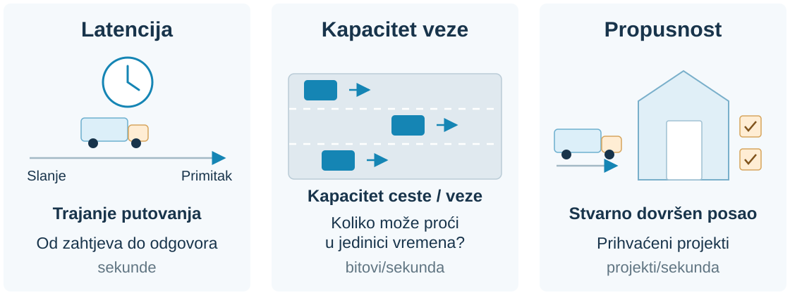{fig-alt="Latencija je trajanje jednog putovanja; propusni kapacitet je kapacitet veze; propusnost je stvarno dovršeni posao u sekundi." height=295px}

Latencija (**latency**) · kapacitet veze (**bandwidth**) · propusnost (**throughput**)

**Kako najbrže prenijeti 100 TB između podatkovnih centara?**

**Velika propusnost ne jamči brz odgovor.**

::: {.notes}
- **Priča:** Poruke traju: razlikujemo trajanje jednog odgovora od količine dovršenog posla.

- Trajanje putovanja = latencija; kapacitet ceste = bandwidth; dovršene dostave = throughput.

- Portal broji prihvaćene projekte, ne poslane bajtove. Čekanje/obrada dodaju latenciju.

- 100 TB: 20 s za ideje; usporediti mrežu s prijevozom diskova.

- Uključiti udaljenost, brzinu prijenosa, pisanje, put, čitanje i provjeru.

- Opcionalno: 10 Gbit/s ≈ 22,2 h prije dodatnih troškova (decimalno). Propusnost ≠ brz odgovor.

Izvori: [Kleppmann, Distributed Systems](https://www.cl.cam.ac.uk/teaching/2122/ConcDisSys/dist-sys-notes.pdf).
:::

## Prisjetimo se Web aplikacija: TTFB

**Vrijeme do prvog bajta (time to first byte, TTFB)** mjeri čekanje na početak odgovora, ne cijelo preuzimanje.

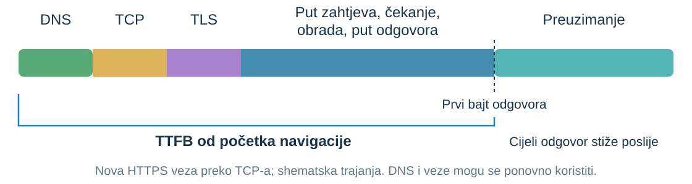{fig-alt="TTFB od početka navigacije uključuje DNS, TCP, TLS i čekanje na prvi bajt. Zatim slijedi preuzimanje." height=280px}

- **Velik kapacitet veze ne jamči nizak TTFB.** Važni su mreža i obrada.
- **Prvi bajt ne dokazuje prihvaćanje.** Što odgovor portala potvrđuje?

::: {.notes}
- **Priča:** Veza s Web aplikacijama: prvi bajt nije potvrda prihvaćanja.

- Navesti početak mjerenja: navigacija uključuje uspostavu veze; početak zahtjeva je isključuje.

- Prikazan novi HTTPS/TCP; DNS predmemorija i postojeća veza skraćuju uspostavu. HTTP/3 rabi QUIC.

- Plavo uključuje put, čekanje i obradu; širine su shematske.

- Prvi bajt ≠ prihvaćanje. Razlikovati potvrdu primitka na obradu od trajnog prihvaćanja.

Izvori: [web.dev, Time to First Byte](https://web.dev/articles/ttfb).
:::

## Jedna komponenta stane; ostale rade

**Portal se otvara, ali usluga zadataka je stala. Što još radi?**

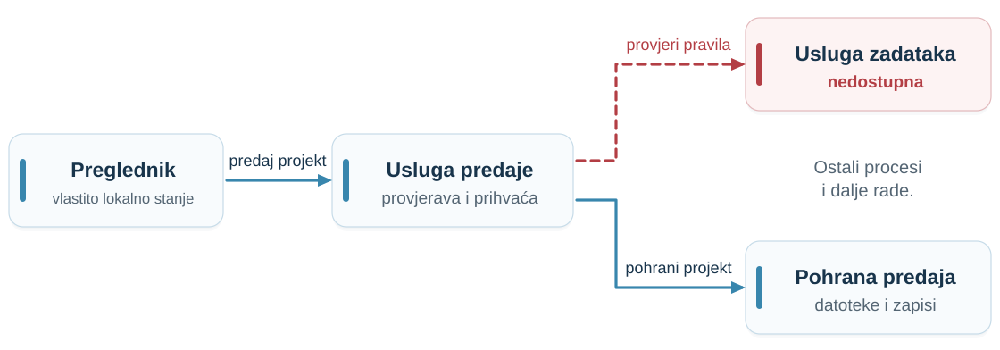{fig-alt="Usluga zadataka nije dostupna, dok drugi procesi i dalje rade." height=268px}

::: {.definition number="1.4"}
**Djelomični ispad (partial failure)** nastaje kada neke komponente prestanu raditi, dok druge nastavljaju.
:::

::: {.notes}
- **Priča:** Dijelovi sustava otkazuju zasebno: djelomični ispad.

- Pitati: može li se dohvatiti stara potvrda dok provjera roka ne radi?

- Ovisi o ovisnostima svake operacije.

- Neki procesi nastavljaju; usluge na istom računalu mogu ispasti zajedno.

Izvori: [Kleppmann, Distributed Systems](https://www.cl.cam.ac.uk/teaching/2122/ConcDisSys/dist-sys-notes.pdf).
:::

## Klijent može biti i druga usluga

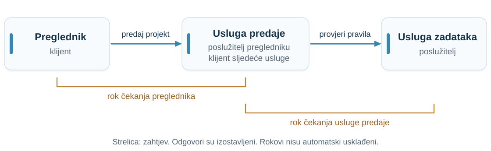{fig-alt="Preglednik poziva uslugu predaje, koja poziva uslugu zadataka. Usluga predaje istodobno je poslužitelj i klijent." height=320px}

**Klijent (client)** i **poslužitelj (server)** uloge su u komunikaciji. Usluga predaje ima obje.

::: {.notes}
- **Priča:** Pripremamo teren: tko koga čeka i tko postavlja rok čekanja.

- Klijent/poslužitelj su uloge; usluga predaje ima obje.

- Svaki pozivatelj može postaviti vlastiti rok čekanja; rokovi nisu automatski usklađeni.
:::

## Istek čekanja (timeout)

**Zašto?** Pozivatelj postavlja rok čekanja da ne čeka zauvijek.

**Timeout znači samo jedno: pozivatelj je odustao od čekanja.**

Timeout **ne**:

- uništava zahtjev
- prekida udaljeni posao
- otkriva ishod

**Slijede tri priče koje završavaju istim timeoutom.**

::: {.notes}
- **Priča:** Vraćamo se početnom timeoutu: što on znači, a što ne.

- Središnja misao predavanja: timeout prekida čekanje, ne udaljeni rad i njegove učinke.

- Izričito otkazivanje je zasebna poruka i može se utrkivati s dovršetkom.

- Prijelaz: tri slijeda, isto opažanje kod klijenta.
:::

## Slijed A: zahtjev se izgubi

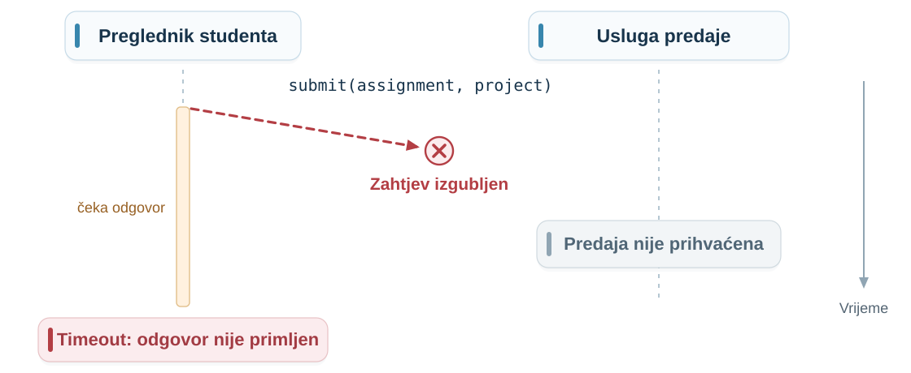{fig-alt="Zahtjev se izgubi prije primitka; predaja nije prihvaćena, a klijentu istekne vrijeme čekanja." height=440px}

::: {.notes}
- **Priča:** Prva priča iza timeouta: zahtjev nije ni stigao.

- Čitati prema dolje: cijeli zahtjev nije stigao; nema prihvaćene predaje.

- Strelica znači cijeli zahtjev, ne paket; privremeni dijelovi nisu prihvaćanje.

- Klijent vidi samo izostanak odgovora do roka.

- Pitati: što zna dijagram, a klijent ne zna?

Izvori: [Kleppmann, Distributed Systems](https://www.cl.cam.ac.uk/teaching/2122/ConcDisSys/dist-sys-notes.pdf).
:::

## Slijed B: odgovor se izgubi

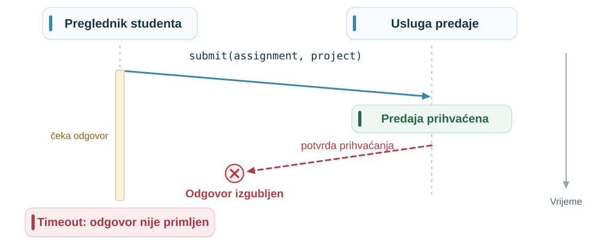{fig-alt="Predaja je prihvaćena i pohranjena; odgovor se izgubi, a klijentu istekne vrijeme čekanja." height=440px}

::: {.notes}
- **Priča:** Druga priča: posao je obavljen, ali odgovor se izgubio.

- Prihvaćeno i trajno pohranjeno; potvrda izgubljena.

- Usporediti A: drugo stanje poslužitelja, isti timeout.

- Moguće je i čekanje u redu ili na mreži; slijedovi nisu iscrpni.

Izvori: [Kleppmann, Distributed Systems](https://www.cl.cam.ac.uk/teaching/2122/ConcDisSys/dist-sys-notes.pdf).
:::

## Slijed C: proces poslužitelja se sruši

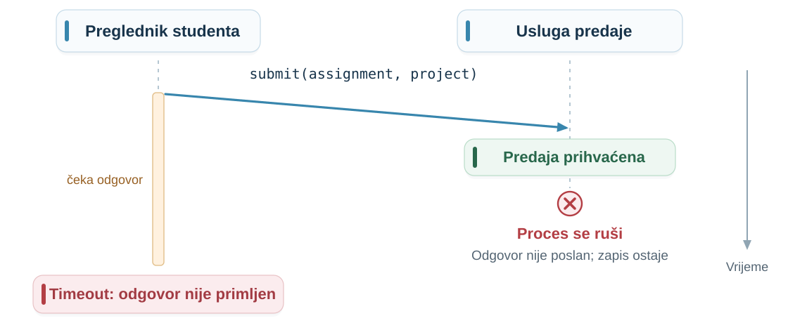{fig-alt="Predaja je trajno prihvaćena; proces se sruši prije odgovora. Zapis ostaje, a klijentu istekne vrijeme čekanja." height=440px}

::: {.notes}
- **Priča:** Treća priča: poslužitelj je spremio predaju i pao prije odgovora.

- Trajno prihvaćanje → rušenje procesa prije odgovora.

- Zapis ostaje prema pretpostavci; odgovor nije poslan, za razliku od B.

- Rušenje prije prihvaćanja mijenja ishod; timeout ne otkriva trenutak rušenja.

- Neki transporti prijave pogrešku veze. Ponavljanje može duplicirati učinak.
:::

## Isto opažanje, različiti ishodi

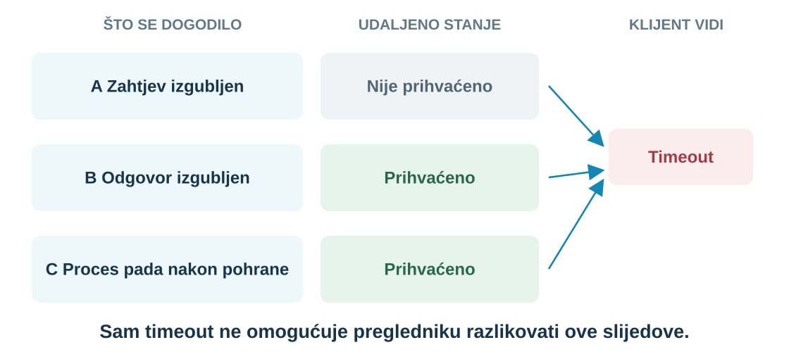{fig-alt="Izgubljen zahtjev znači neprihvaćenu predaju. Izgubljen odgovor ili rušenje nakon pohrane ostavljaju prihvaćenu predaju. Svaki slijed može završiti timeoutom." height=370px}

**Timeout ograničava čekanje; ne određuje udaljeni ishod.**

::: {.notes}
- **Priča:** Spajamo tri priče: isti timeout, različiti ishodi; zato je odgovor na glasanje „ne znamo”.

- Ponoviti glasanje: C. Isto opažanje, različiti udaljeni učinci.

- Dulji konačni timeout ne uklanja neizvjesnost bez korisne gornje granice.

- Naknadni dokaz/upit statusa može pomoći; sam timeout ne može.

Izvori: [Kleppmann, Distributed Systems](https://www.cl.cam.ac.uk/teaching/2122/ConcDisSys/dist-sys-notes.pdf).
:::

## Treba li klijent pokušati ponovno? {.exercise-slide}

Za svaki slijed predvidite što može učiniti drugi zahtjev.

1. Što može popraviti **ponovni pokušaj (retry)**?
2. Može li nastavnik dobiti dva zapisa predaje?
3. Koji bi podatak označavao istu namjeravanu operaciju?

::: {.notes}
- **Priča:** Prirodna reakcija je ponoviti; studenti predviđaju posljedice.

- Parovi (1 min), odgovori (1 min), povezivanje (1 min).

- A: ponavljanje može dostaviti posao. B/C: može duplicirati prihvaćeni posao.

- Idempotentnost: ponavljanje čuva učinak; odgovori se mogu razlikovati.

- ID operacije pomaže samo uz koordiniranu provjeru duplikata i zapis učinka.

- Prijelaz: timeout ne prekida A; B se može preklopiti s njim.

Izvori: [Kleppmann, Distributed Systems](https://www.cl.cam.ac.uk/teaching/2122/ConcDisSys/dist-sys-notes.pdf).
:::

## Ponovni pokušaj može se preklopiti s prvim

**Pozivatelj više ne čeka. Zahtjev možda još putuje, čeka u redu ili se obrađuje.**

::: {.submission-flow}
1. Pošalji pokušaj A
2. Istekne rok čekanja
3. Ponovi kao B
:::

**A i B sada mogu obrađivati istu namjeravanu predaju.**

Primamljiv pristup: **„Ako nema prihvaćenog zapisa, stvori ga.”**

**Što ako oba pokušaja provjere prije nego što ijedan stvori zapis?**

::: {.notes}
- **Priča:** Ponovni pokušaj preklapa se s prvim: konkurentnost se vraća kao problem.

- A/B sada su pokušaji iste predaje, ne različiti studenti.

- Prvi zahtjev nakon timeouta možda još putuje, čeka ili radi.

- Predložiti „provjeri pa stvori”; mogu li oba vidjeti odsutnost?

- Najprije invarijanta, zatim protokol.
:::

## Najprije pravilo, zatim protokol {.retry-overlap}

**Nije sve atomarno (atomic) u raspodijeljenim sustavima.** Provjera i upis ovdje su odvojeni koraci.

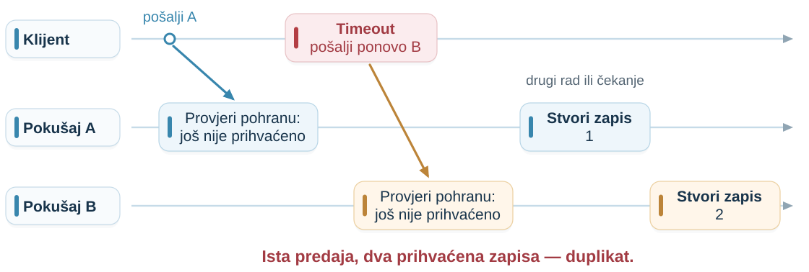{fig-alt="A provjeri pohranu; nakon timeouta B također vidi da nema zapisa. A i B zatim stvaraju dva prihvaćena zapisa iste predaje." height=265px}

::: {.definition number="1.5"}
**Invarijanta (invariant)** je pravilo koje mora vrijediti u svakom dopuštenom stanju sustava.
:::

**Zahtjev:** najviše jedan prihvaćeni zapis po namjeravanoj predaji.

::: {.notes}
- **Priča:** Utrka pokazuje da prije protokola trebamo pravilo: invarijantu.

- Atomarno = nedjeljivo u odnosu na druge operacije.

- Razmak provjere/upisa: U/I, ustupanje ili raspoređivanje; i kratak razmak dopušta utrku.

- Moguće i na jednom računalu.

- Ista namjeravana predaja; svjesna revizija može biti nova verzija.

- Najviše jedan zapis. Odbijanje svega sigurno je, ali beskorisno.
:::

## Sigurnost i napredovanje {.visual-definitions}

**Odbijemo sve predaje: nema duplikata. Je li portal koristan?**

Trebamo oboje: **bez duplikata** i **konačno prihvaćanje valjanog rada**.

::: {.definition number="1.6"}
**Svojstvo sigurnosti (safety)** zahtijeva da se određeni loš događaj ili stanje nikada ne dogodi.
:::

::: {.definition number="1.7"}
**Svojstvo napredovanja (liveness)** zahtijeva da se određeni napredak konačno ostvari pod navedenim pretpostavkama.
:::

Uvjeti napretka: oporavak usluga, uspješna komunikacija i obrada posla.

::: {.notes}
- **Priča:** Pravilo nije dovoljno: sustav koji sve odbija siguran je, ali beskoristan.

- Sigurnost: nikad duplikati. Napredovanje: valjani posao konačno prihvaćen.

- Treba oporavak/dostupnost, komunikaciju, sačuvan/ponovljen posao i obradu.

- „Valjano” uključuje pravilo roka; „konačno” ne daje vremensku granicu.

- Zašto odbijanje svega zadovoljava sigurnost, ali ne napredovanje?
:::

## Sigurnost i napredovanje u različitim sustavima {.property-examples}

| Sustav | Sigurnost (safety): što se ne smije dogoditi? | Napredovanje (liveness): što se mora konačno dogoditi? |
|:---|:---|:---|
| **Plaćanja** | [Ponovni pokušaji naplate isto plaćanje dvaput.]{.fragment fragment-index=1} | [Valjano, odobreno plaćanje se dovrši.]{.fragment fragment-index=2} |
| **Rezervacija sjedala** | [Dva kupca imaju potvrdu za isto sjedalo i događaj.]{.fragment fragment-index=3} | [Svaki zahtjev dobije potvrdu ili odbijenicu.]{.fragment fragment-index=4} |
| **Red poslova** | [Posao je označen dovršenim prije uspjeha.]{.fragment fragment-index=5} | [Svaki valjani posao na čekanju se obradi.]{.fragment fragment-index=6} |
| **Raspodijeljeno zaključavanje (lock)** | [Dva procesa istodobno izvršavaju zaštićeni kritični odsječak.]{.fragment fragment-index=7} | [Svaki ispravan proces koji nastavlja tražiti zaključavanje konačno ga dobije.]{.fragment fragment-index=8} |

**Napredak traži:** oporavak, komunikaciju, sačuvan posao i pravedno raspoređivanje. Proces koji drži zaključavanje mora ga otpustiti ili biti sigurno zamijenjen.

::: {.notes}
- **Priča:** Isti par svojstava prepoznajemo u plaćanjima, rezervacijama, redovima i zaključavanju.

- Otkrivati sigurnost pa napredovanje; stupac sigurnosti navodi zabranjene događaje.

- Plaćanje: ista namjera. Odbijenica zadovoljava obećanje odgovora na rezervaciju.

- Red: istinit status, ne izvršavanje točno jednom; poslovi završavaju ili prijavljuju neuspjeh.

- Zaključavanje: bez izgladnjivanja uz pravednost, konačne odsječke i siguran oporavak.

- Pitati: zašto ne odbiti sva plaćanja?
:::

## Model sustava izričito navodi pretpostavke

**Možemo li obećati konačno prihvaćanje svake valjane predaje ako…**

- struja ostane isključena?
- disk strada i ne ostane obnovljiva kopija?
- kabel bude prekinut, a usluga ostane odspojena?

**Model sustava (system model)** navodi dopušteno ponašanje i jamstva na koja se algoritam smije osloniti.

Pretpostavke navodimo za **mrežu (network), čvorove (nodes) i vrijeme (timing)**.

::: {.notes}
- **Priča:** Obećanja vrijede samo uz pretpostavke: uvodimo model sustava.

- Ispadi ugrožavaju napredovanje; zaustavljen sustav može izbjeći duplikate.

- Privremeni poremećaj dopušta oporavak; trajan gubitak/odspojenost može spriječiti napredak.

- Model = ponašanje + pretpostavke; jamstvo pokriva sva dopuštena izvršavanja.

- Izostanak duplikata tvrdnja je koju algoritam mora ostvariti, ne dar modela.

- Slijedi: mreža, čvorovi, vrijeme.

Izvori: [Kleppmann, Distributed Systems](https://www.cl.cam.ac.uk/teaching/2122/ConcDisSys/dist-sys-notes.pdf).
:::

## Pretpostavke mreže: prolaze li poruke?

**Kabel je prekinut: vraća li se komunikacija ili ostaje prekinuta?**

Ponavljanje pomaže samo ako neki kasniji pokušaj može stići.

| Pretpostavka komunikacije | Posljedica za portal |
|:---|:---|
| Poruke se mogu izgubiti, duplicirati ili promijeniti redoslijed | Obraditi ponovljene zahtjeve i promijenjeni redoslijed. |
| Uporno ponavljanje konačno uspijeva | Dostava je moguća, bez fiksnog roka. |
| Trajna mrežna particija (network partition) blokira sve pokušaje | Prihvaćanje koje treba tu komunikaciju ne napreduje. |

U primjeru isključujemo krivotvorenje i izmjenu poruka.

::: {.notes}
- **Priča:** Prva dimenzija modela: što mreža smije raditi s porukama.

- Pitati (30 s): pomažu li pokušaji ako se put nikad ne oporavi?

- Fair loss: uporni pokušaji između ispravnih sudionika konačno uspiju; bez fiksnog roka.

- Pouzdane veze: konačna dostava bez duplikata/krivotvorenja; redoslijed je zaseban.

- Privremene particije odgađaju; trajne krše uvjet konačne komunikacije.

- Duplikat poruke ≠ ponovljeni poziv; neovlaštene izmjene isključene.

- Slijedi: što ako primatelj padne?

Izvori: [Kleppmann, Distributed Systems](https://www.cl.cam.ac.uk/teaching/2122/ConcDisSys/dist-sys-notes.pdf).
:::

## Tri modela ispada čvorova

**Usluga stane nakon prihvaćanja projekta. Što se događa kad se vrati?**

| Model | Primjer u portalu |
|:---|:---|
| **Ispad bez oporavka (crash-stop)** | Sudionik trajno staje unutar modela. Primjer: izvršitelj se sruši; ostali moraju završiti bez njega. |
| **Ispad s oporavkom (crash-recovery)** | Ponovno se pokrene. Prihvaćeni zapisi ostaju u trajnoj pohrani; red u memoriji nestaje. |
| **Bizantski model (Byzantine)** | Neispravna usluga studentu kaže „prihvaćeno”, a nastavniku „nije prihvaćeno”. |

Modeli opisuju dopušteno ponašanje, ne trenutak otkrivanja ispada.

::: {.notes}
- **Priča:** Druga dimenzija: kako komponente smiju otkazati.

- Pitati što preživi ponovno pokretanje: trajni zapisi nasuprot memoriji.

- Crash-stop: sudionik više ne radi korake; nema oslanjanja na povratak.

- Crash-recovery: vraća se; navesti što ostaje.

- Byzantine: odstupa od protokola, uključujući proturječne odgovore.

- Alternativni modeli, ne faze; ne jamče trenutno otkrivanje.

Izvori: [Kleppmann, Distributed Systems](https://www.cl.cam.ac.uk/teaching/2122/ConcDisSys/dist-sys-notes.pdf).
:::

## Koliko dugo portal treba čekati?

**Usluga zadataka obično brzo odgovori. Danas šuti.**

- Beskonačno čekanje ostavlja studenta bez rezultata.
- Ponovni pokušaj može se preklopiti s poslom koji još traje.

**Koje jamstvo razlikuje „sporo” od „zaustavljeno”?**

Mi, **arhitekti sustava i programeri**, biramo timeout; time ne stvaramo jamstvo brzine odgovora.

> **💡 Uvid:** prekratki timeouti i agresivni ponovni pokušaji mnogih klijenata mogu stvoriti **oluju ponavljanja (retry storm)**: samouzrokovanu uskratu usluge s učincima poput DDoS-a.

::: {.notes}
- **Priča:** Treća dimenzija počinje praktičnim pitanjem: koliko dugo čekati?

- Pitati (20 s): je li rok navika ili jamstvo?

- Arhitekti/programeri biraju politiku, ne granicu odziva ovisne usluge.

- Granica cijelog poziva: dostava + obrada + odgovor.

- Petlja: sporost → timeout → pokušaji/opterećenje → veća sporost.

- Legitimni klijenti mogu uskratiti uslugu; ograničiti pokušaje, backoff + jitter.

- Sigurnost ponavljanja je zaseban zahtjev.

Izvori: [AWS Builders’ Library, Timeouts, retries, and backoff with jitter](https://aws.amazon.com/builders-library/timeouts-retries-and-backoff-with-jitter/); [Kleppmann, Distributed Systems](https://www.cl.cam.ac.uk/teaching/2122/ConcDisSys/dist-sys-notes.pdf).
:::

## Vremenski modeli: što smijemo pretpostaviti? {.timing-comparison}

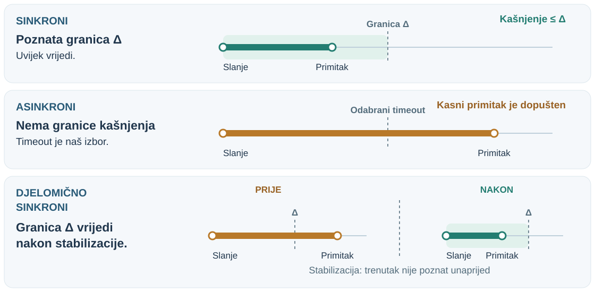{fig-alt="Sinkroni model ima poznatu granicu kašnjenja, asinkroni nema. U prikazanoj djelomičnoj sinkronosti granica vrijedi nakon nepoznatog trenutka stabilizacije." height=370px}

Sinkroni (**synchronous**), asinkroni (**asynchronous**), djelomično sinkroni (**partially synchronous**).

Zagušenje i zastoji motiviraju djelomičnu sinkronost. To je **pretpostavka**, ne „99 % brzo” ni jamstvo Interneta.

**Cilj: sigurnost tijekom poremećaja; napredak nakon stabilizacije.**

::: {.notes}
- **Priča:** Formaliziramo vrijeme: što smijemo pretpostaviti o kašnjenju.

- Δ = gornja granica, ne prosjek. Asinkroni primitak može kasniti iza timeouta.

- Eventual synchrony: nepoznata konačna stabilizacija, zatim granice vrijede do kraja.

- Ne „99 % brzo”; nema obavijesti o stabilizaciji ni jamstva Interneta.

- Stvarni sustavi opet postaju nestabilni; korisno stabilno razdoblje ovisi o algoritmu.

- Sigurnost/napredak treba ostvariti; modeli vremena ≠ blokirajući/async API-ji.

Izvori: [Kleppmann, Distributed Systems](https://www.cl.cam.ac.uk/teaching/2122/ConcDisSys/dist-sys-notes.pdf).
:::

## etcd: jedno uspješno zauzimanje {.example-slide .system-example}

Replicirana pohrana ključ–vrijednost: **dva klijenta žele isti naziv**.

| O čemu zaključujemo | Klaster etcd s tri člana |
|:---|:---|
| **Pretpostavke modela** | Pouzdani, nebizantski članovi; ispad s oporavkom i trajnim stanjem. Moguća kašnjenja i particije. |
| **Invarijanta / sigurnost** | Atomarno „ako ne postoji, stvori” dopušta **najviše jedan uspjeh** dok se ključ ne izbriše. Odvojeno čitanje pa upis nije dovoljno. |
| **Uvjeti napredovanja** | Dostupna **većina (majority, 2 od 3)**, stabilan vođa te pravodobna komunikacija i obrada. |

**Particija 2 + 1:** većina može potvrditi upis; izolirani član ne može potvrditi konkurentsko zauzimanje.

::: {.notes}
- **Priča:** Stvarni sustav rješava naš problem duplikata atomarnim „stvori ako ne postoji”.

- Replika = održavana kopija; većina = 2/3.

- Atomarna provjera odsutnosti + stvaranje dopušta jednog dobitnika; odvojeni pozivi ne.

- Bez brisanja, isteka ili zaobilaznog upisa; vanjski resursi trebaju fencing.

- Pouzdani članovi, oporavak i trajno stanje; napredak treba stabilnu većinu.

- Timeout ostavlja neizvjesnost; opcionalno serializable čitanje može biti zastarjelo.

- Što ostaje kad manjina ne napreduje? Sigurnost.

Izvori: [etcd API guarantees](https://etcd.io/docs/v3.6/learning/api_guarantees/); [failure modes](https://etcd.io/docs/v3.6/op-guide/failures/); [Raft paper](https://raft.github.io/raft.pdf).
:::

## Cassandra: što odgovor obećava? {.example-slide .system-example}

Raspodijeljena baza: **tri replike; obična čitanja i upisi uz razinu konzistentnosti (consistency level) ONE**.

| O čemu zaključujemo | Ova konfiguracija Cassandre |
|:---|:---|
| **Pretpostavke modela** | Nebizantske replike mogu pasti i oporaviti se. Moguća mrežna kašnjenja i particije. |
| **Sigurnost i ograničenje** | Uspjeh traži potvrdu jedne replike. Čitanje može biti zastarjelo; „pročitaj pa upiši” **ne čuva** pravilo „prodaj sjedalo najviše jednom”. |
| **Uvjeti napredovanja** | Dostupna, odzivna replika može obraditi operaciju. Replike se usklade kad komunikacija i popravak dostave sačuvane promjene. |

**Izbor je važan:** QUORUM traži većinu; uvjetne rezervacije trebaju jaču koordinaciju, npr. lake transakcije (LWT).

::: {.notes}
- **Priča:** Kontrast: slabija konfiguracija daje brzinu, ali ne čuva naše pravilo.

- RF=3; ONE čeka relevantnu repliku, ne znači samo jednu kopiju.

- Obične operacije jedne ćelije; bez brojača/brisanja/LWT-a.

- Zastarjela čitanja mogu dvaput rezervirati; jedna konačna vrijednost ne poništava obećanja.

- Usklađivanje treba sačuvane promjene, popravak, komunikaciju i prestanak novih upisa.

- „Posljednje” prema vremenskoj oznaci, ne nužno stvarnom redoslijedu.

- QUORUM ne čini provjeru/upis atomarnima; LWT dodaje uvjetnu koordinaciju.

Izvori: [Dynamo architecture](https://cassandra.apache.org/doc/stable/cassandra/architecture/dynamo.html); [guarantees](https://cassandra.apache.org/doc/stable/cassandra/architecture/guarantees.html); [hints and repair](https://cassandra.apache.org/doc/stable/cassandra/managing/operating/hints.html).
:::

## Bitcoin: potvrde povećavaju pouzdanost {.example-slide .system-example}

Zajednička povijest plaćanja u **otvorenoj mreži s mogućim zlonamjernim sudionicima**.

| O čemu zaključujemo | Bitcoinov dokaz rada (proof of work) |
|:---|:---|
| **Pretpostavke modela** | Sigurna kriptografija, prevladavajuća poštena rudarska snaga i dovoljno brzo širenje blokova u odnosu na rudarenje. |
| **Invarijanta / sigurnost** | Valjani lanac ne troši isti izlaz transakcije dvaput. Čvorovi privremeno mogu pratiti različite grane; **konačnost je probabilistička**. |
| **Uvjeti napredovanja** | Rudarenje i komunikacija omogućuju rast lanca. Transakcija mora ostati valjana, stići rudarima i biti odabrana; **nema fiksnog roka uključivanja**. |

**Tijekom particije:** rastu konkurentske grane. Potvrde smanjuju rizik poništenja pod pretpostavkama; ne svode ga na nulu.

::: {.notes}
- **Priča:** Krajnji slučaj: zlonamjerni sudionici i probabilistička sigurnost.

- Protivničko okruženje; poštena rudarska snaga, kriptografija, dovoljno brzo širenje.

- Valjani lanac ne troši izlaz dvaput; proturječne grane mogu postojati.

- Potvrde pod pretpostavkama smanjuju rizik poništenja, ne na nulu.

- Dominacija znači hash snagu, ne broj čvorova; bira se najveći kumulativni rad.

- Rast traži rudarenje/komunikaciju; uključivanje transakcije i odabir, bez fiksnog roka.

- Većinska hash snaga ne može nametnuti nevaljan potpis poštenim čvorovima.

Izvori: [Bitcoin whitepaper](https://bitcoin.org/bitcoin.pdf); [Bitcoin developer guide: block chain](https://developer.bitcoin.org/devguide/block_chain.html).
:::

## Naš portal: pretpostavke iza obećanja

**Ponovni pokušaji ne smiju stvoriti duplikate, ni nakon ponovnog pokretanja.**

| Dimenzija | Model za ovaj primjer |
|:---|:---|
| Mreža | Zahtjevi i odgovori mogu kasniti, nestati, ponoviti se ili promijeniti redoslijed; bez neovlaštene izmjene. |
| Čvorovi | Usluge se mogu srušiti i ponovno pokrenuti; trajni zapisi ostaju, memorija se može izgubiti. |
| Vrijeme | Nema zajamčenog najduljeg vremena odgovora. |

**Za konačno prihvaćanje:** usluge konačno ostaju dostupne, komunikacija uspijeva, a sačuvani ili ponovljeni posao se obrađuje.

::: {.notes}
- **Priča:** Sve tri dimenzije modela primjenjujemo na naš portal.

- Jedan primjer modela, ne univerzalni model portala.

- Sigurnost pri svim dopuštenim preklapanjima/oporavcima; trajna pohrana sama nije dovoljna.

- Trajna particija prekida konačnu komunikaciju; sačuvati sigurnost bez napretka.

- Blizina WWW/LAN ne jamči sinkronost; isti domaćin dijeli ispade.

- Nepouzdani klijenti ne zahtijevaju automatski bizantski konsenzus pouzdanih poslužitelja.

Izvori: [Kleppmann, Distributed Systems](https://www.cl.cam.ac.uk/teaching/2122/ConcDisSys/dist-sys-notes.pdf).
:::

## 🔥 Kako razviti loš sustav

**Oslonite se na pretpostavke koje niste provjerili:**

:::: {.columns}
::: {.column width="50%"}
- Mreža uvijek dostavlja.
- Komunikacija ne traje.
- Kapacitet veze je neograničen.
- Mreža je automatski sigurna.
:::
::: {.column width="50%"}
- Topologija se ne mijenja.
- Jedan administrator upravlja svime.
- Prijenos podataka ništa ne košta.
- Sve komponente govore istim jezikom.
:::
::::

**Umjesto toga: navedite pretpostavke i objasnite što slijedi kada ne vrijede.**

::: {.notes}
- **Priča:** Suprotan primjer: što se dogodi kad pretpostavke prešutimo.

- Pregled (35 s); koja pretpostavka pada u priči o timeoutu (25 s)?

- „Jedan administrator” = ovlasti/politike; „isti jezik” = protokoli/formati/verzije/značenje.

- Apstrakcije mogu dati uvjetna jamstva; problem su skrivene pretpostavke.

- Slijedi: vježba o 101 ms — koja pretpostavka nedostaje?

Izvori: [Oracle, Fallacies of distributed systems](https://blogs.oracle.com/developers/fallacies-of-distributed-systems).
:::

## Nema odgovora nakon 101 ms {.exercise-slide}

Usluga zadataka **obično odgovori unutar 100 ms**.

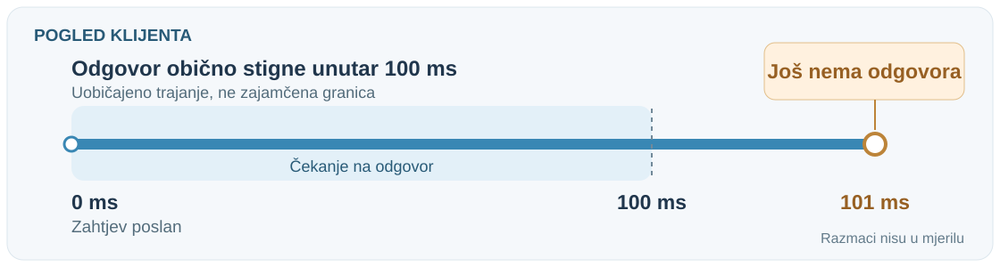{height=280px fig-alt="Zahtjev je poslan u 0 ms. U 101 ms još nema odgovora, iako obično stigne unutar 100 ms. Stanje usluge nije poznato; razmaci nisu u mjerilu."}

**Dokazuje li to da se usluga srušila?**

**Navedite drugo objašnjenje i dodatno jamstvo koje vaš zaključak treba.**

::: {.notes}
- **Priča:** Studenti sami hvataju skrivenu pretpostavku o vremenu.

- Dati 30 s: razlikovati uobičajeno trajanje od zajamčene granice.

- Još nema odgovora; proces ili komunikacija možda kasni ili nije dostupan.

- Dijagram prikazuje opažanje klijenta, ne stvarni ispad.

- Izmišljena vremena, razmaci nisu u mjerilu. Koje jamstvo cijelog poziva nedostaje?

Izvori: [Kleppmann, Distributed Systems](https://www.cl.cam.ac.uk/teaching/2122/ConcDisSys/dist-sys-notes.pdf).
:::

## Natrag na početak: je li portal prihvatio projekt?

**Još ne znamo, i sada znamo zašto.**

- **Djelomični ispad:** neke komponente stanu, druge rade.
- **Istek čekanja:** ograničava čekanje, ne otkriva ishod.
- **Invarijanta:** najviše jedan prihvaćeni zapis po predaji.
- **Sigurnost i napredovanje:** loše se nikad ne dogodi; dobro se konačno dogodi.
- **Model sustava:** izričite pretpostavke o mreži, čvorovima i vremenu.

**Siguran ponovni pokušaj traži pravilo i pretpostavke, a ne samo dulji timeout.**

::: {.notes}
- **Priča:** Zatvaramo krug: odgovor na glasanje je C, i sad znamo zašto.

- Vratiti se na glasanje s početka: tko je glasao C? Odgovor C je točan jer isto opažanje odgovara različitim ishodima.

- Pitati (15 s): koji je pojam još nejasan?

- Prijelaz (15 s): rok stiže prije kraja obrade; što biste izgradili?

- Popis koraka za zaključivanje ostaje u poglavlju (slika reasoning-checklist).
:::

## Osmislite sljedeći korak: predaja na vrijeme? {.exercise-slide}

Rok je **ponoć**.

Prijenos završi u **23:59**, a provjere u **00:19**.

**Kako student može znati je li predao na vrijeme, čak i nakon zatvaranja preglednika?**

Predložite što **pohraniti i prikazati**, **jedno pravilo koje treba očuvati** te pretpostavke o **mreži, ponovnom pokretanju i vremenu**.

::: {.notes}
- **Priča:** Naučeno primjenjujemo na novi problem s rokom i potvrdom.

- Pitati (10 s): što ostaje nakon zatvaranja preglednika?

- Razmisliti (25 s): što pohraniti/prikazati?

- Raspraviti (30 s): koji događaj vrijedi? Završetak u pregledniku ≠ trajni primitak.

- Poticaji: ID/vrijeme potvrde, „primljeno, provjere u tijeku”, dohvat statusa.

- Izazov (25 s): rušenje tijekom provjera; što ostaje i omogućuje dovršetak?

- Najviše jedan prihvaćeni zapis; protokol razvijamo kasnije.
:::

## Domaća zadaća: računi 1, 2, 3, … {.exercise-slide}

Tvrtka izdaje račune s **više poslužitelja**. Brojevi moraju ići **slijedno: bez ponavljanja i bez preskakanja**.

1. Napišite pravilo (invarijantu) koje sustav mora očuvati.
2. Dva poslužitelja istodobno izdaju račun. Tko dodjeljuje broj?
3. Poslužitelj uzme broj 42 i sruši se prije spremanja računa. Što je s brojem 42?
4. Blagajni istekne vrijeme čekanja pa pokuša ponovno. Kako izbjeći dva računa?

**Postoji li rješenje u kojem ništa ne žrtvujete: ni dostupnost, ni brzinu, ni strogi slijed?** Ako ne, što biste žrtvovali?

::: {.notes}
- **Priča:** Ideje prenosimo na problem iz prakse i ostavljamo pitanje za kasnija predavanja.

- Zadati za doma; ne rješavati na satu. Stvarni problem iz nastavnikove prakse.

- Smjerovi za raspravu idući put: jedan brojač = usko grlo i jedinstvena točka ispada; rupa (rušenje nakon dodjele) ≠ duplikat (ponovni pokušaj); identifikator zahtjeva čini ponovni pokušaj sigurnim (idempotentnost, Web aplikacije); raspon brojeva po poslužitelju čuva jedinstvenost, ali ne globalni slijed.

- Mogući izlaz: brojiti zasebno po naplatnom uređaju ili poslovnom prostoru. Hrvatska fiskalizacija tako označava račune (broj/poslovni prostor/uređaj) — provjeriti važeći pravilnik prije navođenja.

- Završno pitanje: očekivani zaključak je da takvo rješenje ne postoji. Strogi slijed bez rupa traži koordinaciju; kod podjele mreže (partition) ili rušenja koordinatora sustav mora čekati (gubi dostupnost) ili izdavati brojeve bez koordinacije (gubi slijed). Neka studenti sami dođu do toga; ideju razvijamo uz replikaciju i konsenzus.

- Kasnije: replikacija (predavanje 06), konsenzus (predavanje 07), transakcije (predavanje 09).
:::
