## Nakon predaje: istek čekanja (timeout) {.example-slide}

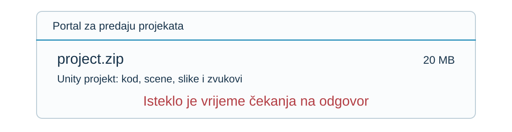{fig-alt="Portal prikazuje Unity ZIP od 20 MB i istek vremena čekanja, bez potvrde prihvaćanja." height=260px}

**Je li portal prihvatio vaš projekt za nastavnika?**

::: {.answer-chips}
[**A** Da]{.answer-chip .answer-a}
[**B** Ne]{.answer-chip .answer-b}
[**C** Još ne znamo]{.answer-chip .answer-c}
:::

::: {.notes}
- **Priča:** Otvaramo napetost: student vidi timeout i ne zna je li predao; na to odgovaramo cijelo predavanje.

- **Sažetak:**
  - Student šalje Unity ZIP od 20 MB; portal javlja istek čekanja bez potvrde prihvaćanja.
  - Pitanje: je li portal prihvatio projekt? A Da · B Ne · C Još ne znamo.
  - Točan odgovor (C) obrazlažemo tek na kraju predavanja.

- Zamišljeni portal: prijavljeni student šalje Unity ZIP (kod, scene, resursi).

- Prihvaćeno = cijeli projekt + trajni zapis; napredak prijenosa nije potvrda.

- Glasanje (30 s); pitati dvoje za razlog. Ostaviti otvorene gubitak zahtjeva, ispad i gubitak odgovora.

- Odgovor C; vratiti se nakon slijedova. Ponavljanje može stvoriti duplikate.

Izvori: [Kleppmann, Distributed Systems](https://www.cl.cam.ac.uk/teaching/2122/ConcDisSys/dist-sys-notes.pdf).
:::

## Što trebamo znati da bismo odgovorili?

- Koje komponente obrađuju predaju?
- Kako komuniciraju i dijele posao?
- Što može prestati raditi dok ostali dijelovi nastavljaju?
- Što bi ponovni pokušaj učinilo sigurnim?
- Koje pretpostavke opravdavaju naše zaključke?

**Pratimo tijek predaje našeg projekta kroz komponente portala.**

**Predznanje:** osnove programiranja, procesa i mreža.

::: {.notes}
- **Priča:** Jedno pitanje razbijamo u pet manjih koja čine plan predavanja.

- **Sažetak:**
  - Pet pitanja = plan predavanja: komponente, komunikacija i podjela posla, djelomični ispadi, siguran ponovni pokušaj, pretpostavke.
  - Tijek jedne predaje pratimo kroz komponente portala.
  - Predznanje: osnove programiranja, procesa i mreža.

- Glasanje ostaje neriješeno: što se dogodilo unutar portala?

- Put: komponente → dijeljenje rada → djelomični ispadi → sigurno ponavljanje → pretpostavke.

- Pitati: tko zna rok, a tko zna je li projekt pohranjen?
:::

## Sustav za predaju projekata {.use-case-slide}

**Tko zna rok? Tko zna je li projekt pohranjen?**

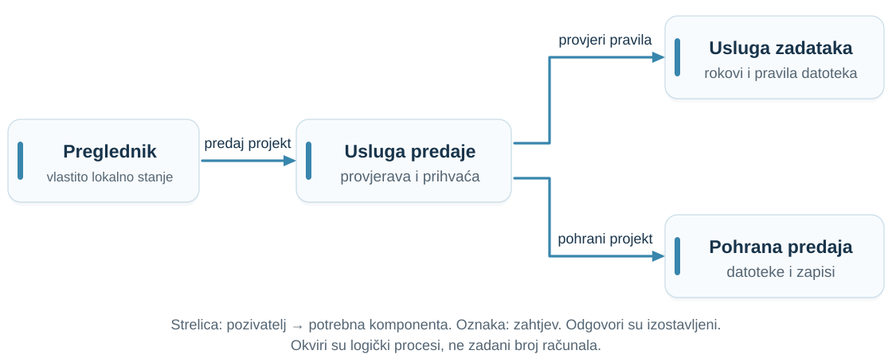{fig-alt="Studentski klijent šalje projekt usluzi za predaju; ona provjerava pravila i pohranjuje projekt." height=400px}

Svaki proces ima **lokalno stanje (local state)**. Strelica znači **„poziva i ovisi o”**.

::: {.notes}
- **Priča:** Otvaramo „crnu kutiju” portala: više procesa, svaki zna samo svoj dio.

- **Sažetak:**
  - Karta portala: studentski klijent → usluga predaje → usluga zadataka (rokovi, pravila) i pohrana (projekt, prihvaćeni zapis).
  - Svaki proces ima lokalno stanje; strelica znači „poziva i ovisi o”.
  - Pitanja: tko zna rok, a tko zna je li projekt pohranjen?

- Pratiti pozivatelj → ovisnost; oznake su zahtjevi. Odgovori izostavljeni.

- Usluga zadataka: rokovi/pravila. Pohrana: projekt + prihvaćeni zapis.

- Pitati što svaki proces zna lokalno.

- Logički procesi, ne nužno zasebna računala; isti domaćin dijeli ispade.

Izvori: [van Steen and Tanenbaum, Distributed Systems](https://www.distributed-systems.net/index.php/books/ds4/); [Waldo et al., A Note on Distributed Computing](https://waldo.scholars.harvard.edu/publications/note-distributed-computing).
:::

## Što sustav čini raspodijeljenim?

**Za jednu predaju više programa surađuje razmjenom poruka.**

::: {.definition number="1.1"}
**Raspodijeljeni sustav (distributed system)** čine komponente koje se neovisno izvršavaju te komuniciraju i koordiniraju razmjenom poruka radi zajedničkog cilja.
:::

Prepoznajte sudionike, njihovo lokalno stanje i poruke.

Jedan naziv **usluge (service)** može skrivati mnogo procesa koji surađuju.

::: {.notes}
- **Priča:** Imenujemo ono što smo upravo vidjeli: neovisne komponente koje surađuju porukama.

- **Sažetak:**
  - Def. 1.1: raspodijeljeni sustav čine neovisno izvršavane komponente koje komuniciraju i koordiniraju razmjenom poruka radi zajedničkog cilja.
  - Tri sastojka: sudionici s lokalnim stanjem, poruke, zajednički cilj.
  - Jedan naziv usluge može skrivati mnogo procesa.

- Proces = program u izvođenju; čvor u modelu može biti proces ili računalo.

- Prepoznati sudionike, poruke i cilj.

- Nepovezani programi na različitim računalima ne moraju činiti raspodijeljenu aplikaciju.

- Jedan naziv usluge može skrivati više procesa.

Izvori: [van Steen and Tanenbaum, Distributed Systems](https://www.distributed-systems.net/index.php/books/ds4/); [Waldo et al., A Note on Distributed Computing](https://waldo.scholars.harvard.edu/publications/note-distributed-computing).
:::

## Raspodijeljeni sustav ili ne? {.exercise-slide .classification-exercise}

**Prepoznajte komponente, poruke i zajednički cilj.**

| Primjer | Odgovor i razlog |
|:---|:---|
| Preglednik, API i baza na istom računalu | [**Da, prema našoj definiciji:** zasebni procesi koordiniraju se porukama, ali dijele ispad računala.]{.fragment fragment-index=1} |
| Računala renderiraju različite kadrove istog filma | [**Da:** koordiniraju rad radi dovršetka jednog filma.]{.fragment fragment-index=2} |
| Tri nepovezana prijenosnika na istom Wi-Fiju | [**Ne:** zajednička mreža ne znači zajednički zadatak.]{.fragment fragment-index=3} |
| Dretve se koordiniraju samo dijeljenom memorijom | [**Ne, prema našoj definiciji:** sama konkurentnost nije dovoljna.]{.fragment fragment-index=4} |
| API i izvršni kontejner na jednom prijenosniku | [**Da, prema našoj definiciji:** poruke koordiniraju posao; oba dijele ispad računala.]{.fragment fragment-index=5} |
| Tri MPI procesa računaju prosječnu temperaturu | [**Da:** proces 0 dijeli podatke; svi računaju zbroj i broj; ostali vraćaju rezultate, a proces 0 ih spaja.]{.fragment fragment-index=6} |

::: {.notes}
- **Priča:** Provjeravamo razumijevanje definicije na rubnim primjerima.

- **Sažetak:**
  - Šest primjera; za svaki tražimo komponente, poruke i zajednički cilj.
  - Da: preglednik + API + baza na istom računalu, render farma, API + kontejner na prijenosniku, MPI prosjek temperature.
  - Ne: nepovezani prijenosnici na istom Wi-Fiju (nema zajedničkog zadatka), dretve samo s dijeljenom memorijom (nema poruka).

- Otkrivati odgovor tek nakon studentske procjene.

- Isti domaćin odgovara našoj definiciji, ali dijeli ispade; strože definicije traže više računala.

- Dretve samo s dijeljenom memorijom ne zadovoljavaju kriterij razmjene poruka.

- MPI: proces 0 zadrži dio i pošalje dva; spaja zbrojeve i brojnosti, ne prosjeke.
:::

## Zašto raspodijeliti posao?

| Razlog | Primjer |
|:---|:---|
| **Komponente su fizički odvojene** | Studenti predaju s raznih mjesta; senzori, mobiteli i korisnici diljem svijeta |
| **Potreban je veći kapacitet** | Tisuće predaja pred rok; više računala dijeli posao |
| **Sustav mora preživjeti ispade** | Kopije usluge i podataka (redundancija); rad se nastavlja kad jedna stane |

**Zato je gotovo svaki današnji informacijski sustav raspodijeljen.**

::: {.notes}
- **Priča:** Ako je to teže, zašto to radimo? Tri razloga zbog kojih je gotovo svaki sustav raspodijeljen.

- **Sažetak:**
  - Tri razloga: komponente su fizički odvojene, potreban je veći kapacitet, sustav mora preživjeti ispade (redundancija).
  - Zaključak: gotovo svaki današnji informacijski sustav je raspodijeljen.

- Tri glavna razloga: geografska odvojenost, kapacitet, otpornost na ispade.

- Pitati: koji od tri razloga vrijedi za aplikacije koje već koristite? Čak i jednostavna web-aplikacija ima preglednik, poslužitelj i bazu u odvojenim procesima.

- Dodatni ciljevi: dijeljenje resursa, otvorenost (dogovorena sučelja) i transparentnost (jedan portal skriva raspored komponenti).

- Cijena: ovisnosti, koordinacija i oporavak. Slijedi Facebook kao primjer kapaciteta, zatim opterećenje našeg portala pred rok.

Izvori: [van Steen and Tanenbaum, Distributed Systems](https://www.distributed-systems.net/index.php/books/ds4/); [Waldo et al., A Note on Distributed Computing](https://waldo.scholars.harvard.edu/publications/note-distributed-computing).
:::

## Facebook: rast mijenja arhitekturu {.example-slide .facebook-scale}

{width=50px fig-alt="Logotip Facebooka"} **Više korisnika, zahtjeva i podataka.**

| Datum | Mjesečno aktivni korisnici Facebooka (MAU) |
|:---|---:|
| Listopad 2012. | **1,00 milijarda** |
| Prosinac 2019. | **2,50 milijardi** |
| Prosinac 2023. | **3,07 milijardi** |

**Vertikalno skaliranje (scale up):** snažnije računalo.  
**Horizontalno skaliranje (scale out):** više računala dijeli posao.

Od Q1 2024. Facebook ne objavljuje zasebne dnevne/mjesečne brojke. Noviji podaci za Metine aplikacije mjere nešto drugo.

::: {.notes}
- **Priča:** Razlog kapaciteta na stvarnim brojkama: rast tjera arhitekturu na više računala.

- **Sažetak:**
  - Facebook MAU: 1,00 mlrd (10/2012) → 2,50 mlrd (12/2019) → 3,07 mlrd (12/2023).
  - Vertikalno skaliranje (scale up) = snažnije računalo; horizontalno (scale out) = više računala dijeli posao.
  - Od Q1 2024. nema zasebnih Facebook brojki; noviji podaci mjere Metine aplikacije.

- Rast (20 s); scale up/out (25 s); cijena koordinacije (15 s).

- MAU nije broj istodobnih korisnika ni zahtjeva u sekundi.

- 2023. je posljednji zasebni Facebook MAU u nizu; Meta Family mjeri drugo.

- Razlozi uključuju rast, dostupnost i geografiju. Mehanizmi: predavanje 11.

Izvori: [2012 milestone](https://about.fb.com/news/2012/10/one-billion-people-on-facebook/); [2019 results](https://investor.atmeta.com/investor-news/press-release-details/2020/Facebook-Reports-Fourth-Quarter-and-Full-Year-2019-Results/default.aspx); [2023 results](https://investor.atmeta.com/investor-news/press-release-details/2024/Meta-Reports-Fourth-Quarter-and-Full-Year-2023-Results-Initiates-Quarterly-Dividend/default.aspx); [reporting change](https://investor.fb.com/files/doc_financials/2023/q4/META-Q4-2023-Prepared-Remarks.pdf); [Facebook engineering on scaling](https://engineering.fb.com/2010/07/21/core-infra/scaling-facebook-to-500-million-users-and-beyond/).
:::

## Kašnjenje, kapacitet i dovršeni posao

**Više projekata završi u sekundi. Mora li moj prijenos završiti brže?**

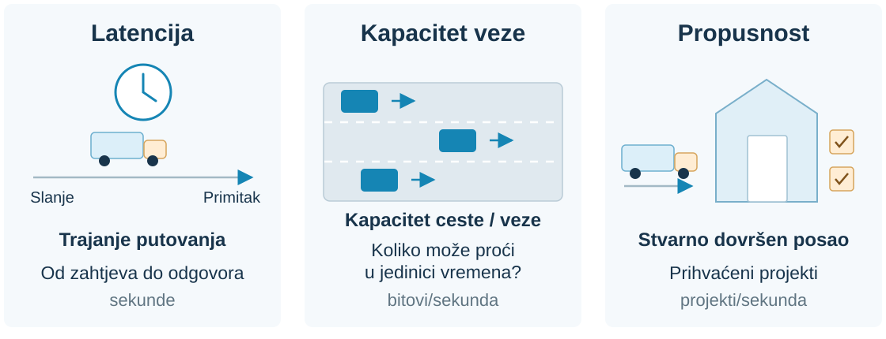{fig-alt="Latencija je trajanje jednog putovanja; propusni kapacitet je kapacitet veze; propusnost je stvarno dovršeni posao u sekundi." height=295px}

Latencija (**latency**) · kapacitet veze (**bandwidth**) · propusnost (**throughput**)

**Kako najbrže prenijeti 100 TB između podatkovnih centara?**

**Velika propusnost ne jamči brz odgovor.**

::: {.notes}
- **Priča:** Poruke traju: razlikujemo trajanje jednog odgovora od količine dovršenog posla.

- **Sažetak:**
  - Latencija = trajanje jednog putovanja; kapacitet veze (bandwidth) = koliko veza može prenijeti; propusnost (throughput) = stvarno dovršeni posao u sekundi.
  - Pitanje za raspravu: kako najbrže prenijeti 100 TB između podatkovnih centara?
  - Poruka slajda: velika propusnost ne jamči brz odgovor.

- Trajanje putovanja = latencija; kapacitet ceste = bandwidth; dovršene dostave = throughput.

- Portal broji prihvaćene projekte, ne poslane bajtove. Čekanje/obrada dodaju latenciju.

- 100 TB: 20 s za ideje; usporediti mrežu s prijevozom diskova.

- Uključiti udaljenost, brzinu prijenosa, pisanje, put, čitanje i provjeru.

- Opcionalno: 10 Gbit/s ≈ 22,2 h prije dodatnih troškova (decimalno). Propusnost ≠ brz odgovor.

Izvori: [Kleppmann, Distributed Systems](https://www.cl.cam.ac.uk/teaching/2122/ConcDisSys/dist-sys-notes.pdf).
:::

## Više predaja može napredovati zajedno {.retry-overlap}

**Dvije predaje: A čeka pohranu. Može li B napredovati?**

Izvršitelj može promijeniti zadatak pri čekanju ili ustupanju izvršavanja, uz poštovanje ovisnosti.

:::: {.columns}
::: {.column width="42%"}
::: {.definition number="1.2"}
**Konkurentnost (concurrency):** više je zadataka u tijeku tijekom razdoblja koja se preklapaju.
:::

::: {.definition number="1.3"}
**Paralelizam (parallelism):** više se zadataka izvršava istodobno.
:::
:::
::: {.column width="58%"}
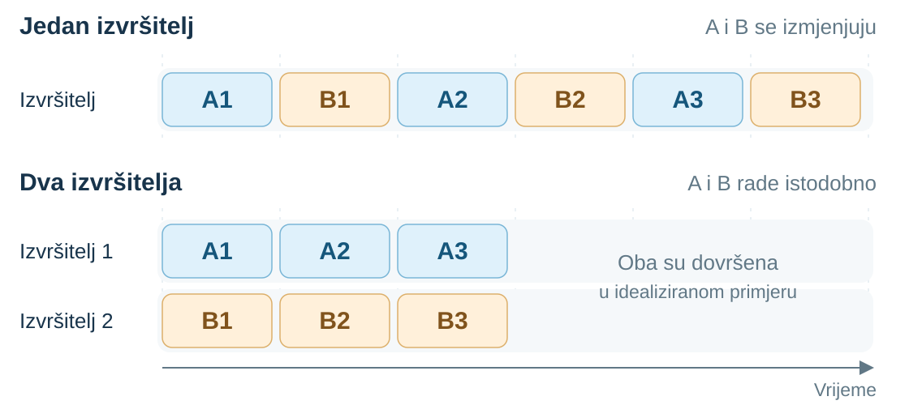{fig-alt="Jedan izvršitelj izmjenjuje dijelove A i B; dva ih izvršavaju istodobno." width=100%}
:::
::::

::: {.notes}
- **Priča:** Odgovor je preklapanje i istodobnost: uvodimo konkurentnost i paralelizam.

- **Sažetak:**
  - Def. 1.2 konkurentnost: više je zadataka u tijeku u razdobljima koja se preklapaju.
  - Def. 1.3 paralelizam: više se zadataka izvršava istodobno.
  - Dok A čeka pohranu, izvršitelj može raditi na B, uz poštovanje ovisnosti.

- Pratiti jednog izvršitelja koji izmjenjuje A/B, zatim dva istodobna izvršitelja.

- Objašnjenje u paru (45 s): konkurentnost i paralelizam.

- Poštovati ovisnosti. Preklapanje može povećati iskorištenost; paralelizam propusnost.

- Ne jamče brži pojedinačni posao; oboje je moguće na jednom računalu.

Izvori: [van Steen and Tanenbaum, Distributed Systems](https://www.distributed-systems.net/index.php/books/ds4/); [Waldo et al., A Note on Distributed Computing](https://waldo.scholars.harvard.edu/publications/note-distributed-computing).
:::

## Kada izvršitelj mijenja zadatak? {.interruption-slide}

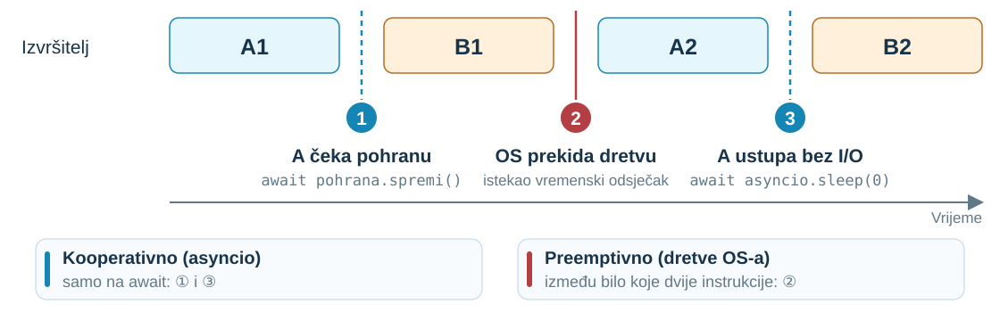{fig-alt="Jedan izvršitelj izvodi A1, B1, A2, B2. Promjena 1: A čeka pohranu (await). Promjena 2: OS prekida dretvu jer je istekao vremenski odsječak. Promjena 3: A ustupa bez I/O pomoću await asyncio.sleep(0). Kooperativno raspoređivanje mijenja zadatak samo na await, preemptivno između bilo koje dvije instrukcije." width=100%}

```python
async def provjeri(predaja):
    for datoteka in predaja.datoteke:
        skeniraj(datoteka)         # samo CPU: petlja ne može promijeniti zadatak
        await asyncio.sleep(0)     # dobrovoljna točka prekida, bez I/O
    await pohrana.spremi(predaja)  # čekanje I/O: točka prekida
```

**Između provjere i upisa može doći na red netko drugi.**

::: {.notes}
- **Priča:** Osvježavamo kako se izvršavanje doista izmjenjuje, jer na tome kasnije pada provjera duplikata.

- **Sažetak:**
  - Tri točke promjene zadatka: čekanje I/O (await), prekid OS-a (istek vremenskog odsječka), dobrovoljno ustupanje (await asyncio.sleep(0)).
  - Kooperativno raspoređivanje mijenja zadatak samo na await; preemptivno između bilo koje dvije instrukcije.
  - Poruka slajda: između provjere i upisa na red može doći netko drugi.

- Tri točke promjene: čekanje I/O (await), prekid OS-a (istekne vremenski odsječak, dretva to ne bira) i dobrovoljno ustupanje bez I/O.

- asyncio (jedna dretva): korutina se mijenja samo na await. OS i dalje može pauzirati cijeli proces, ali tada ne radi nijedna druga korutina iz iste petlje.

- Dretve: OS prekida između bilo koje dvije strojne instrukcije; u CPythonu između bytecode instrukcija (GIL, sys.getswitchinterval(), zadano 5 ms). Zato ni brojac += 1 nije nedjeljiv: čitanje, zbrajanje, upis.

- Kod: bez await asyncio.sleep(0) duga CPU petlja zauzme petlju događaja, pa ostale predaje čekaju. sleep(0) ne čeka ništa, samo ustupa red.

- Prijelaz: zapamtite točke promjene; vratit ćemo se na njih kod ponovnog pokušaja (provjeri pa zapiši).

Izvori: [Python, asyncio.sleep](https://docs.python.org/3/library/asyncio-task.html#asyncio.sleep); [Python, sys.setswitchinterval](https://docs.python.org/3/library/sys.html#sys.setswitchinterval).
:::

## Dva raspoređivača: OS i petlja događaja {.interruption-slide}

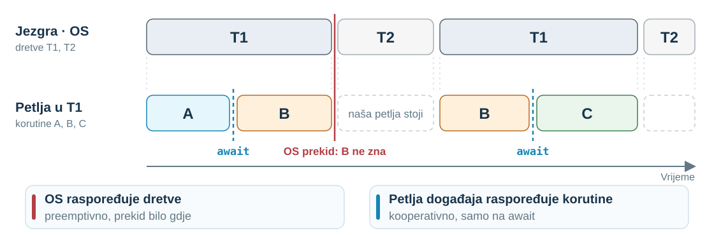{fig-alt="Gore: na jezgri se preemptivno izmjenjuju dretve T1 i T2. Dolje: unutar dretve T1 petlja događaja izvodi korutine A, B i C, koje se mijenjaju samo na await. Dok radi T2, petlja stoji; B nastavlja nakon prekida i ne zna da je bio pauziran." width=100%}

- **Petlja događaja** je obična petlja u jednoj dretvi: raspoređivač u korisničkom prostoru.
- Korutina koja ne dođe do `await` **zaustavlja sve ostale** u toj petlji.

**Između dva `await` kod je nedjeljiv za ostale korutine, ali ne i za druge dretve.**

::: {.notes}
- **Priča:** Ista logika na dvije razine: OS raspoređuje dretve, a petlja događaja korutine unutar jedne dretve.

- **Sažetak:**
  - OS preemptivno izmjenjuje dretve; petlja događaja unutar jedne dretve izmjenjuje korutine samo na await.
  - Petlja događaja je obična petlja u jednoj dretvi: raspoređivač u korisničkom prostoru.
  - Korutina bez await zaustavlja sve ostale; kod između dva await nedjeljiv je za druge korutine, ali ne i za druge dretve.

- Usporedba: dretva ↔ zadatak (Task); red spremnih dretvi ↔ red spremnih poziva petlje; blokirajući syscall ↔ await na I/O (socket se registrira, epoll javi spremnost); sched_yield ↔ await asyncio.sleep(0); preempcija timerom ↔ ne postoji.

- Petlja nije zaseban proces; radi u istoj dretvi kao korutine. OS može pauzirati cijelu dretvu; tada ne radi ni petlja ni ijedna korutina (B ne primijeti prekid).

- Kooperativno kao Windows 3.x i stari Mac OS: tko ne ustupi, zamrzne sve. Dugo računanje: asyncio.to_thread ili ProcessPoolExecutor; debug način upozorava na korake dulje od 100 ms.

- Za portal: provjera i upis bez await između njih ne mogu se ispreplesti s drugim korutinama. Čim je između njih await (upit bazi), mogu: to je utrka s ponovnim pokušajem.

Izvori: [Python, asyncio event loop](https://docs.python.org/3/library/asyncio-eventloop.html); [Python, Developing with asyncio](https://docs.python.org/3/library/asyncio-dev.html).
:::

## Bavljenje zadacima i njihovo izvršavanje {.example-slide}

„**Konkurentnost (concurrency)** znači **baviti se** mnogim stvarima odjednom.

**Paralelizam (parallelism)** znači **raditi** mnogo stvari odjednom.”

— [Rob Pike, *Concurrency is not Parallelism*](https://go.dev/talks/2012/waza.slide), prijevod

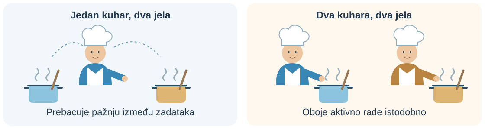{height=240px fig-alt="Jedan kuhar izmjenjuje pažnju između dva jela; dva kuhara mogu raditi istodobno."}

**Paralelno izvršavanje jest konkurentno; konkurentni zadaci ne moraju biti paralelni.**

::: {.notes}
- **Priča:** Učvršćujemo razliku slikom koja se pamti.

- **Sažetak:**
  - Rob Pike: konkurentnost = baviti se mnogim stvarima odjednom; paralelizam = raditi mnogo stvari odjednom.
  - Slika: jedan kuhar izmjenjuje pažnju između dva jela, dva kuhara rade istodobno.
  - Paralelno izvršavanje jest konkurentno; konkurentni zadaci ne moraju biti paralelni.

- Jedan kuhar mijenja pažnju; dva mogu raditi istodobno.

- Analogija opisuje aktivnu pažnju; hrana se može grijati bez nje.

- Pitati: konkurentnost na jednoj jezgri? Da. Paralelno izvršavanje jest konkurentno.

- Poštovati ovisnosti; utrke mijenjaju ishode. Izmjena: čekanje, ustupanje ili prekid raspoređivača.
:::

## Lokalni pozivi i udaljeni zahtjevi

**Provjera roka prelazi na drugi poslužitelj. Što se mijenja za pozivatelja?**

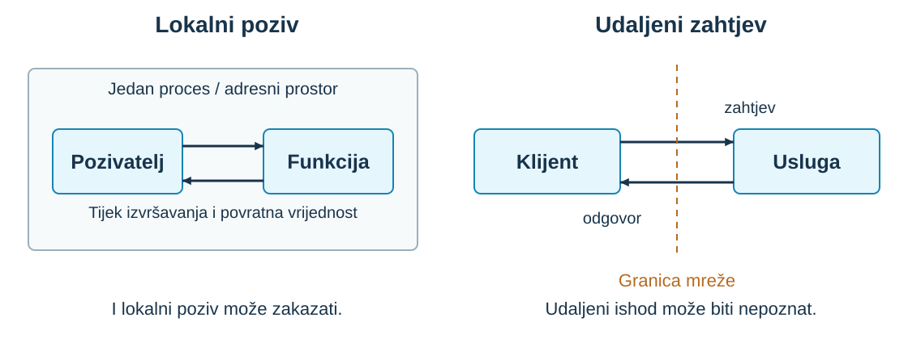{fig-alt="Lokalni poziv ostaje u procesu; udaljeni zahtjev i odgovor prelaze mrežu." height=350px}

Lokalni poziv (**local call**) · udaljeni zahtjev (**remote request**)

::: {.notes}
- **Priča:** Kad posao prijeđe na drugo računalo, poziv postaje poruka preko mreže; tu počinju problemi.

- **Sažetak:**
  - Provjera roka seli na drugi poslužitelj: lokalni poziv postaje zahtjev i odgovor preko mreže.
  - Pitanje slajda: što se time mijenja za pozivatelja?

- Pratiti zahtjev i odgovor preko mreže.

- Udaljeni API nalikuje lokalnom pozivu; komunikacija ipak postoji.

- I lokalni poziv može zakazati; udaljeni učinak može nastati bez vidljivog rezultata.

- Pojedinosti RPC-a dolaze kasnije.

Izvori: [Kleppmann, Distributed Systems](https://www.cl.cam.ac.uk/teaching/2122/ConcDisSys/dist-sys-notes.pdf).
:::

## Isti posao, lokalno i udaljeno {.code-compare-slide}

:::: {.columns}
::: {.column width="33%"}
**Lokalni poziv**

```python
def provjeri_rok(zadatak, sada):
    return sada <= ROKOVI[zadatak]

try:
    ok = provjeri_rok("rs-01", sada)
except KeyError:
    ok = None  # nepoznat zadatak
```

Vrijednost ili iznimka. Izvršilo se **točno jednom**.
:::
::: {.column width="65%"}
**Udaljeni zahtjev**

```python
async def provjeri_rok(klijent, zadatak, sada):
    for pokusaj in range(3):
        t0 = time.perf_counter()
        try:
            r = await klijent.get(f"/zadaci/{zadatak}/rok", timeout=2.0)
            r.raise_for_status()
            return sada <= datetime.fromisoformat(r.json()["rok"])
        except httpx.ConnectError:
            pass   # zahtjev nije poslan: smijemo ponoviti
        except httpx.TimeoutException:
            pass   # spor ili srušen? čitanje smijemo ponoviti
        except httpx.HTTPStatusError as e:
            if e.response.status_code < 500:
                raise  # 404: ponavljanje ne pomaže
        except (KeyError, ValueError):
            raise      # drukčiji odgovor: druga verzija usluge
        finally:
            ms = (time.perf_counter() - t0) * 1000
            log.info("rok %s, pokušaj %d: %.0f ms", zadatak, pokusaj + 1, ms)
        await asyncio.sleep(0.2 * 2**pokusaj + random.uniform(0, 0.1))
    raise RuntimeError("usluga zadataka ne odgovara")
```
:::
::::

**Kod upisa (`POST /predaje`) timeout znači: predaja je možda spremljena, a možda nije.**

::: {.notes}
- **Priča:** Isti posao u kodu: lokalno dva ishoda, udaljeno i treći, „ne znam”.

- **Sažetak:**
  - Lijevo, lokalni poziv: vrijednost ili iznimka; izvršio se točno jednom.
  - Desno, udaljeni zahtjev: timeout, do 3 pokušaja s eksponencijalnim čekanjem i jitterom, razlikovanje grešaka (veza, timeout, 4xx/5xx, neočekivan odgovor), mjerenje trajanja.
  - Kod upisa (POST /predaje) timeout znači: predaja je možda spremljena, a možda nije.

- Lokalno: vrijednost ili iznimka; funkcija se izvršila točno jednom; greška je u našem kodu ili podacima.

- Udaljeno: veza nije uspostavljena (zahtjev nije poslan), istek čekanja (možda je obrađen), greška druge usluge (status 404/503/500), odgovor neočekivanog oblika (druga verzija usluge).

- Provjera roka je čitanje: ponovni pokušaj ništa ne mijenja (idempotentno, Web aplikacije). Problem je upis: ReadTimeout nakon POST /predaje ne kaže je li predaja spremljena.

- Najava: operaciji damo identitet koji preživi ponovni pokušaj (npr. zaglavlje Idempotency-Key s istim predaja_id); razrađujemo u predavanju 03.

- Pitati: koliko dugo čekati? 2 s je naš izbor, a ne jamstvo usluge.

- Ponovni pokušaji: najviše 3, s eksponencijalnim čekanjem (0,2 s, 0,4 s, 0,8 s) i nasumičnim pomakom (jitter), da tisuće klijenata ne udare istodobno (oluja ponavljanja). 4xx ne ponavljamo: zahtjev je kriv. Ponavljamo samo čitanje; upis tek uz identitet operacije.

- finally zapisuje trajanje svakog pokušaja, i uspješnog i neuspješnog: bez toga ne znamo je li usluga spora ili nedostupna. Lokalno ništa od toga ne treba.

Izvori: [AWS Builders’ Library, Timeouts, retries, and backoff with jitter](https://aws.amazon.com/builders-library/timeouts-retries-and-backoff-with-jitter/); [HTTPX, Exceptions](https://www.python-httpx.org/exceptions/); [Waldo et al., A Note on Distributed Computing](https://waldo.scholars.harvard.edu/publications/note-distributed-computing).
:::

## Lanac poziva: pouzdanost se množi {.chain-slide}

```{=html}
<div class="rc-widget" data-lang="hr" data-steps="4"></div>
<script src="assets/reliability-chain.js"></script>
```

::: {.notes}
- **Priča:** Predaja rijetko zove samo jednu uslugu: provjera roka, korisnici, pohrana, obavijest. Već su to četiri udaljena poziva, i svaki mora uspjeti.

- **Sažetak:**
  - Interaktivni simulator: tok od N uzastopnih poziva; svaki uspijeva s p · m, cijeli tok s (p · m)^N.
  - Kartice: simulacija 1000 izvođenja, izračun, obrnuti izračun (koliko pouzdan mora biti korak), pretpostavke.
  - Poruka: pouzdanost komponenti nije isto što i pouzdanost cijelog sustava.

- Zadano „Pouzdan sustav”, N = 4: 0,9999⁴ ≈ 99,96 %. Postaviti p = 99 %: 0,99⁴ ≈ 96 %; svaka 25. predaja negdje zapne. Uz 10 poziva ≈ 90 %.

- Uz N = 10 „Pouzdan sustav” daje 99,900 %. Učitati „Nepouzdan sustav” (p = 98 %, m = 99 %): oko 74 %. Tri postotna boda po pozivu, oko 26 bodova za cijeli tok.

- Pomaknuti mrežu m ispod 100 %: svaki poziv tada uspijeva s p · m. Ispad usluge pada na usluzi, ispad mreže na vezi prije nje.

- Pokrenuti simulaciju: opaženo se razlikuje od teorijskog jer je slučajno, ali je blizu.

- Obrnuti izračun: za 99,9 % cijelog toka kroz 10 koraka svaki korak smije pasti tek oko 100 puta na milijun poziva.

- Isto vrijedi za kašnjenje: ako je 1 % odgovora sporo, zahtjev koji čeka 100 usluga spor je u 63 % slučajeva (Dean i Barroso).

- Pretpostavke: neovisni ispadi, svi koraci potrebni, bez ponovnih pokušaja. Ponovni pokušaj podiže p koraka, ali dodaje opterećenje: na to se vraćamo kod oluje ponavljanja.

Izvori: [Dean i Barroso, The Tail at Scale](https://doi.org/10.1145/2408776.2408794); [Google SRE Book, Embracing Risk](https://sre.google/sre-book/embracing-risk/).
:::

## Moraju li svi čekati jednu predaju?

**Veliko sveučilište. Mnogo studenata. Jedan rok.**

::: {.submission-flow aria-label="Koraci obrade predaje slijeva nadesno"}
1. Primi ZIP
2. Provjeri pravila
3. Raspakiraj i skeniraj
4. Pohrani
5. Prihvati
:::

Pretpostavimo da jedna predaja zahtijeva **20 minuta obrade**.

Jedan izvršitelj završava posao prije sljedećeg: **3 posla/sat**.

**Mogu li drugi studenti slati projekte? Mogu li drugi poslovi napredovati?**

::: {.notes}
- **Priča:** Vraćamo se u portal: što kad tisuće studenata predaju pred rok?

- **Sažetak:**
  - Pet koraka obrade: primi ZIP, provjeri pravila, raspakiraj i skeniraj, pohrani, prihvati.
  - Pretpostavka: 20 minuta po predaji; jedan izvršitelj koji radi posao po posao = 3 posla/sat.
  - Pitanja: mogu li drugi studenti slati projekte i mogu li drugi poslovi napredovati?

- Objasniti pet koraka; 20 minuta je pretpostavka.

- 3 posla/sat vrijedi za jednog izvršitelja i uzastopnu obradu jednakih poslova.

- Pitati (30 s): mogu li prijenosi čekati u zasebnom redu? Može li drugi posao napredovati dok prvi čeka?

- Slijedi: preklapanje i istodobno izvršavanje.

Izvori: [van Steen and Tanenbaum, Distributed Systems](https://www.distributed-systems.net/index.php/books/ds4/); [Waldo et al., A Note on Distributed Computing](https://waldo.scholars.harvard.edu/publications/note-distributed-computing).
:::

## Simulator: latencija i propusnost

```{=html}
<div class="lt-widget" data-lang="hr"></div>
<script src="assets/latency-throughput.js"></script>
```

::: {.notes}
- **Priča:** Isti pojmovi kao na prethodnom slajdu: pomičemo parametre i gledamo što se mijenja.

- **Sažetak:**
  - Interaktivni simulator: latencija, kapacitet veze, veličina projekta i obrada poslužitelja; prikazuje trajanje jedne predaje i propusnost.
  - Gotovi scenariji: mali zahtjev, veliki ZIP, spora provjera, 100 TB mrežom, 100 TB kamionom.
  - Poruka: što dominira ovisi o scenariju; propusnost određuje usko grlo.

- „Mali zahtjev”: oko 152 ms, gotovo sve je latencija. Povećati kapacitet veze: trajanje se ne mijenja.

- „Veliki ZIP”: oko 16 s, dominira slanje; sada veći kapacitet pomaže.

- „Spora provjera”: prijenos je gotov za 180 ms, a obrada traje još 2 s. Veza dopušta 6,25 projekata u sekundi, poslužitelj 0,5: propusnost određuje usko grlo.

- „100 TB mrežom”: 22,2 h. „100 TB kamionom”: 12 h puta. Pitati što model izostavlja: kopiranje, čitanje, provjeru.
:::

## Prisjetimo se Web aplikacija: TTFB

**Vrijeme do prvog bajta (time to first byte, TTFB)** mjeri čekanje na početak odgovora, ne cijelo preuzimanje.

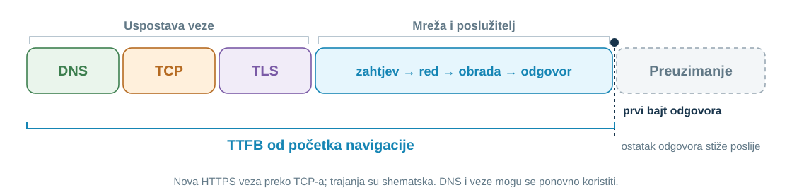{fig-alt="TTFB od početka navigacije uključuje DNS, TCP, TLS i čekanje na prvi bajt. Zatim slijedi preuzimanje." height=280px}

- **Velik kapacitet veze ne jamči nizak TTFB.** Važni su mreža i obrada.
- **Prvi bajt ne dokazuje prihvaćanje.** Što odgovor portala potvrđuje?

::: {.notes}
- **Priča:** Veza s Web aplikacijama: prvi bajt nije potvrda prihvaćanja.

- **Sažetak:**
  - TTFB mjeri čekanje na početak odgovora (DNS, TCP, TLS, čekanje na prvi bajt), ne cijelo preuzimanje.
  - Velik kapacitet veze ne jamči nizak TTFB; važni su mreža i obrada.
  - Prvi bajt ne dokazuje prihvaćanje predaje.

- Navesti početak mjerenja: navigacija uključuje uspostavu veze; početak zahtjeva je isključuje.

- Prikazan novi HTTPS/TCP; DNS predmemorija i postojeća veza skraćuju uspostavu. HTTP/3 rabi QUIC.

- Plavo uključuje put, čekanje i obradu; širine su shematske.

- Prvi bajt ≠ prihvaćanje. Razlikovati potvrdu primitka na obradu od trajnog prihvaćanja.

Izvori: [web.dev, Time to First Byte](https://web.dev/articles/ttfb).
:::

## Jedna komponenta stane; ostale rade

**Portal se otvara, ali usluga zadataka je stala. Što još radi?**

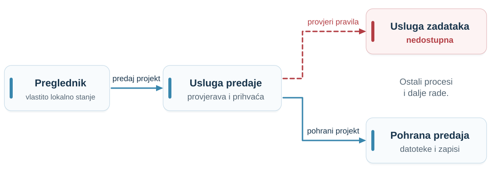{fig-alt="Usluga zadataka nije dostupna, dok drugi procesi i dalje rade." height=268px}

::: {.definition number="1.4"}
**Djelomični ispad (partial failure)** nastaje kada neke komponente prestanu raditi, dok druge nastavljaju.
:::

::: {.notes}
- **Priča:** Dijelovi sustava otkazuju zasebno: djelomični ispad.

- **Sažetak:**
  - Portal se otvara, ali usluga zadataka je stala; ostali procesi rade.
  - Def. 1.4: djelomični ispad nastaje kad neke komponente prestanu raditi, a druge nastavljaju.
  - Što još radi ovisi o tome o čemu ovisi svaka operacija.

- Pitati: može li se dohvatiti stara potvrda dok provjera roka ne radi?

- Ovisi o ovisnostima svake operacije.

- Neki procesi nastavljaju; usluge na istom računalu mogu ispasti zajedno.

Izvori: [Kleppmann, Distributed Systems](https://www.cl.cam.ac.uk/teaching/2122/ConcDisSys/dist-sys-notes.pdf).
:::

## Klijent može biti i druga usluga

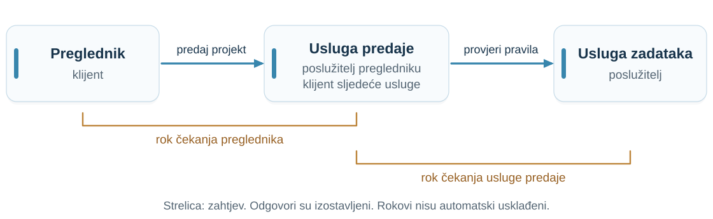{fig-alt="Preglednik poziva uslugu predaje, koja poziva uslugu zadataka. Usluga predaje istodobno je poslužitelj i klijent." height=320px}

**Klijent (client)** i **poslužitelj (server)** uloge su u komunikaciji. Usluga predaje ima obje.

::: {.notes}
- **Priča:** Pripremamo teren: tko koga čeka i tko postavlja rok čekanja.

- **Sažetak:**
  - Preglednik poziva uslugu predaje, a ona poziva uslugu zadataka.
  - Klijent i poslužitelj su uloge u komunikaciji; usluga predaje ima obje.

- Klijent/poslužitelj su uloge; usluga predaje ima obje.

- Svaki pozivatelj može postaviti vlastiti rok čekanja; rokovi nisu automatski usklađeni.
:::

## Istek čekanja (timeout)

**Zašto?** Pozivatelj postavlja rok čekanja da ne čeka zauvijek.

**Timeout znači samo jedno: pozivatelj je odustao od čekanja.**

Timeout **ne**:

- uništava zahtjev
- prekida udaljeni posao
- otkriva ishod

**Slijede tri priče koje završavaju istim timeoutom.**

::: {.notes}
- **Priča:** Vraćamo se početnom timeoutu: što on znači, a što ne.

- **Sažetak:**
  - Pozivatelj postavlja rok čekanja da ne čeka zauvijek.
  - Timeout znači samo jedno: pozivatelj je odustao od čekanja.
  - Timeout ne uništava zahtjev, ne prekida udaljeni posao i ne otkriva ishod.
  - Najava: tri priče koje završavaju istim timeoutom.

- Središnja misao predavanja: timeout prekida čekanje, ne udaljeni rad i njegove učinke.

- Izričito otkazivanje je zasebna poruka i može se utrkivati s dovršetkom.

- Prijelaz: tri slijeda, isto opažanje kod klijenta.
:::

## Slijed A: zahtjev se izgubi

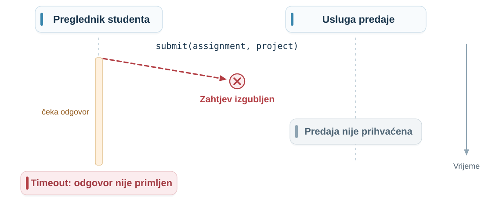{fig-alt="Zahtjev se izgubi prije primitka; predaja nije prihvaćena, a klijentu istekne vrijeme čekanja." height=440px}

::: {.notes}
- **Priča:** Prva priča iza timeouta: zahtjev nije ni stigao.

- **Sažetak:**
  - Slijed A: zahtjev se izgubi prije primitka; predaja nije prihvaćena.
  - Klijentu istekne vrijeme čekanja.

- Čitati prema dolje: cijeli zahtjev nije stigao; nema prihvaćene predaje.

- Strelica znači cijeli zahtjev, ne paket; privremeni dijelovi nisu prihvaćanje.

- Klijent vidi samo izostanak odgovora do roka.

- Pitati: što zna dijagram, a klijent ne zna?

Izvori: [Kleppmann, Distributed Systems](https://www.cl.cam.ac.uk/teaching/2122/ConcDisSys/dist-sys-notes.pdf).
:::

## Slijed B: odgovor se izgubi

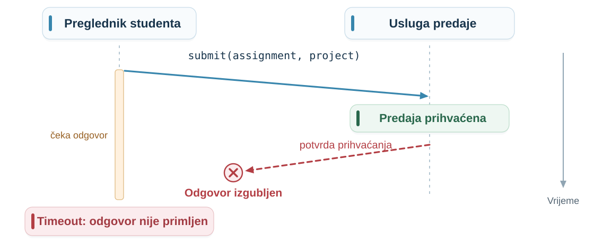{fig-alt="Predaja je prihvaćena i pohranjena; odgovor se izgubi, a klijentu istekne vrijeme čekanja." height=440px}

::: {.notes}
- **Priča:** Druga priča: posao je obavljen, ali odgovor se izgubio.

- **Sažetak:**
  - Slijed B: predaja je prihvaćena i trajno pohranjena, ali se odgovor izgubi.
  - Klijentu istekne vrijeme čekanja, isto kao u slijedu A.

- Prihvaćeno i trajno pohranjeno; potvrda izgubljena.

- Usporediti A: drugo stanje poslužitelja, isti timeout.

- Moguće je i čekanje u redu ili na mreži; slijedovi nisu iscrpni.

Izvori: [Kleppmann, Distributed Systems](https://www.cl.cam.ac.uk/teaching/2122/ConcDisSys/dist-sys-notes.pdf).
:::

## Slijed C: proces poslužitelja se sruši

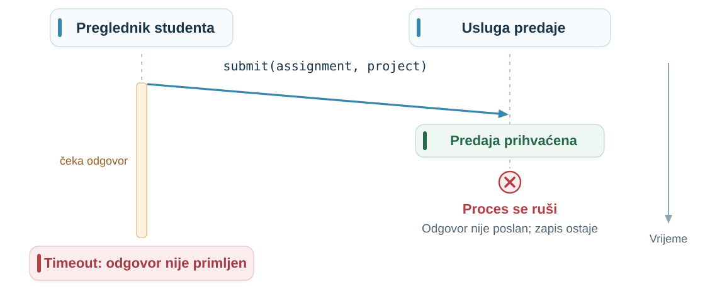{fig-alt="Predaja je trajno prihvaćena; proces se sruši prije odgovora. Zapis ostaje, a klijentu istekne vrijeme čekanja." height=440px}

::: {.notes}
- **Priča:** Treća priča: poslužitelj je spremio predaju i pao prije odgovora.

- **Sažetak:**
  - Slijed C: predaja je trajno prihvaćena, a proces poslužitelja se sruši prije odgovora.
  - Zapis ostaje; klijentu istekne vrijeme čekanja.

- Trajno prihvaćanje → rušenje procesa prije odgovora.

- Zapis ostaje prema pretpostavci; odgovor nije poslan, za razliku od B.

- Rušenje prije prihvaćanja mijenja ishod; timeout ne otkriva trenutak rušenja.

- Neki transporti prijave pogrešku veze. Ponavljanje može duplicirati učinak.
:::

## Isto opažanje, različiti ishodi

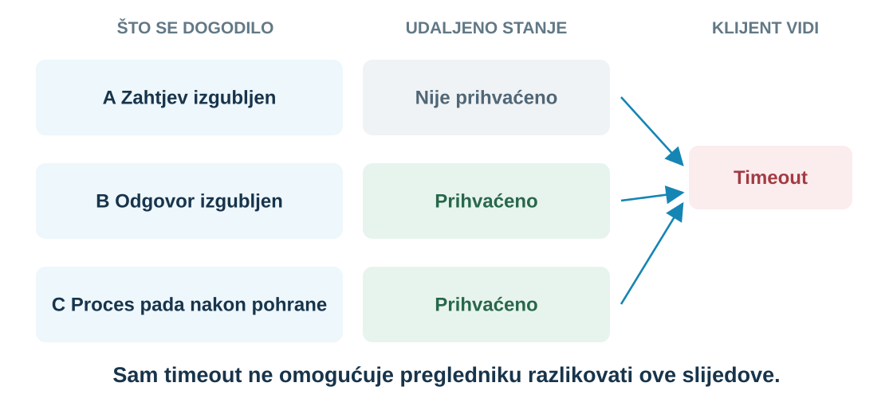{fig-alt="Izgubljen zahtjev znači neprihvaćenu predaju. Izgubljen odgovor ili rušenje nakon pohrane ostavljaju prihvaćenu predaju. Svaki slijed može završiti timeoutom." height=370px}

**Timeout ograničava čekanje; ne određuje udaljeni ishod.**

::: {.notes}
- **Priča:** Spajamo tri priče: isti timeout, različiti ishodi; zato je odgovor na glasanje „ne znamo”.

- **Sažetak:**
  - Usporedba: izgubljen zahtjev → predaja nije prihvaćena; izgubljen odgovor ili rušenje nakon pohrane → predaja je prihvaćena.
  - Svaki slijed klijentu izgleda jednako: timeout.
  - Poruka slajda: timeout ograničava čekanje; ne određuje udaljeni ishod.

- Ponoviti glasanje: C. Isto opažanje, različiti udaljeni učinci.

- Dulji konačni timeout ne uklanja neizvjesnost bez korisne gornje granice.

- Naknadni dokaz/upit statusa može pomoći; sam timeout ne može.

Izvori: [Kleppmann, Distributed Systems](https://www.cl.cam.ac.uk/teaching/2122/ConcDisSys/dist-sys-notes.pdf).
:::

## Treba li klijent pokušati ponovno? {.exercise-slide}

Za svaki slijed predvidite što može učiniti drugi zahtjev.

1. Što može popraviti **ponovni pokušaj (retry)**?
2. Može li nastavnik dobiti dva zapisa predaje?
3. Koji bi podatak označavao istu namjeravanu operaciju?

::: {.notes}
- **Priča:** Prirodna reakcija je ponoviti; studenti predviđaju posljedice.

- **Sažetak:**
  - Vježba: za svaki slijed predvidjeti što može učiniti drugi zahtjev.
  - Tri pitanja: što popravlja ponovni pokušaj, može li nastavnik dobiti dva zapisa, koji podatak označava istu namjeravanu operaciju.

- Parovi (1 min), odgovori (1 min), povezivanje (1 min).

- A: ponavljanje može dostaviti posao. B/C: može duplicirati prihvaćeni posao.

- Idempotentnost: ponavljanje čuva učinak; odgovori se mogu razlikovati.

- ID operacije pomaže samo uz koordiniranu provjeru duplikata i zapis učinka.

- Prijelaz: timeout ne prekida A; B se može preklopiti s njim.

Izvori: [Kleppmann, Distributed Systems](https://www.cl.cam.ac.uk/teaching/2122/ConcDisSys/dist-sys-notes.pdf).
:::

## Ponovni pokušaj može se preklopiti s prvim

**Pozivatelj više ne čeka. Zahtjev možda još putuje, čeka u redu ili se obrađuje.**

::: {.submission-flow}
1. Pošalji pokušaj A
2. Istekne rok čekanja
3. Ponovi kao B
:::

**A i B sada mogu obrađivati istu namjeravanu predaju.**

Primamljiv pristup: **„Ako nema prihvaćenog zapisa, stvori ga.”**

**Što ako oba pokušaja provjere prije nego što ijedan stvori zapis?**

::: {.notes}
- **Priča:** Ponovni pokušaj preklapa se s prvim: konkurentnost se vraća kao problem.

- **Sažetak:**
  - Nakon timeouta pokušaj A možda još putuje, čeka u redu ili se obrađuje; pokušaj B kreće usporedno.
  - A i B mogu obrađivati istu namjeravanu predaju.
  - „Ako nema prihvaćenog zapisa, stvori ga” puca kad oba provjere prije nego što ijedan upiše.

- A/B sada su pokušaji iste predaje, ne različiti studenti.

- Prvi zahtjev nakon timeouta možda još putuje, čeka ili radi.

- Predložiti „provjeri pa stvori”; mogu li oba vidjeti odsutnost?

- Najprije invarijanta, zatim protokol.
:::

## Ponovni pokušaji mogu srušiti uslugu {.storm-slide}

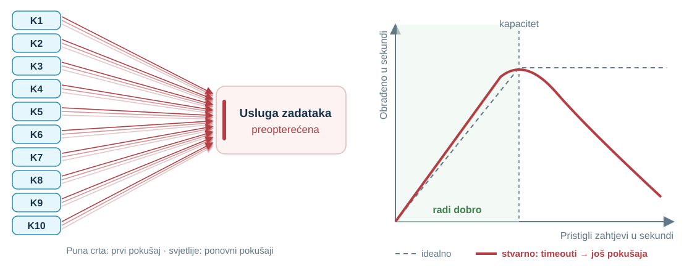{fig-alt="Lijevo deset klijenata, svaki s prvim i dva ponovna pokušaja, šalje zahtjeve istoj preopterećenoj usluzi zadataka. Desno shematska krivulja: do kapaciteta broj obrađenih zahtjeva raste s brojem pristiglih, a iznad kapaciteta pada jer timeouti izazivaju još pokušaja." width=100%}

**Sporiji odgovori → više timeouta → još više pokušaja.** Legitimni klijenti tako izvode **nenamjerni DDoS**: oluju ponavljanja (retry storm).

::: {.notes}
- **Priča:** Ponovni pokušaj pomaže jednom klijentu, ali kad pokušavaju svi, usluga koja pati dobiva još više posla.

- **Sažetak:**
  - Lijevo: deset klijenata s prvim i dva ponovna pokušaja šalje zahtjeve istoj preopterećenoj usluzi.
  - Desno, shematski: do kapaciteta obrađeni zahtjevi rastu s pristiglima, iznad kapaciteta padaju.
  - Petlja: sporiji odgovori → više timeouta → više pokušaja; legitimni klijenti izvode nenamjerni DDoS (oluja ponavljanja).

- Lijevo: 10 klijenata × 3 pokušaja = 30 zahtjeva umjesto 10, baš kad je usluga najsporija.

- Desno: do kapaciteta usluga radi dobro. Iznad njega red raste, odgovori kasne, klijentima istječe čekanje, a usluga i dalje obrađuje zahtjeve na koje više nitko ne čeka. Krivulja je shematska, ne mjerenje.

- Pitati: kako biste vi ograničili štetu? Očekivano: najviše N pokušaja, eksponencijalno čekanje, jitter, budžet ponovnih pokušaja, prekidač strujnog kruga (circuit breaker) kasnije.

- Ovo nije napad: nitko nije zlonamjeran, ali učinak je isti kao kod DDoS-a.

Izvori: [AWS Builders’ Library, Timeouts, retries, and backoff with jitter](https://aws.amazon.com/builders-library/timeouts-retries-and-backoff-with-jitter/); [Google SRE Book, Addressing Cascading Failures](https://sre.google/sre-book/addressing-cascading-failures/).
:::

## Najprije pravilo, zatim protokol {.retry-overlap}

**Nije sve atomarno (atomic) u raspodijeljenim sustavima.** Provjera i upis ovdje su odvojeni koraci.

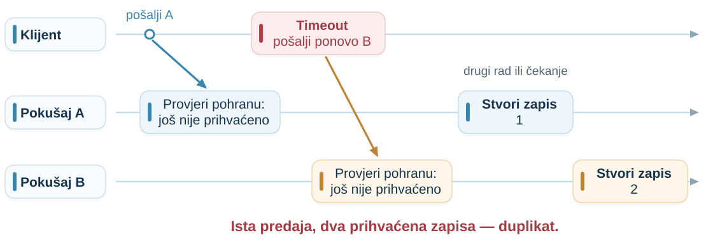{fig-alt="A provjeri pohranu; nakon timeouta B također vidi da nema zapisa. A i B zatim stvaraju dva prihvaćena zapisa iste predaje." height=265px}

::: {.definition number="1.5"}
**Invarijanta (invariant)** je pravilo koje mora vrijediti u svakom dopuštenom stanju sustava.
:::

**Zahtjev:** najviše jedan prihvaćeni zapis po namjeravanoj predaji.

::: {.notes}
- **Priča:** Utrka pokazuje da prije protokola trebamo pravilo: invarijantu.

- **Sažetak:**
  - Provjera i upis su odvojeni, neatomarni koraci: A i B oba vide da nema zapisa i stvore dva prihvaćena zapisa.
  - Def. 1.5: invarijanta je pravilo koje mora vrijediti u svakom dopuštenom stanju sustava.
  - Zahtjev portala: najviše jedan prihvaćeni zapis po namjeravanoj predaji.

- Atomarno = nedjeljivo u odnosu na druge operacije.

- Razmak provjere/upisa: U/I, ustupanje ili raspoređivanje; i kratak razmak dopušta utrku.

- Moguće i na jednom računalu.

- Ista namjeravana predaja; svjesna revizija može biti nova verzija.

- Najviše jedan zapis. Odbijanje svega sigurno je, ali beskorisno.
:::

## Sigurnost i napredovanje {.visual-definitions}

**Odbijemo sve predaje: nema duplikata. Je li portal koristan?**

Trebamo oboje: **bez duplikata** i **konačno prihvaćanje valjanog rada**.

::: {.definition number="1.6"}
**Svojstvo sigurnosti (safety)** zahtijeva da se određeni loš događaj ili stanje nikada ne dogodi.
:::

::: {.definition number="1.7"}
**Svojstvo napredovanja (liveness)** zahtijeva da se određeni napredak konačno ostvari pod navedenim pretpostavkama.
:::

Uvjeti napretka: oporavak usluga, uspješna komunikacija i obrada posla.

::: {.notes}
- **Priča:** Pravilo nije dovoljno: sustav koji sve odbija siguran je, ali beskoristan.

- **Sažetak:**
  - Odbijanje svih predaja izbjegava duplikate, ali portal je beskoristan.
  - Def. 1.6 sigurnost: određeni loš događaj ili stanje nikad se ne dogodi. Def. 1.7 napredovanje: napredak se konačno ostvari pod navedenim pretpostavkama.
  - Portal treba oboje: bez duplikata i konačno prihvaćanje valjanog rada; uvjeti su oporavak, komunikacija i obrada.

- Sigurnost: nikad duplikati. Napredovanje: valjani posao konačno prihvaćen.

- Treba oporavak/dostupnost, komunikaciju, sačuvan/ponovljen posao i obradu.

- „Valjano” uključuje pravilo roka; „konačno” ne daje vremensku granicu.

- Zašto odbijanje svega zadovoljava sigurnost, ali ne napredovanje?
:::

## Sigurnost i napredovanje u različitim sustavima {.property-examples}

| Sustav | Sigurnost (safety): što se ne smije dogoditi? | Napredovanje (liveness): što se mora konačno dogoditi? |
|:---|:---|:---|
| **Plaćanja** | [Ponovni pokušaji naplate isto plaćanje dvaput.]{.fragment fragment-index=1} | [Valjano, odobreno plaćanje se dovrši.]{.fragment fragment-index=2} |
| **Rezervacija sjedala** | [Dva kupca imaju potvrdu za isto sjedalo i događaj.]{.fragment fragment-index=3} | [Svaki zahtjev dobije potvrdu ili odbijenicu.]{.fragment fragment-index=4} |
| **Red poslova** | [Posao je označen dovršenim prije uspjeha.]{.fragment fragment-index=5} | [Svaki valjani posao na čekanju se obradi.]{.fragment fragment-index=6} |
| **Raspodijeljeno zaključavanje (lock)** | [Dva procesa istodobno izvršavaju zaštićeni kritični odsječak.]{.fragment fragment-index=7} | [Svaki ispravan proces koji nastavlja tražiti zaključavanje konačno ga dobije.]{.fragment fragment-index=8} |

**Napredak traži:** oporavak, komunikaciju, sačuvan posao i pravedno raspoređivanje. Proces koji drži zaključavanje mora ga otpustiti ili biti sigurno zamijenjen.

::: {.notes}
- **Priča:** Isti par svojstava prepoznajemo u plaćanjima, rezervacijama, redovima i zaključavanju.

- **Sažetak:**
  - Tablica s otkrivanjem: za plaćanja, rezervaciju sjedala, red poslova i raspodijeljeno zaključavanje po jedno svojstvo sigurnosti i napredovanja.
  - Napredak traži oporavak, komunikaciju, sačuvan posao i pravedno raspoređivanje; zaključavanje se mora otpustiti ili sigurno zamijeniti.

- Otkrivati sigurnost pa napredovanje; stupac sigurnosti navodi zabranjene događaje.

- Plaćanje: ista namjera. Odbijenica zadovoljava obećanje odgovora na rezervaciju.

- Red: istinit status, ne izvršavanje točno jednom; poslovi završavaju ili prijavljuju neuspjeh.

- Zaključavanje: bez izgladnjivanja uz pravednost, konačne odsječke i siguran oporavak.

- Pitati: zašto ne odbiti sva plaćanja?
:::

## Model sustava izričito navodi pretpostavke

**Možemo li obećati konačno prihvaćanje svake valjane predaje ako…**

- struja ostane isključena?
- disk strada i ne ostane obnovljiva kopija?
- kabel bude prekinut, a usluga ostane odspojena?

**Ne.** Nijedan dizajn to ne može obećati; svako obećanje vrijedi samo uz pretpostavke.

**Model sustava (system model)** navodi dopušteno ponašanje i jamstva na koja se algoritam smije osloniti.

Pretpostavke navodimo u tri dimenzije, redom na sljedećim slajdovima: **mreža (network) → čvorovi (nodes) → vrijeme (timing)**.

::: {.notes}
- **Priča:** Obećanja vrijede samo uz pretpostavke: uvodimo model sustava.

- **Sažetak:**
  - Tri slučaja u kojima ne možemo obećati prihvaćanje: struja ostane isključena, disk strada bez kopije, usluga ostane odspojena. Odgovor: ne; obećanja vrijede samo uz pretpostavke.
  - Model sustava navodi dopušteno ponašanje i jamstva na koja se algoritam smije osloniti.
  - Pretpostavke navodimo u tri dimenzije: mreža, čvorovi, vrijeme.

- Ispadi ugrožavaju napredovanje; zaustavljen sustav može izbjeći duplikate.

- Privremeni poremećaj dopušta oporavak; trajan gubitak/odspojenost može spriječiti napredak.

- Model = ponašanje + pretpostavke; jamstvo pokriva sva dopuštena izvršavanja.

- Izostanak duplikata tvrdnja je koju algoritam mora ostvariti, ne dar modela.

- Slijedi: mreža, čvorovi, vrijeme.

Izvori: [Kleppmann, Distributed Systems](https://www.cl.cam.ac.uk/teaching/2122/ConcDisSys/dist-sys-notes.pdf).
:::

## Pretpostavke mreže: prolaze li poruke?

**Kabel je prekinut: vraća li se komunikacija ili ostaje prekinuta?**

Ponavljanje pomaže samo ako neki kasniji pokušaj može stići.

| Što mreža smije učiniti? | Što to znači za portal? |
|:---|:---|
| Izgubiti, duplicirati ili promijeniti redoslijed poruka | Obraditi ponovljene zahtjeve i promijenjeni redoslijed. |
| Kasniti, ali uporno ponavljanje konačno uspijeva | Dostava je moguća, bez fiksnog roka. |
| Trajno se podijeliti (network partition) | Prihvaćanje koje treba tu komunikaciju ne napreduje. |

**Za portal:** prva dva retka; nitko usput ne mijenja niti lažira poruke. Tijekom particije čuvamo sigurnost, a napredak čeka oporavak veze.

::: {.notes}
- **Priča:** Prva dimenzija modela: što mreža smije raditi s porukama.

- **Sažetak:**
  - Ponavljanje pomaže samo ako neki kasniji pokušaj može stići.
  - Tri pretpostavke: poruke se gube, dupliciraju ili mijenjaju redoslijed; uporno ponavljanje konačno uspijeva; trajna particija blokira sve pokušaje.
  - Za portal: prva dva retka, bez lažiranja poruka; tijekom particije sigurnost ostaje, napredak čeka oporavak veze.

- Pitati (30 s): pomažu li pokušaji ako se put nikad ne oporavi?

- Fair loss: uporni pokušaji između ispravnih sudionika konačno uspiju; bez fiksnog roka.

- Pouzdane veze: konačna dostava bez duplikata/lažnih poruka; redoslijed je zaseban.

- Privremene particije odgađaju; trajne krše uvjet konačne komunikacije.

- Duplikat poruke ≠ ponovljeni poziv; neovlaštene izmjene isključene.

- Slijedi: što ako primatelj padne?

Izvori: [Kleppmann, Distributed Systems](https://www.cl.cam.ac.uk/teaching/2122/ConcDisSys/dist-sys-notes.pdf).
:::

## Tri modela ispada čvorova

**Usluga stane nakon prihvaćanja projekta. Što se događa kad se vrati?**

| Model | Što čvor smije učiniti | Primjer u portalu |
|:---|:---|:---|
| **Ispad bez oporavka (crash-stop)** | Stane i više se ne vraća. | Izvršitelj se sruši; ostali moraju završiti bez njega. |
| **Ispad s oporavkom (crash-recovery)** | Stane i kasnije se vrati; zadrži samo ono što je na disku. | Prihvaćeni zapisi ostaju u trajnoj pohrani; red u memoriji nestaje. |
| **Bizantski model (Byzantine)** | Odstupi od protokola: laže ili proturječi. | Neispravna usluga studentu kaže „prihvaćeno”, a nastavniku „nije prihvaćeno”. |

: {tbl-colwidths="[30,30,40]"}

Modeli opisuju dopušteno ponašanje, ne trenutak otkrivanja ispada. **Za portal: ispad s oporavkom.**

::: {.notes}
- **Priča:** Druga dimenzija: kako komponente smiju otkazati.

- **Sažetak:**
  - Crash-stop: sudionik trajno staje. Crash-recovery: ponovno se pokrene, trajni zapisi ostaju, red u memoriji nestaje. Bizantski: proturječni ili lažni odgovori.
  - Modeli opisuju dopušteno ponašanje, ne trenutak otkrivanja ispada. Za portal biramo ispad s oporavkom.

- Pitati što preživi ponovno pokretanje: trajni zapisi nasuprot memoriji.

- Crash-stop: sudionik više ne radi korake; nema oslanjanja na povratak.

- Crash-recovery: vraća se; navesti što ostaje.

- Byzantine: odstupa od protokola, uključujući proturječne odgovore.

- Alternativni modeli, ne faze; ne jamče trenutno otkrivanje.

Izvori: [Kleppmann, Distributed Systems](https://www.cl.cam.ac.uk/teaching/2122/ConcDisSys/dist-sys-notes.pdf).
:::

## Koliko dugo portal treba čekati?

**Usluga zadataka obično brzo odgovori. Danas šuti.**

- Beskonačno čekanje ostavlja studenta bez rezultata.
- Ponovni pokušaj može se preklopiti s poslom koji još traje.

Mi, **arhitekti sustava i programeri**, biramo timeout; time ne stvaramo jamstvo brzine odgovora.

**Koje jamstvo razlikuje „sporo” od „zaustavljeno”?** To određuje vremenski model.

> **💡 Uvid:** prekratki timeouti i agresivni ponovni pokušaji mnogih klijenata mogu stvoriti **oluju ponavljanja (retry storm)**: samouzrokovanu uskratu usluge s učincima poput DDoS-a.

::: {.notes}
- **Priča:** Treća dimenzija počinje praktičnim pitanjem: koliko dugo čekati?

- **Sažetak:**
  - Beskonačno čekanje ostavlja studenta bez rezultata; ponovni pokušaj se može preklopiti s poslom koji još traje.
  - Timeout biramo mi; on ne stvara jamstvo brzine odgovora. Prekratki timeouti i agresivni pokušaji → oluja ponavljanja.
  - Završno pitanje vodi na sljedeći slajd: koje jamstvo razlikuje „sporo” od „zaustavljeno”? To određuje vremenski model.

- Pitati (20 s): je li rok navika ili jamstvo?

- Arhitekti/programeri biraju politiku, ne granicu odziva ovisne usluge.

- Granica cijelog poziva: dostava + obrada + odgovor.

- Petlja: sporost → timeout → pokušaji/opterećenje → veća sporost.

- Legitimni klijenti mogu uskratiti uslugu; ograničiti pokušaje, backoff + jitter.

- Sigurnost ponavljanja je zaseban zahtjev.

Izvori: [AWS Builders’ Library, Timeouts, retries, and backoff with jitter](https://aws.amazon.com/builders-library/timeouts-retries-and-backoff-with-jitter/); [Kleppmann, Distributed Systems](https://www.cl.cam.ac.uk/teaching/2122/ConcDisSys/dist-sys-notes.pdf).
:::

## Vremenski modeli: što smijemo pretpostaviti? {.timing-comparison}

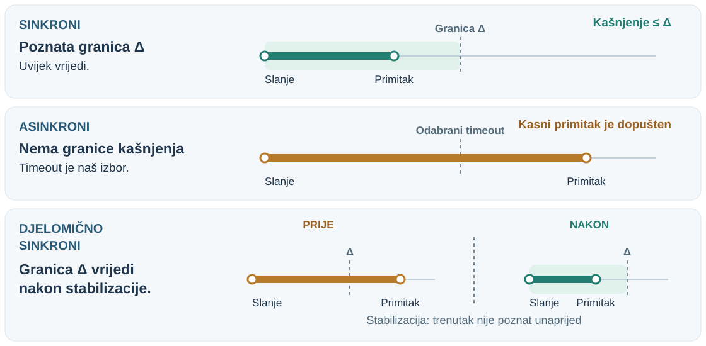{fig-alt="Sinkroni model ima poznatu granicu kašnjenja, asinkroni nema. U prikazanoj djelomičnoj sinkronosti granica vrijedi nakon nepoznatog trenutka stabilizacije." height=370px}

Sinkroni (**synchronous**), asinkroni (**asynchronous**), djelomično sinkroni (**partially synchronous**).

Zagušenje i zastoji motiviraju djelomičnu sinkronost. To je **pretpostavka**, ne „99 % brzo” ni jamstvo Interneta.

**Cilj: sigurnost tijekom poremećaja; napredak nakon stabilizacije.**

::: {.notes}
- **Priča:** Formaliziramo vrijeme: što smijemo pretpostaviti o kašnjenju.

- **Sažetak:**
  - Sinkroni model: poznata granica kašnjenja. Asinkroni: nema granice. Djelomično sinkroni: granica vrijedi nakon nepoznatog trenutka stabilizacije.
  - Djelomična sinkronost je pretpostavka, ne „99 % brzo” ni jamstvo Interneta.
  - Cilj: sigurnost tijekom poremećaja, napredak nakon stabilizacije.

- Δ = gornja granica, ne prosjek. Asinkroni primitak može kasniti iza timeouta.

- Eventual synchrony: nepoznata konačna stabilizacija, zatim granice vrijede do kraja.

- Ne „99 % brzo”; nema obavijesti o stabilizaciji ni jamstva Interneta.

- Stvarni sustavi opet postaju nestabilni; korisno stabilno razdoblje ovisi o algoritmu.

- Sigurnost/napredak treba ostvariti; modeli vremena ≠ blokirajući/async API-ji.

Izvori: [Kleppmann, Distributed Systems](https://www.cl.cam.ac.uk/teaching/2122/ConcDisSys/dist-sys-notes.pdf).
:::

## etcd: isti ključ stvara samo jedan klijent {.example-slide .system-example}

**etcd** je replicirana pohrana parova (ključ: vrijednost) u kojoj raspodijeljeni sustavi (npr. Kubernetes) drže konfiguraciju i podatke za koordinaciju. Primjer: **dva klijenta istodobno pokušavaju stvoriti isti ključ**, kao A i B s istom predajom.

| O čemu zaključujemo | Klaster etcd s tri člana |
|:---|:---|
| **Pretpostavke modela** | **Čvorovi:** ispad s oporavkom, stanje na disku; ne lažu. **Mreža:** poruke kasne, moguća particija. **Vrijeme:** napredak traži djelomičnu sinkronost. |
| **Sigurnost (invarijanta)** | Naredba „ako ključ ne postoji, stvori ga” (create-if-absent) izvršava se kao jedan nedjeljiv (atomic) korak, pa **uspijeva samo jedan klijent**, sve dok se ključ ne izbriše. Da su čitanje i upis dva zasebna poziva (read-then-write), oba bi klijenta mogla vidjeti da ključa nema i oba ga upisati. |
| **Napredovanje** | Zahtjevi se izvršavaju ako su **barem 2 od 3 člana (većina, majority)** dostupna i imaju vođu (leader), a kašnjenja nisu tolika da se vođa stalno mijenja. |

**Tijekom particije 2 + 1:** većina i dalje potvrđuje upise. Odsječeni član ne potvrđuje nijedan upis, pa preko njega nitko ne može stvoriti isti ključ.

::: {.notes}
- **Priča:** Stvarni sustav rješava naš problem duplikata atomarnim „stvori ako ne postoji”.

- **Sažetak:**
  - etcd: replicirana pohrana ključ–vrijednost (npr. za Kubernetes); dva klijenta istodobno stvaraju isti ključ.
  - Model u tri dimenzije: čvorovi s oporavkom (ne lažu), mreža s kašnjenjem i particijom, za napredak djelomična sinkronost.
  - Sigurnost: atomarni create-if-absent → uspijeva samo jedan klijent. Napredak: dostupna većina (2 od 3) s vođom.
  - Particija 2 + 1: većina i dalje potvrđuje upise, odsječeni član ne može potvrditi nijedan.

- Replika = održavana kopija; većina = 2/3.

- Atomarna provjera odsutnosti + stvaranje dopušta jednog dobitnika; odvojeni pozivi ne.

- Bez brisanja, isteka ili zaobilaznog upisa; vanjski resursi trebaju fencing.

- Pouzdani članovi, oporavak i trajno stanje; napredak treba stabilnu većinu.

- Timeout ostavlja neizvjesnost; opcionalno serializable čitanje može biti zastarjelo.

- Što ostaje kad manjina ne napreduje? Sigurnost.

Izvori: [etcd API guarantees](https://etcd.io/docs/v3.6/learning/api_guarantees/); [failure modes](https://etcd.io/docs/v3.6/op-guide/failures/); [Raft paper](https://raft.github.io/raft.pdf).
:::

## Cassandra: što odgovor obećava? {.example-slide .system-example .dense-table}

**Apache Cassandra** je raspodijeljena NoSQL baza koja iste podatke čuva na više poslužitelja. Primjer: **tri kopije podataka (replike); čitanje i upis čekaju potvrdu samo jedne (consistency level ONE)**.

| O čemu zaključujemo | Ova konfiguracija Cassandre |
|:---|:---|
| **Pretpostavke modela** | **Čvorovi:** ispad s oporavkom; replike ne lažu. **Mreža:** poruke kasne, moguća particija. **Vrijeme:** bez granice kašnjenja; replike se usklađuju kasnije. |
| **Sigurnost (invarijanta)** | Za uspjeh je dovoljna potvrda jedne replike. Čitanje zato može vratiti stari podatak, pa „pročitaj pa upiši” **ne sprječava** da se isto sjedalo proda dvaput. |
| **Napredovanje** | Operacija uspijeva čim odgovori jedna dostupna replika. Ostale replike dobiju promjenu kasnije, kad se veza oporavi i popravak (repair) dostavi sačuvane promjene. |
| **U odnosu na etcd** | etcd prije potvrde traži **većinu i jedan redoslijed** upisa (Raft); u particiji manjina ne piše. Cassandra s ONE potvrđuje nakon **jedne replike** i usklađuje kasnije: obje strane particije pišu, a pri sukobu pobjeđuje novija vremenska oznaka. |

**Izbor je važan:** razina QUORUM čeka većinu (2 od 3), a za uvjet „prodaj samo ako je slobodno” treba jača koordinacija, npr. lake transakcije (lightweight transactions, LWT).

::: {.notes}
- **Priča:** Kontrast: slabija konfiguracija daje brzinu, ali ne čuva naše pravilo.

- **Sažetak:**
  - Cassandra s tri replike i razinom ONE: čitanje i upis čekaju potvrdu jedne replike.
  - Sigurnost: čitanje može vratiti stari podatak, pa „pročitaj pa upiši” ne sprječava dvostruku prodaju sjedala.
  - Napredak: dovoljna je jedna dostupna replika; ostale se usklade kasnije (repair).
  - Za razliku od etcd-a obje strane particije pišu, a pobjeđuje novija vremenska oznaka; jače opcije su QUORUM i LWT.

- RF=3; ONE čeka relevantnu repliku, ne znači samo jednu kopiju.

- Obične operacije jedne ćelije; bez brojača/brisanja/LWT-a.

- Zastarjela čitanja mogu dvaput rezervirati; jedna konačna vrijednost ne poništava obećanja.

- Usklađivanje treba sačuvane promjene, popravak, komunikaciju i prestanak novih upisa.

- „Posljednje” prema vremenskoj oznaci, ne nužno stvarnom redoslijedu.

- Razlika od etcd-a: etcd bira dosljednost (CP: bez većine nema upisa), Cassandra s ONE dostupnost i brzinu (AP: upisuje se i u manjini, usklađuje kasnije). Isti problem duplikata etcd rješava, Cassandra s ONE ne.

- QUORUM ne čini provjeru/upis atomarnima; LWT dodaje uvjetnu koordinaciju.

Izvori: [Dynamo architecture](https://cassandra.apache.org/doc/stable/cassandra/architecture/dynamo.html); [guarantees](https://cassandra.apache.org/doc/stable/cassandra/architecture/guarantees.html); [hints and repair](https://cassandra.apache.org/doc/stable/cassandra/managing/operating/hints.html).
:::

## Bitcoin: potvrde povećavaju pouzdanost {.example-slide .system-example}

Zajednička povijest plaćanja u **otvorenoj mreži s mogućim zlonamjernim sudionicima**.

| O čemu zaključujemo | Bitcoinov dokaz rada (proof of work) |
|:---|:---|
| **Pretpostavke modela** | **Čvorovi:** bizantski, ali **većinski pošten hash-rate** (računalna snaga, ne broj čvorova); sigurna kriptografija. **Mreža i vrijeme:** blokovi se šire mnogo brže nego što nastaju novi. |
| **Sigurnost (invarijanta)** | Valjani lanac ne troši isti izlaz transakcije dvaput. Čvorovi privremeno mogu pratiti različite grane; **konačnost je probabilistička**. |
| **Napredovanje** | Rudarenje i komunikacija omogućuju rast lanca. Transakcija mora ostati valjana, stići rudarima i biti odabrana; **nema fiksnog roka uključivanja**. |

**Tijekom particije:** rastu konkurentske grane. Potvrde smanjuju rizik poništenja pod pretpostavkama; ne svode ga na nulu.

::: {.notes}
- **Priča:** Krajnji slučaj: zlonamjerni sudionici i probabilistička sigurnost.

- **Sažetak:**
  - Bitcoin: zajednička povijest plaćanja u otvorenoj mreži s mogućim zlonamjernim sudionicima.
  - Model: bizantski čvorovi uz većinski pošten hash-rate, sigurna kriptografija, blokovi se šire mnogo brže nego što nastaju.
  - Sigurnost: valjani lanac ne troši isti izlaz dvaput; konačnost je probabilistička. Napredak: lanac raste, bez fiksnog roka uključivanja.
  - U particiji rastu konkurentske grane; potvrde smanjuju rizik poništenja, ali ne na nulu.

- Protivničko okruženje; većinski pošten hash-rate, kriptografija, dovoljno brzo širenje.

- Valjani lanac ne troši izlaz dvaput; proturječne grane mogu postojati.

- Potvrde pod pretpostavkama smanjuju rizik poništenja, ne na nulu.

- Većina znači hash-rate, ne broj čvorova; bira se najveći kumulativni rad.

- Rast traži rudarenje/komunikaciju; uključivanje transakcije i odabir, bez fiksnog roka.

- Većinski hash-rate ne može nametnuti nevaljan potpis poštenim čvorovima.

Izvori: [Bitcoin whitepaper](https://bitcoin.org/bitcoin.pdf); [Bitcoin developer guide: block chain](https://developer.bitcoin.org/devguide/block_chain.html).
:::

## Naš portal: pretpostavke iza obećanja {.dense-table}

**Cilj:** ponovni pokušaj ne smije stvoriti drugi prihvaćeni zapis, ni nakon ponovnog pokretanja usluge. Model čine **razumne pretpostavke koje mi kao arhitekti možemo predvidjeti**: kvarovi na koje naš dizajn mora računati.

| Dimenzija | Što pretpostavljamo |
|:---|:---|
| Mreža | Zahtjevi i odgovori mogu kasniti, nestati, ponoviti se ili promijeniti redoslijed; nitko ih usput ne mijenja. |
| Čvorovi | **Ispad s oporavkom:** usluge se mogu srušiti i ponovno pokrenuti; zapisi na disku (RAID) ostaju, sadržaj radne memorije (RAM) se gubi. |
| Vrijeme | **Asinkrono:** nema zajamčenog najduljeg vremena odgovora. |

: {tbl-colwidths="[18,82]"}

**Za konačno prihvaćanje:** usluge konačno ostaju dostupne, komunikacija uspijeva, a sačuvani ili ponovljeni posao se obrađuje.

::: {.notes}
- **Priča:** Sve tri dimenzije modela primjenjujemo na naš portal.

- **Sažetak:**
  - Cilj: ponovni pokušaj ne smije stvoriti drugi prihvaćeni zapis, ni nakon ponovnog pokretanja usluge.
  - Mreža: kašnjenje, gubitak, ponavljanje i promjena redoslijeda, bez izmjena. Čvorovi: ispad s oporavkom (disk ostaje, RAM se gubi). Vrijeme: asinkrono, nema zajamčenog najduljeg odgovora.
  - Za konačno prihvaćanje: usluge su konačno dostupne, komunikacija uspijeva, sačuvani ili ponovljeni posao se obrađuje.

- Pretpostavke nisu činjenice o sustavu: predviđamo ih mi, arhitekti, a dizajn vrijedi samo dok one vrijede.

- Jedan primjer modela, ne univerzalni model portala.

- Sigurnost pri svim dopuštenim preklapanjima/oporavcima; trajna pohrana sama nije dovoljna.

- Trajna particija prekida konačnu komunikaciju; sačuvati sigurnost bez napretka.

- Blizina WWW/LAN ne jamči sinkronost; isti domaćin dijeli ispade.

- Nepouzdani klijenti ne zahtijevaju automatski bizantski konsenzus pouzdanih poslužitelja.

Izvori: [Kleppmann, Distributed Systems](https://www.cl.cam.ac.uk/teaching/2122/ConcDisSys/dist-sys-notes.pdf).
:::

## Uvijek isti izbori, različite postavke {.system-example .dense-table}

**Svaki raspodijeljeni sustav donosi iste odluke. Razlikuju se po tome što nude kao postavku i koje funkcije daju.**

| Odluka | Što biramo i što to košta | Primjer postavke |
|:---|:---|:---|
| **RAM ili disk** | Potvrditi tek nakon trajnog upisa (sigurno, sporije) ili prije njega (brže, rušenje gubi zadnje upise). | Redis `appendfsync` (always / everysec / no); PostgreSQL `synchronous_commit` |
| **Particije su uvijek moguće** | Ne biramo hoće li ih biti, nego što radimo dok traju: čekamo (dosljednost) ili odgovaramo (dostupnost). | etcd: manjina ne piše; Cassandra s ONE: piše i manjina |
| **Razina konzistentnosti** | Jaka za ono što ne smije poći krivo, slabija za ono što smije kasniti. | Cassandra ONE / QUORUM / ALL po upitu; etcd linearizabilno ili serijalizabilno čitanje |
| **Brzina** | I bez particije: čekamo potvrde replika (dosljedno, sporije) ili odgovaramo odmah (brže, moguće zastarjelo). | PostgreSQL asinkrona (zadano) ili sinkrona replikacija (`synchronous_standby_names`) |

: {tbl-colwidths="[18,46,36]"}

**Funkcije čine razliku:** etcd nudi atomarni „stvori ako ne postoji”, Cassandra lake transakcije (LWT). Bez njih istu invarijantu moramo graditi sami.

::: {.notes}
- **Priča:** Nakon tri sustava i našeg portala izvlačimo obrazac: odluke su uvijek iste, a sustavi se razlikuju po postavkama i funkcijama.

- **Sažetak:**
  - Četiri odluke: RAM ili disk, ponašanje tijekom particije, razina konzistentnosti, brzina.
  - Za svaku: što biramo, koja je cijena i primjer stvarne postavke (Redis, PostgreSQL, etcd, Cassandra).
  - Funkcije poput atomarnog „stvori ako ne postoji” ili LWT-a odlučuju moramo li invarijantu graditi sami.
  - Za portal (samo u bilješkama, pitati studente): prihvaćeni zapis tek nakon trajnog upisa i uz jaku konzistentnost; popis predaja za nastavnika smije kasniti nekoliko sekundi.

- RAM ili disk veže se na ispad s oporavkom: što nije na disku, nestaje pri rušenju. Redis zadano radi fsync svake sekunde; PostgreSQL s isključenim synchronous_commit potvrđuje prije upisa WAL-a na disk.

- Particije: rijetke su, ali se u mreži ne mogu isključiti; CAP ograničava samo ponašanje tijekom particije (Brewer).

- Brzina: čim se podaci repliciraju, i bez particije biramo između dosljednosti i latencije (Abadi, PACELC).

- Razina konzistentnosti često se bira po operaciji, ne za cijeli sustav: isti klaster Cassandre može čitati s ONE i pisati s QUORUM.

- Pitati: što u portalu smije biti zastarjelo, a što ne? Očekivano: popis predaja smije; potvrda prihvaćanja ne smije.

- Detaljnije: replikacija (predavanje 06), konsenzus (07), transakcije (09).

Izvori: [Brewer, CAP Twelve Years Later](https://www.infoq.com/articles/cap-twelve-years-later-how-the-rules-have-changed/); [Abadi, Consistency Tradeoffs in Modern Distributed Database System Design](https://www.cs.umd.edu/~abadi/papers/abadi-pacelc.pdf); [Redis persistence](https://redis.io/docs/latest/operate/oss_and_stack/management/persistence/); [PostgreSQL, Asynchronous Commit](https://www.postgresql.org/docs/current/wal-async-commit.html); [PostgreSQL, Synchronous Replication](https://www.postgresql.org/docs/current/warm-standby.html).
:::

## 🔥 Kako razviti loš sustav

**Oslonite se na pretpostavke koje niste provjerili:**

:::: {.columns}
::: {.column width="50%"}
- Mreža uvijek dostavlja.
- Komunikacija ne traje.
- Kapacitet veze je neograničen.
- Mreža je automatski sigurna.
:::
::: {.column width="50%"}
- Topologija se ne mijenja.
- Jedan administrator upravlja svime.
- Prijenos podataka ništa ne košta.
- Sve komponente govore istim jezikom.
:::
::::

**Umjesto toga: navedite pretpostavke i objasnite što slijedi kada ne vrijede.**

::: {.notes}
- **Priča:** Suprotan primjer: što se dogodi kad pretpostavke prešutimo.

- **Sažetak:**
  - Osam prešutnih pretpostavki (zablude raspodijeljenog računarstva): mreža uvijek dostavlja, komunikacija ne traje, neograničen kapacitet, sigurna mreža, nepromjenjiva topologija, jedan administrator, besplatan prijenos, isti jezik.
  - Umjesto toga: navesti pretpostavke i objasniti što slijedi kad ne vrijede.

- Pregled (35 s); koja pretpostavka pada u priči o timeoutu (25 s)?

- „Jedan administrator” = ovlasti/politike; „isti jezik” = protokoli/formati/verzije/značenje.

- Apstrakcije mogu dati uvjetna jamstva; problem su skrivene pretpostavke.

- Slijedi: povratak na početno pitanje — je li portal prihvatio projekt?

Izvori: [Oracle, Fallacies of distributed systems](https://blogs.oracle.com/developers/fallacies-of-distributed-systems).
:::

## Natrag na početak: je li portal prihvatio projekt?

**Još ne znamo, i sada znamo zašto.**

- **Djelomični ispad:** neke komponente stanu, druge rade.
- **Istek čekanja:** ograničava čekanje, ne otkriva ishod.
- **Invarijanta:** najviše jedan prihvaćeni zapis po predaji.
- **Sigurnost i napredovanje:** loše se nikad ne dogodi; dobro se konačno dogodi.
- **Model sustava:** izričite pretpostavke o mreži, čvorovima i vremenu.

**Siguran ponovni pokušaj traži pravilo i pretpostavke, a ne samo dulji timeout.**

::: {.notes}
- **Priča:** Zatvaramo krug: odgovor na glasanje je C, i sad znamo zašto.

- **Sažetak:**
  - Odgovor: još ne znamo (C), i sada znamo zašto.
  - Pet pojmova: djelomični ispad, istek čekanja, invarijanta, sigurnost i napredovanje, model sustava.
  - Siguran ponovni pokušaj traži pravilo i pretpostavke, a ne samo dulji timeout.

- Vratiti se na glasanje s početka: tko je glasao C? Odgovor C je točan jer isto opažanje odgovara različitim ishodima.

- Pitati (15 s): koji je pojam još nejasan?

- Prijelaz (15 s): rok stiže prije kraja obrade; što biste izgradili?

- Popis koraka za zaključivanje ostaje u poglavlju (slika reasoning-checklist).
:::

## Osmislite sljedeći korak: predaja na vrijeme? {.exercise-slide}

Rok je **ponoć**.

Prijenos završi u **23:59**, a provjere u **00:19**.

**Kako student može znati je li predao na vrijeme, čak i nakon zatvaranja preglednika?**

Predložite što **pohraniti i prikazati**, **jedno pravilo koje treba očuvati** te pretpostavke o **mreži, ponovnom pokretanju i vremenu**.

::: {.notes}
- **Priča:** Naučeno primjenjujemo na novi problem s rokom i potvrdom.

- **Sažetak:**
  - Rok je ponoć; prijenos završi u 23:59, provjere u 00:19.
  - Pitanje: kako student može znati je li predao na vrijeme, i nakon zatvaranja preglednika?
  - Studenti predlažu što pohraniti i prikazati, jedno pravilo koje treba očuvati te pretpostavke o mreži, ponovnom pokretanju i vremenu.

- Pitati (10 s): što ostaje nakon zatvaranja preglednika?

- Razmisliti (25 s): što pohraniti/prikazati?

- Raspraviti (30 s): koji događaj vrijedi? Završetak u pregledniku ≠ trajni primitak.

- Poticaji: ID/vrijeme potvrde, „primljeno, provjere u tijeku”, dohvat statusa.

- Izazov (25 s): rušenje tijekom provjera; što ostaje i omogućuje dovršetak?

- Najviše jedan prihvaćeni zapis; protokol razvijamo kasnije.
:::

## Domaća zadaća: računi 1, 2, 3, … {.exercise-slide}

Tvrtka izdaje račune s **više poslužitelja**. Brojevi moraju ići **slijedno: bez ponavljanja i bez preskakanja**.

1. Napišite pravilo (invarijantu) koje sustav mora očuvati.
2. Dva poslužitelja istodobno izdaju račun. Tko dodjeljuje broj?
3. Poslužitelj uzme broj 42 i sruši se prije spremanja računa. Što je s brojem 42?
4. Blagajni istekne vrijeme čekanja pa pokuša ponovno. Kako izbjeći dva računa?

**Postoji li rješenje u kojem ništa ne žrtvujete: ni dostupnost, ni brzinu, ni strogi slijed?** Ako ne, što biste žrtvovali?

::: {.notes}
- **Priča:** Ideje prenosimo na problem iz prakse i ostavljamo pitanje za kasnija predavanja.

- **Sažetak:**
  - Računi s više poslužitelja; brojevi idu slijedno, bez ponavljanja i bez preskakanja.
  - Četiri pitanja: invarijanta, tko dodjeljuje broj, što s brojem 42 nakon rušenja, kako izbjeći dva računa nakon timeouta.
  - Završno: postoji li rješenje bez žrtve dostupnosti, brzine ili strogog slijeda; ako ne, što žrtvovati?

- Zadati za doma; ne rješavati na satu. Stvarni problem iz nastavnikove prakse.

- Smjerovi za raspravu idući put: jedan brojač = usko grlo i jedinstvena točka ispada; rupa (rušenje nakon dodjele) ≠ duplikat (ponovni pokušaj); identifikator zahtjeva čini ponovni pokušaj sigurnim (idempotentnost, Web aplikacije); raspon brojeva po poslužitelju čuva jedinstvenost, ali ne globalni slijed.

- Mogući izlaz: brojiti zasebno po naplatnom uređaju ili poslovnom prostoru. Hrvatska fiskalizacija tako označava račune (broj/poslovni prostor/uređaj) — provjeriti važeći pravilnik prije navođenja.

- Završno pitanje: očekivani zaključak je da takvo rješenje ne postoji. Strogi slijed bez rupa traži koordinaciju; kod podjele mreže (partition) ili rušenja koordinatora sustav mora čekati (gubi dostupnost) ili izdavati brojeve bez koordinacije (gubi slijed). Neka studenti sami dođu do toga; ideju razvijamo uz replikaciju i konsenzus.

- Kasnije: replikacija (predavanje 06), konsenzus (predavanje 07), transakcije (predavanje 09).
:::
