## A timeout after submission {.example-slide}

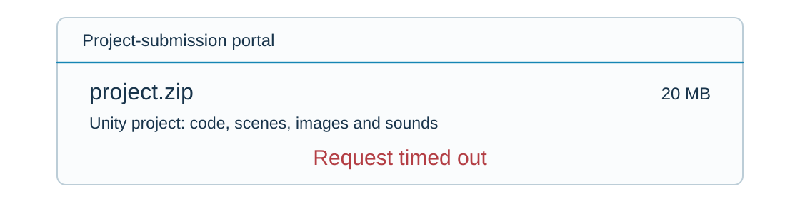{fig-alt="Hypothetical portal showing a 20 MB Unity project ZIP and a timeout, with no acceptance receipt." height=260px}

**Has the portal accepted your project for the teacher?**

::: {.answer-chips}
[**A** Yes]{.answer-chip .answer-a}
[**B** No]{.answer-chip .answer-b}
[**C** We do not yet know]{.answer-chip .answer-c}
:::

::: {.notes}
- **Story:** We open the tension: the student sees a timeout and doesn't know if the project was submitted; the lecture answers this.

- Hypothetical portal: signed-in student submits Unity ZIP (code, scenes, assets).

- Accepted = complete project + durable record; upload progress is not a receipt.

- Vote (30 s); ask two students why. Keep request loss, crash and reply loss open.

- Answer C; revisit after the histories. Retries may duplicate entries.

Sources: [Kleppmann, Distributed Systems](https://www.cl.cam.ac.uk/teaching/2122/ConcDisSys/dist-sys-notes.pdf).
:::

## What do we need to know to answer?

- Which components handle the submission?
- How do they communicate and share the work?
- What can fail while other parts keep running?
- What would make a retry safe?
- Which assumptions justify our conclusions?

**Let’s follow our project’s submission through the portal’s components.**

**Starting knowledge:** basic programming, processes, and networks.

::: {.notes}
- **Story:** We break one question into five smaller ones that form the lecture plan.

- Keep the vote unresolved: what happened inside the portal?

- Route: components → shared work → partial failures → safe retries → assumptions.

- Ask: who knows the deadline, and who knows the project was saved?
:::

## A project-submission system {.use-case-slide}

**Who knows the deadline? Who knows whether the project was saved?**

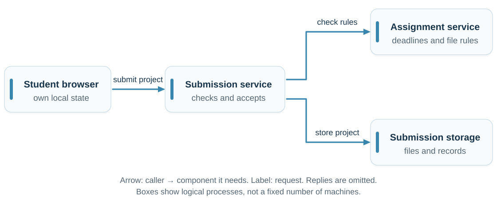{fig-alt="Student client sends submit to submission; submission checks the assignment service and stores a result in the submission storage." height=350px}

Each process has local state. An arrow means **“calls and depends on.”**

::: {.notes}
- **Story:** We open the portal's black box: several processes, each knowing only its part.

- Trace caller → dependency; labels name requests. Replies omitted.

- Assignment service: deadline/file rules. Storage: project + accepted record.

- Ask what each process knows locally.

- Logical processes, not necessarily separate machines; one host shares failures.

Sources: [van Steen and Tanenbaum, Distributed Systems](https://www.distributed-systems.net/index.php/books/ds4/); [Waldo et al., A Note on Distributed Computing](https://waldo.scholars.harvard.edu/publications/note-distributed-computing).
:::

## What makes it distributed?

**One submission needs several programs to cooperate through messages.**

::: {.definition number="1.1"}
A **distributed system** consists of independently executing components that communicate and coordinate through message passing to achieve a shared goal.
:::

Identify the participants, their local state, and their messages.

A single service name can hide many cooperating processes.

::: {.notes}
- **Story:** We name what we just saw: independent components cooperating through messages.

- Process = running program; a model's node may mean process or machine.

- Identify participants, messages and shared goal.

- Unrelated programs on different machines need not form one distributed application.

- One service name can hide many cooperating processes.

Sources: [van Steen and Tanenbaum, Distributed Systems](https://www.distributed-systems.net/index.php/books/ds4/); [Waldo et al., A Note on Distributed Computing](https://waldo.scholars.harvard.edu/publications/note-distributed-computing).
:::

## Distributed system or not? {.exercise-slide .classification-exercise}

**Identify the components, messages, and shared goal.**

| Example | Classification and reason |
|:---|:---|
| Browser, API, database on the same machine | [**Yes under our definition:** separate processes coordinate through messages, but share a host failure domain.]{.fragment fragment-index=1} |
| Computers rendering different frames of one film | [**Yes:** coordinate work toward one finished film.]{.fragment fragment-index=2} |
| Three unrelated laptops on the same Wi-Fi | [**No:** a shared network alone is not a shared task.]{.fragment fragment-index=3} |
| Threads coordinating only through shared memory | [**No under our definition:** concurrency alone is insufficient.]{.fragment fragment-index=4} |
| API and worker containers on one laptop | [**Yes under our definition:** messages coordinate work, but both share a host failure domain.]{.fragment fragment-index=5} |
| Three MPI processes averaging temperatures | [**Yes:** process 0 distributes chunks; all compute sums and counts; workers send results back; process 0 combines them.]{.fragment fragment-index=6} |

::: {.notes}
- **Story:** We test the definition on borderline examples.

- Reveal each answer after students classify it.

- Same-host processes fit our definition but share failures; stricter definitions require multiple machines.

- Shared-memory-only threads do not meet our message-passing criterion.

- MPI: process 0 keeps one chunk, sends two; combine sums/counts, not averages.
:::

## Why distribute the work?

| Reason | Example |
|:---|:---|
| **Components are physically apart** | Students submit from many places; sensors, phones and users around the world |
| **More capacity is needed** | Thousands of submissions before a deadline; several machines share the work |
| **The system must survive failures** | Copies of services and data (redundancy); work continues when one stops |

**That is why almost every information system today is distributed.**

::: {.notes}
- **Story:** If this is harder, why do it? Three reasons nearly every system is distributed.

- Three main reasons: geographic separation, capacity, resilience to failures.

- Ask: which of the three applies to applications you already use? Even a simple web application has a browser, a server and a database in separate processes.

- Further goals: resource sharing, openness (agreed interfaces) and transparency (one portal hides component placement).

- Cost: dependencies, coordination and recovery. Facebook follows as a capacity example, then our portal’s workload before a deadline.

Sources: [van Steen and Tanenbaum, Distributed Systems](https://www.distributed-systems.net/index.php/books/ds4/); [Waldo et al., A Note on Distributed Computing](https://waldo.scholars.harvard.edu/publications/note-distributed-computing).
:::

## Facebook: scale changes the architecture {.example-slide .facebook-scale}

{width=50px fig-alt="Facebook logo"} **More users, more requests, more data.**

| Date | Facebook monthly active users |
|:---|---:|
| October 2012 | **1.00 billion** |
| December 2019 | **2.50 billion** |
| December 2023 | **3.07 billion** |

**Scale up:** a more powerful machine. **Scale out:** more machines sharing the work.

Facebook stopped reporting standalone daily/monthly user counts from Q1 2024. Meta’s newer combined-app figures measure something different.

::: {.notes}
- **Story:** The capacity reason in real numbers: growth pushes the architecture onto more machines.

- Growth (20 s); scale up/out (25 s); coordination cost (15 s).

- MAU is not concurrent users or requests/second.

- 2023 is the last standalone Facebook MAU here; Meta Family metrics differ.

- Scale, availability and geography motivate distribution. Mechanisms: Lecture 11.

Sources: [2012 milestone](https://about.fb.com/news/2012/10/one-billion-people-on-facebook/); [2019 results](https://investor.atmeta.com/investor-news/press-release-details/2020/Facebook-Reports-Fourth-Quarter-and-Full-Year-2019-Results/default.aspx); [2023 results](https://investor.atmeta.com/investor-news/press-release-details/2024/Meta-Reports-Fourth-Quarter-and-Full-Year-2023-Results-Initiates-Quarterly-Dividend/default.aspx); [reporting change](https://investor.fb.com/files/doc_financials/2023/q4/META-Q4-2023-Prepared-Remarks.pdf); [Facebook engineering on scaling](https://engineering.fb.com/2010/07/21/core-infra/scaling-facebook-to-500-million-users-and-beyond/).
:::

## Must everyone wait for one submission?

**A large university. Many students. One deadline.**

::: {.submission-flow aria-label="Submission processing steps, from left to right"}
1. Receive ZIP
2. Check rules
3. Unpack & scan
4. Store
5. Accept
:::

Suppose one submission needs **20 minutes of processing**.

One worker finishing each job before starting the next: **3 jobs/hour**.

**Can other students upload? Can other jobs make progress?**

::: {.notes}
- **Story:** Back to the portal: what happens when thousands submit before the deadline?

- Explain the five steps; 20 minutes is hypothetical.

- 3 jobs/hour assumes one worker completes fixed-duration jobs sequentially.

- Ask (30 s): can uploads be queued separately? Can another job progress during a wait?

- Next: overlapping work versus simultaneous execution.

Sources: [van Steen and Tanenbaum, Distributed Systems](https://www.distributed-systems.net/index.php/books/ds4/); [Waldo et al., A Note on Distributed Computing](https://waldo.scholars.harvard.edu/publications/note-distributed-computing).
:::

## Several submissions can make progress together {.retry-overlap}

**Two students’ submissions: A waits for storage. Can B make progress?**

A worker can switch on waits or yields, while respecting each task’s dependencies.

:::: {.columns}
::: {.column width="42%"}
::: {.definition number="1.2"}
**Concurrency** means that multiple tasks are in progress during overlapping periods.
:::

::: {.definition number="1.3"}
**Parallelism** means that multiple tasks execute at the same time.
:::
:::
::: {.column width="58%"}
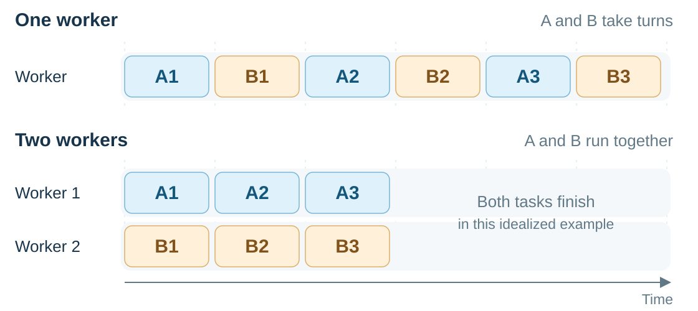{fig-alt="One worker alternates pieces of A and B; two workers run A and B simultaneously." width=100%}
:::
::::

::: {.notes}
- **Story:** The answer is overlap and simultaneity: we introduce concurrency and parallelism.

- Trace one worker alternating A/B, then two workers executing simultaneously.

- Pair explanation (45 s): concurrency versus parallelism.

- Respect dependencies. Overlap may improve utilization; parallelism may increase throughput.

- Neither guarantees faster individual jobs; both can occur on one machine.

Sources: [van Steen and Tanenbaum, Distributed Systems](https://www.distributed-systems.net/index.php/books/ds4/); [Waldo et al., A Note on Distributed Computing](https://waldo.scholars.harvard.edu/publications/note-distributed-computing).
:::

## Dealing with tasks vs. doing them {.example-slide}

“**Concurrency** is about **dealing with** lots of things at once.

**Parallelism** is about **doing** lots of things at once.”

— [Rob Pike, *Concurrency is not Parallelism*](https://go.dev/talks/2012/waza.slide)

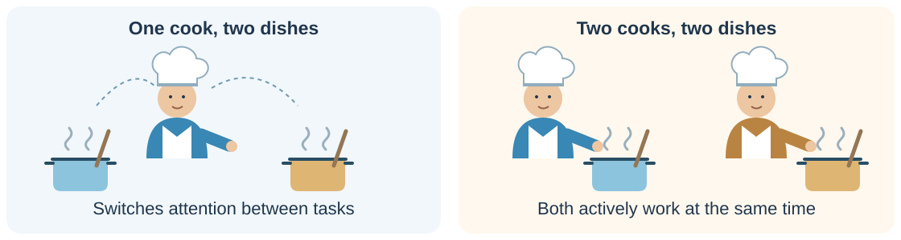{height=240px fig-alt="One cook switches attention between two dishes; two cooks can each actively work on a dish at the same time."}

**Parallel execution is concurrent; concurrent tasks need not run in parallel.**

::: {.notes}
- **Story:** We fix the distinction with a memorable picture.

- One cook switches attention; two cooks can work simultaneously.

- Analogy concerns active attention; food can heat unattended.

- Ask: concurrency on one core? Yes. Parallel execution is concurrent.

- Preserve dependencies; races can change outcomes. Switching: wait, yield or preemption.
:::

## Local function calls and remote requests

**The deadline check moves to another server. What changes for the caller?**

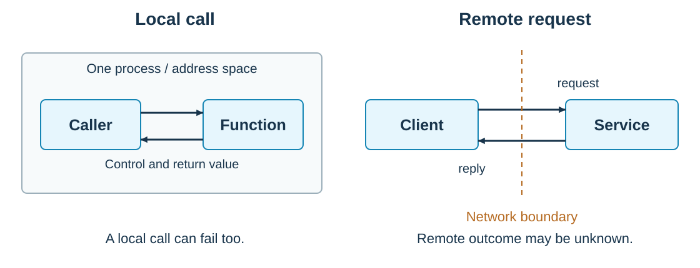{fig-alt="A local call stays within one process; a remote call exchanges a request and reply across a network boundary." height=350px}

::: {.notes}
- **Story:** When work moves to another machine, a call becomes a network message; this is where trouble starts.

- Trace request/reply across the network.

- Remote APIs can resemble local calls; communication still occurs.

- Local calls can fail too; remote effects may occur without a visible result.

- RPC implementation details come later.

Sources: [Kleppmann, Distributed Systems](https://www.cl.cam.ac.uk/teaching/2122/ConcDisSys/dist-sys-notes.pdf).
:::

## Delay, capacity, and completed work

**More projects finish each second. Must my own upload finish sooner?**

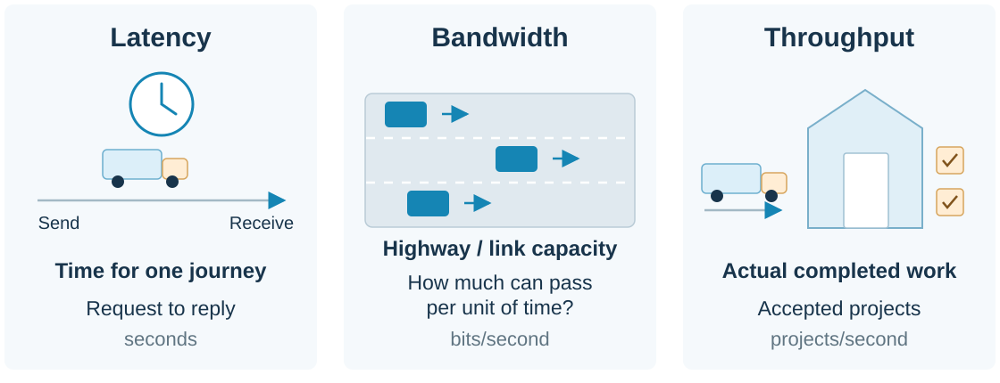{fig-alt="Latency times one journey. A multilane highway represents bandwidth, the link's capacity in bits per second. A receiving depot represents throughput, the actual rate of completed deliveries or accepted projects per second." height=295px}

**Think: how would you move 100 TB between datacenters fastest?**

Back to our portal: **high throughput does not guarantee a quick reply.**

::: {.notes}
- **Story:** Messages take time: we separate one reply's duration from the amount of completed work.

- Journey time = latency; highway capacity = bandwidth; completed deliveries = throughput.

- Portal: accepted projects, not uploaded bytes. Queueing/processing add latency.

- 100 TB: allow 20 s for ideas; compare network transfer with transporting drives.

- Include distance, transfer rate, writing, travel, reading and verification.

- Optional: 10 Gbit/s ≈ 22.2 h before overhead (decimal). High throughput ≠ quick reply.

Sources: [Kleppmann, Distributed Systems](https://www.cl.cam.ac.uk/teaching/2122/ConcDisSys/dist-sys-notes.pdf).
:::

## Recall Web Apps: time to first byte

**TTFB measures waiting for the first response byte, not the full download.**

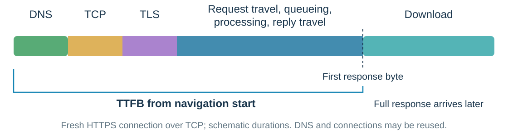{fig-alt="Navigation-start TTFB includes DNS, TCP, TLS and request-to-first-byte waiting. Download follows. Cached DNS and reused connections can skip setup." height=280px}

- **High bandwidth does not guarantee low TTFB.** Network travel and server work also matter.
- **A first byte is not proof of acceptance.** What does the portal's response confirm?

::: {.notes}
- **Story:** Link to Web Apps: the first byte is not proof of acceptance.

- Name start point: navigation-start TTFB includes setup; request-start TTFB excludes it.

- Fresh HTTPS/TCP shown; cached DNS/reused connections skip setup. HTTP/3 uses QUIC.

- Blue includes network travel, queueing and processing; widths are schematic.

- First byte ≠ acceptance. Distinguish pending acknowledgement from durable receipt.

Sources: [web.dev, Time to First Byte](https://web.dev/articles/ttfb).
:::

## One component fails; others keep running

**The portal still opens, but the assignment service has stopped. What still works?**

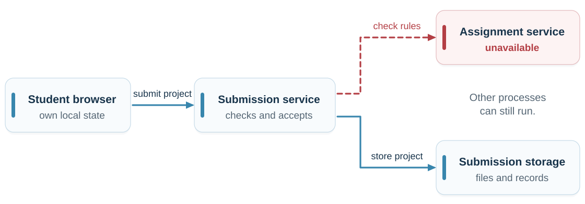{fig-alt="Assignment service unavailable while other processes remain running." height=250px}

::: {.definition number="1.4"}
A **partial failure** occurs when some components fail while others continue running.
:::

::: {.notes}
- **Story:** Parts of the system fail independently: partial failure.

- Ask: can an old receipt be retrieved while deadline checks fail?

- Depends on each operation's dependencies.

- Some processes continue; colocated services can fail together.

Sources: [Kleppmann, Distributed Systems](https://www.cl.cam.ac.uk/teaching/2122/ConcDisSys/dist-sys-notes.pdf).
:::

## A client can be another service

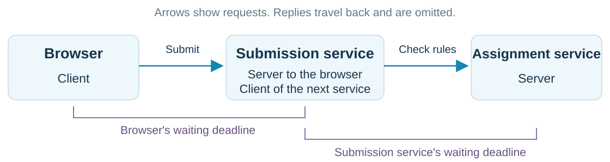{fig-alt="Browser calls submission service, which calls assignment service. Submission service is both a server and a client. Each caller may set its own waiting deadline." height=320px}

**Client** and **server** are roles in an interaction. The submission service plays both.

::: {.notes}
- **Story:** We set the scene: who waits for whom, and who sets the waiting deadline.

- Client/server are interaction roles; submission service is both.

- Each caller may configure its own deadline; deadlines are not automatically coordinated.
:::

## Timeout

**Why?** The caller sets a waiting deadline so it does not wait forever.

**A timeout means one thing only: the caller gave up waiting.**

A timeout does **not**:

- destroy the request
- cancel remote work
- reveal the outcome

**Next: three stories that end in the same timeout.**

::: {.notes}
- **Story:** Back to the opening timeout: what it means and what it doesn't.

- Central idea of the lecture: a timeout ends waiting, not remote work or its effects.

- Explicit cancellation is a separate message and can race with completion.

- Bridge: three histories, one client observation.
:::

## History A: the request is lost

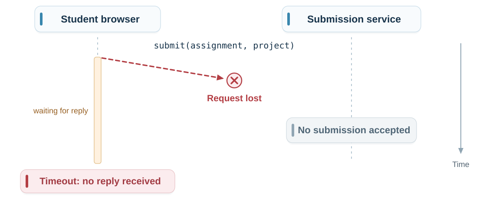{fig-alt="Request is lost before reaching the service; no submission is accepted, and the client times out." height=440px}

::: {.notes}
- **Story:** First story behind the timeout: the request never arrived.

- Read downward: complete request never arrives; no accepted submission.

- Arrow means whole request, not one packet; temporary fragments are not acceptance.

- Client sees only no reply by its deadline.

- Ask: what does the diagram know that the client does not?

Sources: [Kleppmann, Distributed Systems](https://www.cl.cam.ac.uk/teaching/2122/ConcDisSys/dist-sys-notes.pdf).
:::

## History B: the reply is lost

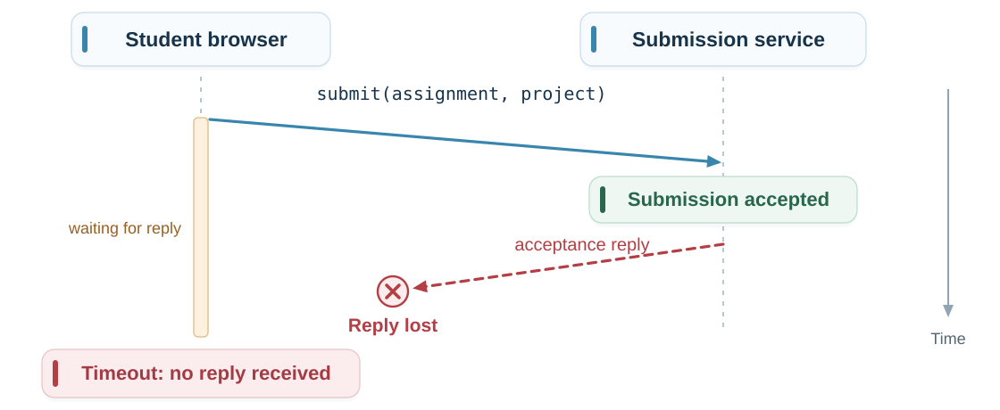{fig-alt="Request reaches the service and is stored; the reply is lost, and the client times out." height=440px}

::: {.notes}
- **Story:** Second story: the work was done, but the reply was lost.

- Accepted and durably stored; confirmation lost.

- Compare A: different server state, same timeout.

- Other possibilities include queued/in-flight work; histories are not exhaustive.

Sources: [Kleppmann, Distributed Systems](https://www.cl.cam.ac.uk/teaching/2122/ConcDisSys/dist-sys-notes.pdf).
:::

## History C: the server process crashes

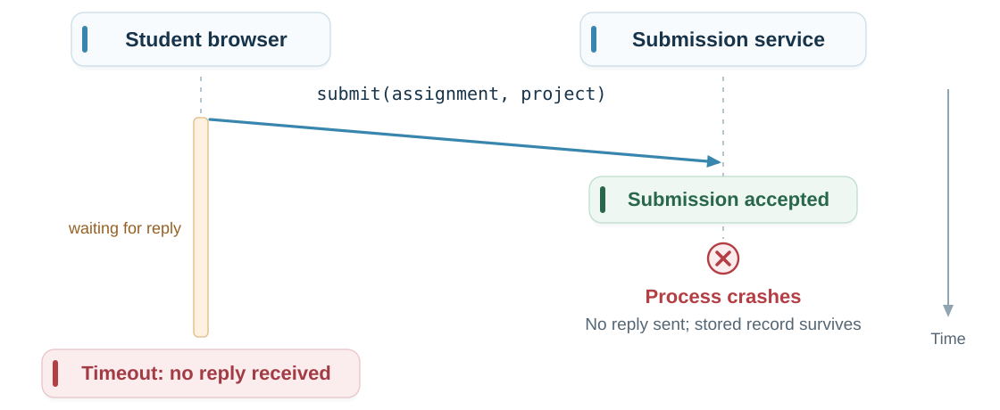{fig-alt="The service durably accepts the submission, then its process crashes before sending a reply. The accepted record survives, while the browser receives no reply and times out." height=440px}

::: {.notes}
- **Story:** Third story: the server stored the submission and crashed before replying.

- Durable acceptance → server process crashes before replying.

- Record survives under our assumption; no reply sent, unlike B.

- Crash before acceptance changes the outcome; timeout cannot locate the crash.

- Some transports report connection errors instead. Retry may duplicate the effect.
:::

## Same observation, different outcomes

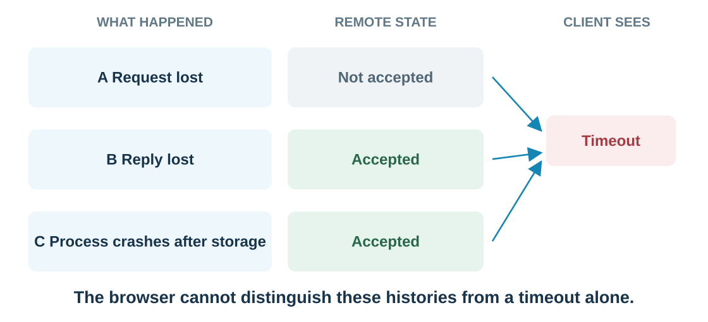{fig-alt="A lost request leaves no accepted submission. A lost reply or a process crash after durable storage leaves an accepted submission. All three histories can produce the same client-visible timeout." height=370px}

**A timeout limits waiting; it does not determine the remote outcome.**

::: {.notes}
- **Story:** We join the three stories: same timeout, different outcomes; hence the vote answer is "we don't know".

- Revisit vote: C. Same observation, different remote effects.

- Longer finite timeout cannot remove uncertainty without a usable bound.

- Later evidence/status query may help; timeout alone cannot.

Sources: [Kleppmann, Distributed Systems](https://www.cl.cam.ac.uk/teaching/2122/ConcDisSys/dist-sys-notes.pdf).
:::

## Pair exercise: should the client retry? {.exercise-slide}

For each history, predict what a second request might do.

1. What could a retry fix?
2. Could the teacher receive two submission entries?
3. What information could identify the same intended operation?

::: {.notes}
- **Story:** The natural reaction is to retry; students predict the consequences.

- Pairs (1 min), answers (1 min), synthesis (1 min).

- A: retry may deliver missing work. B/C: may duplicate accepted work.

- Idempotency: repeated operation preserves effect; replies may differ.

- Operation ID helps only with coordinated duplicate detection + stored effect.

- Bridge: timeout does not cancel A; retry B may overlap it.

Sources: [Kleppmann, Distributed Systems](https://www.cl.cam.ac.uk/teaching/2122/ConcDisSys/dist-sys-notes.pdf).
:::

## A retry can overlap the original request

**The caller gave up waiting. The request may still be travelling, queued, or running.**

::: {.submission-flow}
1. Send attempt A
2. Waiting deadline expires
3. Send retry B
:::

Now **A and B may both be running for the same intended submission**.

A tempting approach: **“If no accepted entry exists, create one.”**

**What if both attempts check before either creates the entry?**

::: {.notes}
- **Story:** A retry overlaps the first attempt: concurrency returns as a problem.

- A/B now mean two attempts of one submission, not different students.

- Original may still be travelling, queued or running after timeout.

- Propose “check, then create”; could both observe absence?

- Identify the invariant before choosing a protocol.
:::

## State the rule before choosing the protocol {.retry-overlap}

**Not everything is atomic in distributed systems.** Here, checking and writing are separate steps.

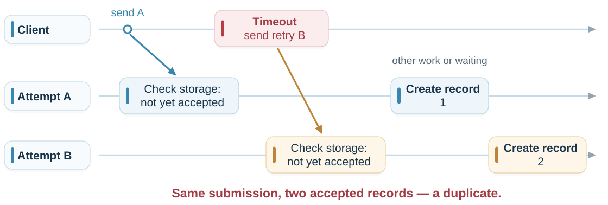{fig-alt="Client sends A; A checks storage and finds the submission not yet accepted. The client times out and retries as B. B checks before A creates record 1; B then creates duplicate record 2. A continues after the client timeout." height=265px}

::: {.definition number="1.5"}
An **invariant** is a rule that must hold in every permitted state of the system.
:::

**Required rule:** at most one accepted record per intended submission.

::: {.notes}
- **Story:** The race shows we need a rule before a protocol: an invariant.

- Atomic = indivisible relative to other operations.

- Check/write gap: I/O, yielding or scheduling. Even a short gap permits a race.

- Possible on one machine too.

- Same intended submission; deliberate revision may be a new version.

- At most one accepted record. Rejecting everything is safe but useless.
:::

## Safety and liveness {.visual-definitions}

**Reject every submission: no duplicates. Is that a useful portal?**

We need both: **avoid duplicate entries** and **eventually accept valid work**.

::: {.definition number="1.6"}
A **safety property** requires that a specified bad event or state never occurs.
:::

::: {.definition number="1.7"}
A **liveness property** requires that specified progress eventually occurs under stated assumptions.
:::

For progress here: services recover, communication succeeds, and pending work is processed.

::: {.notes}
- **Story:** A rule alone is not enough: a system that rejects everything is safe but useless.

- Safety: never duplicates. Liveness: eventually accept valid work.

- Needs available/recovered services, successful communication, retained/retried work and processing.

- “Valid” includes deadline policy; “eventually” gives no fixed deadline.

- Ask why rejecting everything satisfies safety but not liveness.
:::

## Safety and liveness in different systems {.property-examples}

| System | Safety: what must never happen? | Liveness: what must eventually happen? |
|:---|:---|:---|
| **Payments** | [Retries charge twice for one payment.]{.fragment fragment-index=1} | [A valid, authorised payment completes.]{.fragment fragment-index=2} |
| **Seat booking** | [Two customers hold confirmed bookings for the same seat and event.]{.fragment fragment-index=3} | [Each request receives confirmation or rejection.]{.fragment fragment-index=4} |
| **Job queue** | [A job is marked complete before it succeeds.]{.fragment fragment-index=5} | [Each valid pending job gets processed.]{.fragment fragment-index=6} |
| **Distributed lock** | [Two processes execute the protected critical section at once.]{.fragment fragment-index=7} | [Each correct process that keeps requesting the lock acquires it.]{.fragment fragment-index=8} |

**Progress needs:** recovery, successful communication, retained work and fair scheduling. Lock holders must release or be safely replaced.

::: {.notes}
- **Story:** We recognise the same pair of properties in payments, bookings, queues and locks.

- Reveal safety then liveness; safety cells name forbidden events.

- Payment: same intended payment. Booking rejection satisfies the response claim.

- Queue: truthful status, not exactly-once execution; jobs terminate or fail explicitly.

- Lock: starvation freedom needs fairness, finite critical sections and safe recovery.

- Ask: why not reject every payment?
:::

## A system model makes assumptions explicit

**Can we promise every valid submission will eventually be accepted if…**

- the power stays off?
- the disk fails and no recoverable copy remains?
- a cable is cut and the service stays disconnected?

A **system model** states the behaviour allowed and the guarantees an algorithm may rely on.

We make those assumptions explicit in three parts: **network, nodes, and timing**.

::: {.notes}
- **Story:** Promises hold only under assumptions: we introduce the system model.

- Outages challenge liveness; stopped systems may still avoid duplicates.

- Temporary disruption permits recovery; permanent loss/disconnection may prevent progress.

- Model = allowed behaviour + assumptions; guarantees cover every allowed execution.

- No duplicates is an algorithm claim to establish, not supplied by the model.

- Next: network, nodes, timing.

Sources: [Kleppmann, Distributed Systems](https://www.cl.cam.ac.uk/teaching/2122/ConcDisSys/dist-sys-notes.pdf).
:::

## Network assumptions: can messages get through?

**Start with the cut cable: does communication recover, or stay broken?**

Retries help only if some later attempt can reach the receiver.

| Communication assumption | Consequence for the portal |
|:---|:---|
| Messages may be lost, duplicated, or reordered | Handle repeated requests and changing arrival order. |
| Continued retries eventually get through | Eventual delivery is possible, without a fixed deadline. |
| A permanent partition blocks every attempt | Acceptance needing that communication cannot progress. |

Our example excludes forged or altered messages.

::: {.notes}
- **Story:** First model dimension: what the network may do to messages.

- Ask (30 s): can retries help if the route never recovers?

- Fair loss: persistent retries between correct endpoints eventually succeed; no fixed deadline.

- Reliable links: eventual delivery, no duplication/fabrication; ordering is separate.

- Temporary partitions delay progress; permanent ones violate eventual communication.

- Message duplication ≠ application retries; tampering excluded here.

- Next: what if the receiving process crashes?

Sources: [Kleppmann, Distributed Systems](https://www.cl.cam.ac.uk/teaching/2122/ConcDisSys/dist-sys-notes.pdf).
:::

## Three node-failure models

**The service stops after accepting your project. What happens when it returns?**

| Model | Example in our submission portal |
|:---|:---|
| **Crash-stop** | Stops permanently within the model; no recovery is assumed. Example: a worker dies, and surviving workers must finish without it. |
| **Crash-recovery** | It restarts. Accepted records survive in durable storage; its in-memory queue is lost. |
| **Byzantine** | A faulty service tells the student “accepted” and the teacher “not accepted”. |

These describe allowed behaviour, not when others detect a failure.

::: {.notes}
- **Story:** Second dimension: how components may fail.

- Ask what survives restart: durable records versus memory.

- Crash-stop: participant takes no further steps; cannot rely on its recovery.

- Crash-recovery: participant returns; specify retained state.

- Byzantine: deviates from protocol, including contradictory replies.

- Alternative models, not stages; none implies immediate detection.

Sources: [Kleppmann, Distributed Systems](https://www.cl.cam.ac.uk/teaching/2122/ConcDisSys/dist-sys-notes.pdf).
:::

## How long should the portal wait?

**The assignment service usually replies quickly. Today it is silent.**

- Waiting forever can leave the student without a result.
- Retrying can overlap work that is still running.

**What guarantee would let us distinguish “slow” from “stopped”?**

As **system architects and developers**, we choose the timeout; we do not create a response-time guarantee.

> **💡 Insight: your clients can overwhelm your own service.** Too-short timeouts + aggressive retries from many clients can cause a **retry storm — a self-inflicted denial of service with DDoS-like effects**.

::: {.notes}
- **Story:** The third dimension starts with a practical question: how long to wait?

- Ask (20 s): is the deadline a habit or a guarantee?

- Architects/developers choose policy, not the dependency's response bound.

- End-to-end bound: delivery + processing + reply.

- Feedback: slow → timeout → retries/load → slower.

- Legitimate clients can cause denial of service; bounded retries, backoff + jitter.

- Retry safety is a separate requirement.

Sources: [AWS Builders’ Library, Timeouts, retries, and backoff with jitter](https://aws.amazon.com/builders-library/timeouts-retries-and-backoff-with-jitter/); [Kleppmann, Distributed Systems](https://www.cl.cam.ac.uk/teaching/2122/ConcDisSys/dist-sys-notes.pdf).
:::

## Timing models: what may we assume?

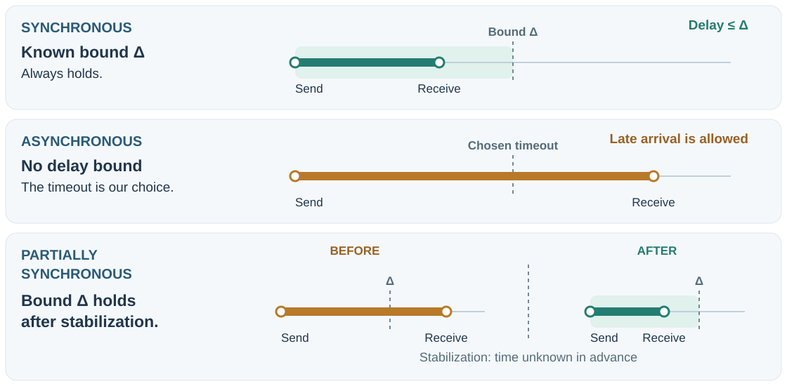{fig-alt="Send and receive points compared with a delay bound delta. A chosen timeout is not a guarantee. The partial-synchrony row shows eventual synchrony: after unknown stabilization, the bound continues to hold." height=400px}

Internet congestion and process pauses motivate **partial synchrony**. It is a **model assumption**, not “99% fast” or an Internet guarantee.

**Goal: safety during disruption; progress after stabilization.**

::: {.notes}
- **Story:** We formalise timing: what we may assume about delays.

- Δ = upper bound, not average. Asynchronous arrival may exceed chosen timeout.

- Eventual synchrony: unknown finite stabilization, then bounds hold for the rest of execution.

- Not “99% fast”; no stabilization notification or Internet guarantee.

- Real systems can become unstable again; useful stable intervals depend on algorithm.

- Safety/progress are design obligations; timing models ≠ blocking/async APIs.

Sources: [Kleppmann, Distributed Systems](https://www.cl.cam.ac.uk/teaching/2122/ConcDisSys/dist-sys-notes.pdf).
:::

## etcd: one successful claim {.example-slide .system-example}

A replicated key-value store for coordination: **two clients try to claim the same name**.

| What we reason about | Three-member etcd cluster |
|:---|:---|
| **Model assumptions** | Trusted, non-Byzantine members; crash-recovery with durable state. Delays and partitions are possible. |
| **Invariant / safety** | Atomic “if absent, create” lets **at most one claimant succeed**, until the key is deleted. A separate read then write would not suffice. |
| **Liveness conditions** | A reachable **majority (2 of 3)**, a stable leader, and timely communication and processing allow progress. |

**Partition 2 + 1:** the majority can commit; the isolated member cannot commit a competing claim.

::: {.notes}
- **Story:** A real system solves our duplicate problem with an atomic create-if-absent.

- Replica = maintained copy; majority = 2/3.

- Atomic compare-absence + create allows one claimant; separate read/write does not.

- Assume no deletion, expiry or bypass; external resources need fencing.

- Trusted crash-recovery members + durable state; progress needs stable majority.

- Timeout leaves outcome uncertain; optional serializable reads can be stale.

- Ask what survives when minority progress stops: safety.

Sources: [etcd API guarantees](https://etcd.io/docs/v3.6/learning/api_guarantees/); [failure modes](https://etcd.io/docs/v3.6/op-guide/failures/); [Raft paper](https://raft.github.io/raft.pdf).
:::

## Cassandra: choose what a reply promises {.example-slide .system-example}

A distributed database: **three replicas; ordinary reads and writes at consistency level ONE**.

| What we reason about | This Cassandra configuration |
|:---|:---|
| **Model assumptions** | Non-Byzantine replicas may crash and recover. Network delays and partitions are possible. |
| **Safety / its limit** | Success requires one replica’s acknowledgement. Reads may be stale; ordinary “read then write” does **not** preserve “sell a seat at most once”. |
| **Liveness conditions** | A reachable, responsive replica can serve the operation. Replicas converge after communication and repair deliver retained updates. |

**The choice matters:** QUORUM requires a majority; conditional reservations need stronger coordination, such as lightweight transactions (LWT).

::: {.notes}
- **Story:** Contrast: a weaker configuration buys speed but does not protect our rule.

- RF=3; ONE waits for one relevant replica, not one stored copy.

- Ordinary single-cell operations; exclude counters/deletes/LWT.

- Stale reads can cause two bookings; one final value cannot undo promises.

- Convergence needs retained updates, repair, recovered communication and quiescent writes.

- “Last” means timestamp order, not necessarily real-world order.

- QUORUM does not make read-then-write atomic; LWT adds conditional coordination.

Sources: [Dynamo architecture](https://cassandra.apache.org/doc/stable/cassandra/architecture/dynamo.html); [guarantees](https://cassandra.apache.org/doc/stable/cassandra/architecture/guarantees.html); [hints and repair](https://cassandra.apache.org/doc/stable/cassandra/managing/operating/hints.html).
:::

## Bitcoin: confidence grows with confirmations {.example-slide .system-example}

A shared payment history in an **open network with potentially malicious participants**.

| What we reason about | Bitcoin’s proof-of-work model |
|:---|:---|
| **Model assumptions** | Secure cryptography, dominant honest mining power, and block propagation fast enough relative to mining. |
| **Invariant / safety** | A valid chain never spends the same transaction output twice. Nodes can temporarily follow different branches; **settlement is probabilistic**. |
| **Liveness conditions** | Continued mining and communication allow chain growth. A transaction must remain valid, reach miners, and be selected; **no fixed inclusion deadline**. |

**During a partition:** competing branches can grow. More confirmations reduce reversal risk under the assumptions; they do not make it zero.

::: {.notes}
- **Story:** The extreme case: malicious participants and probabilistic safety.

- Adversarial network; honest mining power, secure cryptography, adequate propagation.

- Same valid chain cannot spend an output twice; conflicting branches may coexist.

- Confirmations reduce reversal risk under assumptions, never to zero.

- Honest dominance = hash power, not node count; select greatest cumulative work.

- Growth needs mining/communication; transaction inclusion also needs selection, without fixed deadline.

- Majority hash power cannot make honest nodes accept invalid signatures.

Sources: [Bitcoin whitepaper](https://bitcoin.org/bitcoin.pdf); [Bitcoin developer guide: block chain](https://developer.bitcoin.org/devguide/block_chain.html).
:::

## Our portal: assumptions behind the promise

**Retries must not create duplicate accepted entries, including after a restart.**

| Dimension | Model for this example |
|:---|:---|
| Network | Requests and replies may be delayed, lost, repeated, or reordered; no tampering. |
| Nodes | Services can crash and restart; durable records survive, memory may be lost. |
| Timing | No guaranteed maximum response time. |

**To promise eventual acceptance:** services eventually stay available, communication succeeds, and retained or retried work is processed.

::: {.notes}
- **Story:** We apply all three model dimensions to our portal.

- One example model, not a universal portal model.

- Safety across allowed interleavings/restarts; durable storage alone does not make retries safe.

- Permanent partition breaks eventual communication; preserve safety while progress stops.

- WWW/LAN proximity does not establish synchrony; same-host processes share failures.

- Untrusted clients do not automatically require Byzantine consensus among trusted servers.

Sources: [Kleppmann, Distributed Systems](https://www.cl.cam.ac.uk/teaching/2122/ConcDisSys/dist-sys-notes.pdf).
:::

## 🔥 How to develop a bad system

**Build on assumptions you never checked:**

:::: {.columns}
::: {.column width="50%"}
- The network always delivers.
- Communication takes no time.
- Bandwidth has no limit.
- The network is automatically secure.
:::
::: {.column width="50%"}
- The topology never changes.
- One administrator controls everything.
- Moving data costs nothing.
- Every component speaks the same language.
:::
::::

**Instead: make each assumption explicit—and explain what happens when it fails.**

::: {.notes}
- **Story:** The counterexample: what happens when assumptions stay unstated.

- Scan (35 s); ask which assumption the timeout story challenges (25 s).

- “One administrator” = authority/policy; “same language” = protocols/formats/versions/meaning.

- Abstractions can offer conditional guarantees; hidden assumptions are the problem.

- Next: the 101 ms exercise — which assumption is missing?

Sources: [Oracle, Fallacies of distributed systems](https://blogs.oracle.com/developers/fallacies-of-distributed-systems).
:::

## No reply after 101 ms {.exercise-slide}

The assignment service **usually replies within 100 ms**.

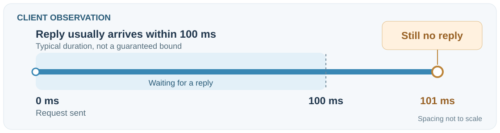{height=280px fig-alt="Client timeline: request sent at 0 ms, reply usually arrives within 100 ms, but no reply has arrived at 101 ms. Time moves right; spacing is not to scale. The service's state is unknown."}

**Does that prove the service has crashed?**

**State one alternative explanation and the extra guarantee your conclusion would need.**

::: {.notes}
- **Story:** Students catch the hidden timing assumption themselves.

- Give 30 s: distinguish typical time from guaranteed bound.

- No reply yet; process or communication may be delayed/unavailable.

- Diagram shows only client observations, not an actual crash.

- Invented times; spacing not to scale. Ask what end-to-end guarantee is missing.

Sources: [Kleppmann, Distributed Systems](https://www.cl.cam.ac.uk/teaching/2122/ConcDisSys/dist-sys-notes.pdf).
:::

## Back to the start: did the portal accept the project?

**We still don't know, and now we know why.**

- **Partial failure:** some components stop while others keep running.
- **Timeout:** limits waiting; does not reveal the outcome.
- **Invariant:** at most one accepted entry per submission.
- **Safety and liveness:** nothing bad ever happens; something good eventually happens.
- **System model:** explicit assumptions about network, nodes and timing.

**A safe retry needs a rule and assumptions, not just a longer timeout.**

::: {.notes}
- **Story:** We close the loop: the vote answer is C, and now we know why.

- Return to the opening vote: who chose C? C is right because one observation matches different outcomes.

- Ask (15 s): which concept is still unclear?

- Bridge (15 s): the deadline arrives before processing finishes—what would you build?

- The reasoning checklist remains in the chapter (reasoning-checklist figure).
:::

## Design the next step: did I submit on time? {.exercise-slide}

The deadline is **midnight**.

The upload finishes at **23:59**; the checks finish at **00:19**.

**How would you design the portal so the student knows whether they submitted on time—even after closing the browser?**

Propose what to **save and show**, **one rule to preserve**, and your **network, restart, and timing assumptions**.

::: {.notes}
- **Story:** We apply what we learned to a new problem with a deadline and a receipt.

- Ask (10 s): what evidence remains after closing the browser?

- Think (25 s): what to save/show?

- Discuss (30 s): which event counts? Browser completion ≠ durable receipt.

- Prompts: receipt ID/time, “received—checks pending”, retrievable status.

- Challenge (25 s): crash during checks; what survives and enables eventual completion?

- Preserve one accepted entry; later lectures develop the protocol.
:::

## Homework: invoices 1, 2, 3, … {.exercise-slide}

A company issues invoices from **several servers**. Numbers must be **sequential: no repeats and no gaps**.

1. Write the rule (invariant) the system must preserve.
2. Two servers issue an invoice at the same time. Who assigns the number?
3. A server takes number 42 and crashes before storing the invoice. What happens to 42?
4. A till times out and retries. How do you avoid two invoices?

**Is there a solution where you give up nothing: not availability, not speed, not strict sequence?** If not, what would you give up?

::: {.notes}
- **Story:** We carry the ideas to a real-world problem and leave a question for later lectures.

- Assign for home; do not solve in class. A real problem from the lecturer's practice.

- Directions for next time: one counter = bottleneck and single point of failure; gap (crash after assignment) ≠ duplicate (retry); a request identifier makes retries safe (idempotency, Web Apps); number ranges per server keep uniqueness but not global order.

- Possible way out: number separately per till or business premises. Croatian fiscalization labels invoices this way (number/premises/device) — verify the current regulation before citing it.

- Final question: the expected conclusion is that no such solution exists. A gapless strict sequence needs coordination; during a network partition or a coordinator crash the system must wait (losing availability) or issue numbers without coordination (losing the sequence). Let students reach this themselves; replication and consensus develop the idea.

- Later: replication (Lecture 06), consensus (Lecture 07), transactions (Lecture 09).
:::
