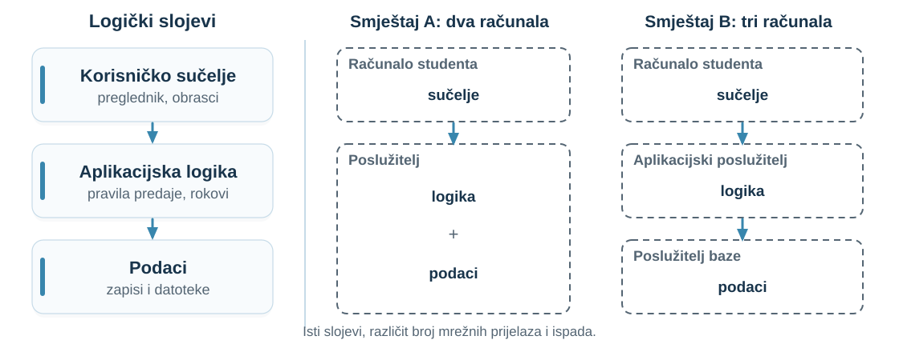
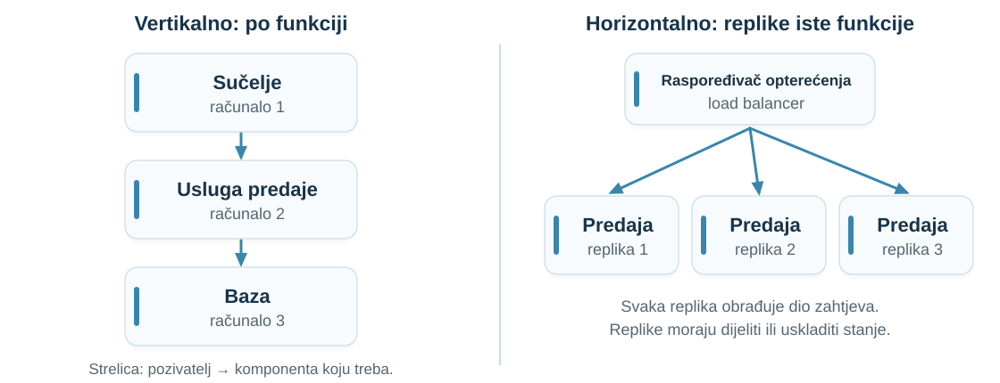
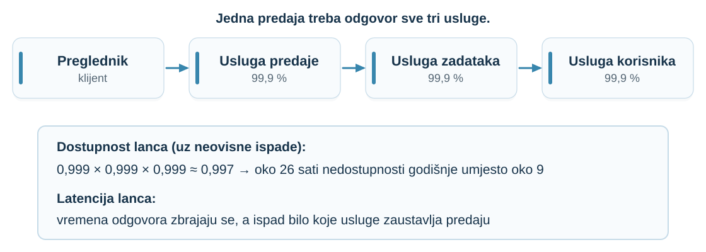
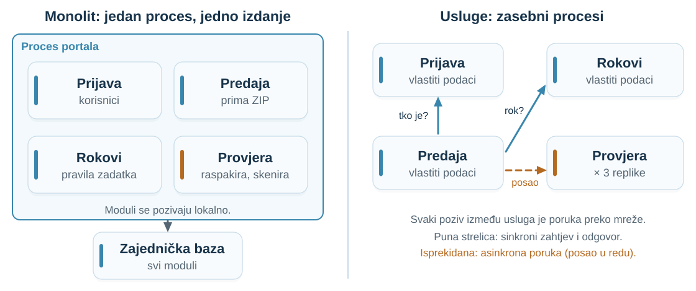
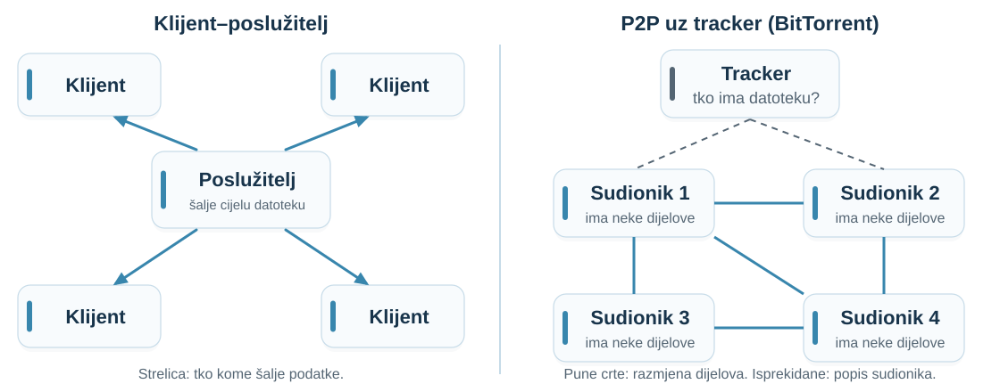
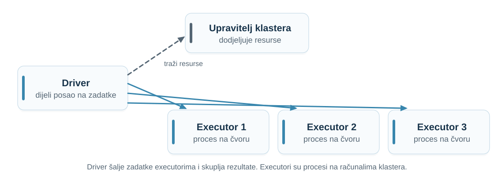
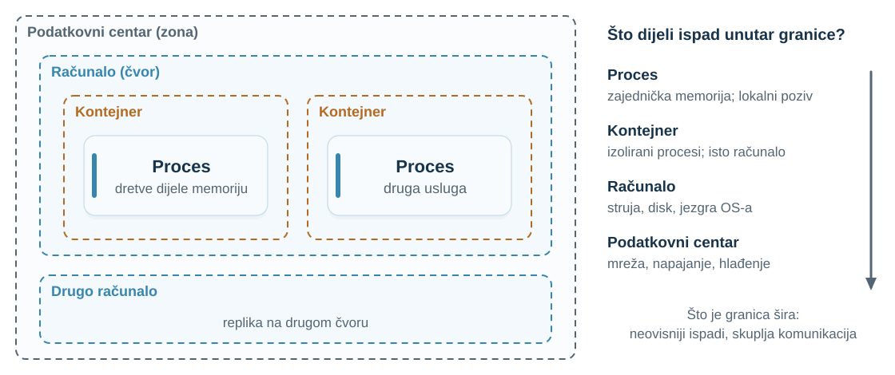
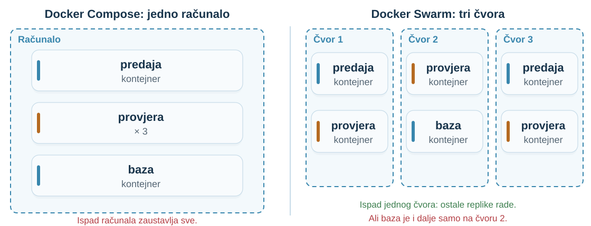

## Domaća zadaća: računi 1, 2, 3, … {.exercise-slide}

Više poslužitelja izdaje račune. Brojevi idu **slijedno: bez ponavljanja i bez preskakanja**.

**Najjednostavnije rješenje:** jedan **središnji brojač** dodjeljuje sljedeći broj.

| Pitanje | Posljedica središnjeg brojača |
|:---|:---|
| Tko odlučuje o broju? | [Samo brojač: slijed je lako očuvati.]{.fragment fragment-index=1} |
| Što ako brojač ne radi? | [Nitko ne može izdati račun: jedina točka ispada.]{.fragment fragment-index=2} |
| Broj 42, pa rušenje prije spremanja? | [Rupa u slijedu, osim ako se broj dodjeljuje pri spremanju.]{.fragment fragment-index=3} |
| Istek čekanja i ponovni pokušaj? | [Identifikator namjeravanog računa sprječava dva računa.]{.fragment fragment-index=4} |

::: {.notes}
- **Priča:** Rješenje domaće zadaće već je arhitekturna odluka; danas takve odluke učimo imenovati.

- Pitati dvoje-troje studenata za rješenje prije otkrivanja redaka.

- Ključ: o slijedu odlučuje jedno mjesto; cijena je usko grlo i jedina točka ispada.

- Bez žrtve nema rješenja: tijekom particije ili ispada brojača čekamo ili gubimo strogi slijed (predavanja 06, 07, 09).
:::

## Portal pred rok {.example-slide}

Portal dobiva novu funkciju: **provjeru projekta** (raspakiraj ZIP, provjeri strukturu, skeniraj).

- Sve je u **jednom programu**: prijava, predaja, rokovi i provjera.
- Večer prije roka provjere zauzmu procesor: **usporavaju se prijava i preuzimanja**.
- Pogreška u raspakiravanju **sruši proces**: nitko ne može predati.

**Kamo staviti provjeru projekta?**

::: {.answer-chips}
[**A** U isti program]{.answer-chip .answer-a}
[**B** U zasebnu uslugu]{.answer-chip .answer-b}
[**C** Ovisi]{.answer-chip .answer-c}
:::

::: {.notes}
- **Priča:** Otvaramo pitanje na koje odgovaramo na kraju: gdje povući granicu.

- Glasanje 30 s; pitati po jednog studenta za svaki odgovor.

- Ne otkrivati odgovor. Zapisati argumente na ploču: vratit ćemo se na njih.
:::

## Što trebamo znati da bismo odlučili?

- Kako opisati **arhitekturu** sustava?
- Koje **organizacije** postoje: klijent–poslužitelj, slojevi, replike, P2P?
- Gdje povući **granicu usluge** i što ona **košta**?
- Što se **ruši zajedno**, a što neovisno?

**Pratimo portal od jednog programa do više usluga na više računala.**

::: {.notes}
- **Priča:** Jedno pitanje razbijamo u četiri koja čine plan predavanja.

- Predznanje iz 01: djelomični ispad, istek čekanja, ponovni pokušaj, invarijanta.
:::

## Logička organizacija i fizički smještaj {.retry-overlap}

**Isti dijagram s četiri procesa ne znači četiri računala.**

::: {.definition number="2.1"}
**Arhitektura raspodijeljenog sustava (system architecture)** opisuje komponente sustava, njihove odgovornosti i veze te smještaj komponenti na računala i u procese.
:::

| Logička organizacija | Fizički smještaj |
|:---|:---|
| koje komponente postoje i za što su odgovorne | na kojim računalima i u kojim procesima rade |
| koje poruke razmjenjuju | koji je poziv lokalan, a koji mrežni i što se ruši zajedno |

::: {.notes}
- **Priča:** Uvodimo dvije razine opisa: što sustav radi i gdje se to izvršava.

- Ista logička podjela s drukčijim smještajem ima drukčiju latenciju i drukčije ispade.

- Poveznica s 01: „logički procesi, ne nužno zasebna računala”.

Izvori: [van Steen and Tanenbaum, Distributed Systems, pogl. 2](https://www.distributed-systems.net/index.php/books/ds4/).
:::

## Klijent–poslužitelj {.retry-overlap}

::: {.definition number="2.2"}
U arhitekturi **klijent–poslužitelj (client–server)** poslužitelj nudi uslugu i čeka zahtjeve, a klijent šalje zahtjev i čeka odgovor.
:::

- **Uloge, ne vrste računala:** usluga predaje je poslužitelj pregledniku i klijent usluzi zadataka.
- **Prednost:** stanje i pravila su na poznatom mjestu.
- **Cijena:** klijenti ovise o poslužitelju; kad on ne radi ili ne stigne, nemaju alternativu.

**Središnji brojač računa je poslužitelj; blagajne su njegovi klijenti.**

::: {.notes}
- **Priča:** Najčešća organizacija; prepoznajemo je u portalu i u domaćoj zadaći.

- Pitati: tko je klijent, a tko poslužitelj kad usluga predaje pita uslugu zadataka?

- Vratiti se na brojač: jednostavno odlučivanje, ali jedina točka ispada.

Izvori: [van Steen and Tanenbaum, Distributed Systems, pogl. 2](https://www.distributed-systems.net/index.php/books/ds4/).
:::

## Slojevi i njihov smještaj

{fig-alt="Tri logička sloja: sučelje, aplikacijska logika i podaci. Smještaj na dva računala: sučelje kod studenta, logika i podaci na poslužitelju. Smještaj na tri računala: sučelje, aplikacijski poslužitelj i poslužitelj baze." height=400px}

**Slojevi su logička podjela; broj računala je odluka o smještaju.**

::: {.notes}
- **Priča:** Prvi primjer razlike logike i smještaja: isti slojevi, dva ili tri računala.

- Dvoslojno (two-tier): logika i podaci zajedno. Troslojno (three-tier): baza zasebno.

- Pitati: što dobivamo zasebnom bazom, a što plaćamo? Očekivano: zasebno skaliranje i održavanje; dodatni mrežni prijelaz i još jedan mogući ispad.

Izvori: [van Steen and Tanenbaum, Distributed Systems, pogl. 2](https://www.distributed-systems.net/index.php/books/ds4/).
:::

## Vertikalna i horizontalna raspodjela

{fig-alt="Vertikalno: sučelje, usluga predaje i baza na tri računala. Horizontalno: raspoređivač opterećenja i tri replike usluge predaje." height=380px}

**Replike povećavaju kapacitet samo ako ne drže stanje koje druge ne vide.**

::: {.notes}
- **Priča:** Dva načina kako posao rasporediti na više računala.

- Vertikalno: različite funkcije na različitim računalima. Horizontalno: replike iste funkcije; to je horizontalno skaliranje (scale out) iz 01.

- Pitati: replika 1 pamti u memoriji da je predaja u tijeku, sljedeći zahtjev stigne na repliku 2. Što zna replika 2? Očekivano: ništa; stanje mora biti u zajedničkoj bazi ili usklađeno (predavanje 06).

Izvori: [van Steen and Tanenbaum, Distributed Systems, pogl. 2](https://www.distributed-systems.net/index.php/books/ds4/).
:::

## Monolit: jedan proces, jedno izdanje

| Prednosti | Problemi u našem portalu |
|:---|:---|
| lokalni poziv je brz i ne gubi se u mreži | provjera troši procesor koji treba prijavi |
| jedna transakcija obuhvaća sve module | ne možemo skalirati samo provjeru |
| jednostavan razvoj, test i pokretanje | pogreška u jednom modulu ruši sve |
| pozivi se lako prate pri traženju pogrešaka | svaka promjena traži novo izdanje svega |

**Monolit je često razuman početak. Problem nastaje kad dijelovi imaju različite zahtjeve.**

::: {.notes}
- **Priča:** Prva verzija portala je monolit; on nije pogreška nego odluka s cijenom.

- Ne ismijavati monolit: za mnoge sustave, osobito na početku, dobar je izbor.

- Svi moduli dijele istu granicu ispada; to vodi do pitanja granice.
:::

## Usluga i granica usluge {.visual-definitions}

::: {.definition number="2.3"}
**Usluga (service)** je komponenta koja se izvršava zasebno, preko definiranog sučelja nudi skup povezanih funkcija i upravlja vlastitim podacima.
:::

::: {.definition number="2.4"}
**Granica usluge (service boundary)** odvaja uslugu od ostatka sustava. Sve što prelazi granicu postaje poruka preko sučelja usluge.
:::

**Usluga predaje više ne čita tablicu rokova; šalje zahtjev usluzi rokova i čeka odgovor.**

Sve iz predavanja 01 sada vrijedi za taj poziv: djelomični ispad, istek čekanja, ponovni pokušaj.

::: {.notes}
- **Priča:** Alternativa monolitu: usluge s vlastitim podacima i sučeljem.

- Mikroservisi (Lewis i Fowler): vlastiti proces, lagana komunikacija, poslovna sposobnost, neovisno izdavanje, vlastita baza.

- Naglasiti: granica određuje tko smije mijenjati koje podatke i koji poziv postaje mrežna poruka.

Izvori: [Lewis and Fowler, Microservices](https://martinfowler.com/articles/microservices.html).
:::

## Gdje povući granicu?

| Pitanje | Provjera projekta | Formatiranje datuma |
|:---|:---|:---|
| Jedna prepoznatljiva poslovna funkcija? | [da]{.fragment fragment-index=1} | [ne]{.fragment fragment-index=2} |
| Vlastiti podaci? | [da: stanje provjera]{.fragment fragment-index=1} | [ne]{.fragment fragment-index=2} |
| Drukčiji resursi ili broj replika? | [da: procesor]{.fragment fragment-index=1} | [ne]{.fragment fragment-index=2} |
| Smije li ostatak raditi kad ovo ne radi? | [da]{.fragment fragment-index=1} | [ne]{.fragment fragment-index=2} |
| Mijenja se drukčijim tempom? | [da: biblioteke za skeniranje]{.fragment fragment-index=1} | [ne]{.fragment fragment-index=2} |

**Upozorenje:** dvije usluge koje neprestano razgovaraju vjerojatno pripadaju zajedno.

::: {.notes}
- **Priča:** Dajemo kriterije: dobra granica okuplja ono što se mijenja zajedno i razdvaja različite zahtjeve.

- Studenti najprije procijene stupac provjere, zatim formatiranje datuma.

- Zasebna usluga za formatiranje datuma donijela bi samo troškove.
:::

## Cijena granice 1: latencija

**Memorija ≈ 100 ns · povratno putovanje u podatkovnom centru ≈ 500 µs: oko 5000 puta dulje.**

Nastavnik otvori **popis od 200 predaja**. Usluga predaje za svaku predaju pita uslugu korisnika za ime.

- [200 uzastopnih zahtjeva × 2 ms ≈ **400 ms** samo čekanja; svaki može isteći.]{.fragment fragment-index=1}
- [**Jedan zahtjev za svih 200** imena: manje poruka, nova operacija u sučelju.]{.fragment fragment-index=2}
- [**Lokalna kopija imena:** nema poziva, ali kopija može zastarjeti.]{.fragment fragment-index=3}

**Razgovorljivo sučelje (chatty interface)** množi cijenu jednog poziva.

::: {.notes}
- **Priča:** Prva cijena granice: lokalni poziv postaje mrežna poruka, a mnogo poruka zbraja čekanje.

- Brojke su Deanove procjene iz 2009.; služe za red veličine, ne za točno mjerenje.

- Pitati za ukupno vrijeme prije otkrivanja. Zatim tražiti dva poboljšanja i kompromis svakog.

Izvori: [Dean, LADIS 2009](https://www.cs.cornell.edu/projects/ladis2009/talks/dean-keynote-ladis2009.pdf).
:::

## Cijena granice 2: dostupnost lanca

{fig-alt="Preglednik poziva uslugu predaje, ona uslugu zadataka, a ona uslugu korisnika; svaka je dostupna 99,9 posto. Dostupnost lanca je oko 99,7 posto, oko 26 sati nedostupnosti godišnje umjesto oko 9." height=420px}

**Treba li zahtjev doista sinkroni odgovor svih usluga?**

::: {.notes}
- **Priča:** Druga cijena: svaka sinkrona ovisnost smanjuje dostupnost cijelog lanca.

- Izračun: 0,999³ ≈ 0,997; 0,1 % godišnje ≈ 8,8 h, 0,3 % ≈ 26 h.

- Pretpostavka neovisnih ispada: ako sve tri rade na istom računalu, ruše se zajedno.

- Lanac isteka čekanja i ponovnih pokušaja može pojačati jedan spori dio.
:::

## Cijena granice 3: podaci i pravila

**Pravilo:** predaja se prihvaća samo prije roka. Rok je u usluzi rokova, predaja u usluzi predaje.

- Usluga predaje mora **pitati za rok** ili **čuvati kopiju**.
- Pravilo preko dvije usluge više nije jedna transakcija u bazi (predavanje 09).

**Prečac: sve usluge na zajedničkoj bazi.**

- Promjena jedne tablice ruši više usluga; usluge se izdaju zajedno.
- Rezultat: **raspodijeljeni monolit (distributed monolith)**, troškovi raspodjele bez njezinih koristi.

::: {.notes}
- **Priča:** Treća cijena: podaci i pravila koji su bili u jednoj bazi sada su raspodijeljeni.

- Pitati: što ako nastavnik produži rok, a predaja ima staru kopiju?

- Svaka usluga upravlja vlastitim podacima (Lewis i Fowler); drugima ih daje samo preko sučelja.

Izvori: [Lewis and Fowler, Microservices](https://martinfowler.com/articles/microservices.html).
:::

## Podijelite portal u usluge {.exercise-slide}

Funkcije: **prijava**, **predaja**, **rokovi i pravila**, **provjera projekta**, **pohrana datoteka**, **obavijesti nastavniku**, **ocjenjivanje**.

1. Predložite usluge i njihove podatke.
2. Za svaku granicu: koja poruka je prelazi?
3. Treba li pozivatelj **sinkroni odgovor**?
4. Što se događa ako druga strana **ne radi**?

::: {.notes}
- **Priča:** Studenti sami povlače granice i odmah plaćaju njihovu cijenu.

- Rad u paru 3 minute, zatim dva para pokažu rješenje.

- Tražiti obrazloženje kriterijima s prethodnih slajdova, ne „jer su mikroservisi moderni”.

- Prihvatiti više rješenja ako su obrazložena.
:::

## Jedno moguće rješenje

{fig-alt="Lijevo monolit s modulima u jednom procesu i zajedničkom bazom. Desno usluge prijava, rokovi, predaja i provjera s tri replike; predaja sinkrono pita prijavu i rokove, a provjeri šalje posao asinkrono." height=400px}

**Sinkrono ono bez čega ne možemo odlučiti; asinkrono ono što smije pričekati.**

::: {.notes}
- **Priča:** Uspoređujemo monolit i jednu razumnu podjelu na usluge.

- Predaja sinkrono pita prijavu i rokove: bez njih ne može odlučiti smije li primiti.

- Provjera i obavijesti asinkrono: studentu treba potvrda primanja, ne završena provjera.

- Redove poruka detaljno obrađuje predavanje 10.
:::

## P2P: svi su klijenti i poslužitelji {.retry-overlap}

::: {.definition number="2.5"}
U **P2P sustavu (peer-to-peer)** ravnopravni sudionici istodobno nude i koriste resurse te glavni posao obavljaju bez središnjeg poslužitelja.
:::

| Klijent–poslužitelj | P2P |
|:---|:---|
| sav promet ide kroz poslužitelj | svaki sudionik šalje dijelove drugima |
| kapacitet određuje poslužitelj | kapacitet raste s brojem sudionika |
| poslužitelj čuva i jamči podatke | podatak postoji dok ga netko nudi |

::: {.notes}
- **Priča:** Suprotan pol od klijent–poslužitelj: nema središta za glavni posao.

- Pitati: kad poslužitelj šalje datoteku od 2 GB tisućama korisnika, gdje je usko grlo?

Izvori: [van Steen and Tanenbaum, Distributed Systems, pogl. 2](https://www.distributed-systems.net/index.php/books/ds4/).
:::

## BitTorrent: P2P uz tracker {.example-slide}

{fig-alt="Lijevo poslužitelj šalje datoteku četirima klijentima. Desno tracker vraća popis sudionika, a sudionici izravno razmjenjuju dijelove." height=390px}

**Dijelovi (pieces)** se provjeravaju prema **SHA-1 sažetku** iz datoteke `.torrent`. **DHT**: „svaki sudionik postaje tracker”.

::: {.notes}
- **Priča:** Stvarni P2P sustav: podaci putuju između sudionika, a popis daje tracker.

- Hibrid: tracker je središnji, razmjena dijelova nije. DHT uklanja i tracker (strukturirani P2P).

- Sažeci štite od oštećenih ili lažnih dijelova jer sudionicima ne vjerujemo.

- Cijena: izmjena sudionika (churn), nepovjerenje, teže pronalaženje.

Izvori: [BEP 3](https://www.bittorrent.org/beps/bep_0003.html); [BEP 5](https://www.bittorrent.org/beps/bep_0005.html).
:::

## Može li portal biti P2P? {.exercise-slide}

**Službena predaja projekta:**

- [Nastavnik preuzima projekt i kad je student isključio računalo.]{.fragment fragment-index=1}
- [Netko mora **jamčiti** da je predaja zabilježena prije roka.]{.fragment fragment-index=2}
- [Sudionici nisu pouzdani svjedoci: treba **pouzdano mjesto odlučivanja**.]{.fragment fragment-index=3}

[**Gdje P2P pomaže:** 200 računala u laboratoriju preuzima skup podataka od 50 GB i međusobno dijeli dijelove.]{.fragment fragment-index=4}

::: {.notes}
- **Priča:** Primjenjujemo P2P na naš portal i otkrivamo zašto postoji poslužitelj.

- Najprije pitati studente, zatim otkrivati razloge.

- Zaključak: jamstva (dostupnost zapisa, dokaz vremena) traže pouzdano mjesto; P2P je dobar za distribuciju velikih podataka.
:::

## Klaster s koordinatorom: Spark {.example-slide}

{fig-alt="Driver traži resurse od upravitelja klastera i šalje zadatke trima executorima, procesima na čvorovima klastera." height=330px}

**Mnogo računala radi, jedan proces koordinira.** Driver mora biti mrežno dostupan executorima.

::: {.notes}
- **Priča:** Srednji put za obradu podataka: mnogo procesa radi, jedan koordinira.

- Driver dijeli posao na zadatke; executori su procesi koji ih izvršavaju i čuvaju podatke aplikacije.

- Pitati: što ako se sruši executor, a što ako se sruši driver? Očekivano: zadatke executora driver dodijeli drugima; bez drivera aplikaciju treba ponovno pokrenuti.

- Veza s projektom: raspodijeljena obrada podataka iz uvodnog predavanja.

Izvori: [Apache Spark, Cluster Mode Overview](https://spark.apache.org/docs/latest/cluster-overview.html).
:::

## Granice razmještaja {.visual-definitions}

::: {.definition number="2.6"}
**Granica razmještaja (deployment boundary)** obuhvaća komponente koje se pokreću, zaustavljaju i mogu srušiti zajedno, na primjer proces, kontejner, računalo ili podatkovni centar.
:::

{fig-alt="Podatkovni centar sadrži računalo s dva kontejnera i drugo računalo s replikom. Desno popis što dijeli ispad na svakoj razini." height=380px}

::: {.notes}
- **Priča:** Logika kaže koje usluge postoje; smještaj kaže što se ruši zajedno.

- Proces dijeli memoriju; kontejner dijeli jezgru i računalo; računalo struju i disk; podatkovni centar mrežu i napajanje.

- Pitati: tri replike provjere u tri kontejnera na istom računalu. Od čega nas štite? Očekivano: od pada procesa, ne od pada računala.
:::

## Ista arhitektura, različiti ispadi {.use-case-slide}

{fig-alt="Lijevo jedno računalo s kontejnerima predaja, provjera puta tri i baza. Desno tri čvora s raspoređenim replikama predaje i provjere te bazom na drugom čvoru." height=380px}

**Swarm premješta zadatke s nedostupnog čvora, ali ne i podatke s njegova diska.**

::: {.notes}
- **Priča:** Primjenjujemo granice razmještaja na alate koje koristite u projektu.

- Compose u našem primjeru: sve na jednom računalu. Swarm: replike na više čvorova; zadaci s nedostupnog čvora raspoređuju se na druge.

- Baza s podacima na lokalnom disku čvora 2: novi kontejner drugdje nema te podatke. Rješenje je replikacija (predavanje 06).

Izvori: [Docker, Swarm mode key concepts](https://docs.docker.com/engine/swarm/key-concepts/).
:::

## Natrag na početak: kamo s provjerom?

**Odgovor C, ovisi. Sada znamo o čemu:**

| Za zasebnu uslugu | Cijena granice |
|:---|:---|
| drukčiji resursi i broj replika | poruke između predaje i provjere |
| pogreška ne ruši primanje predaja | stanja **primljeno** i **provjereno** |
| neovisno izdavanje biblioteka | što ako provjera ne radi? |

**Predaja ne čeka provjeru:** zabilježi trenutak primanja i pošalje posao u red.

::: {.notes}
- **Priča:** Zatvaramo uvodno pitanje kriterijima i cijenom granice.

- Vratiti se na argumente s ploče iz glasanja.

- Veza s 01: prijenos u 23:59, provjera u 00:19. Trenutak primanja je dokaz predaje na vrijeme.

- Asinkroni posao u redu detaljno obrađuje predavanje 10.
:::

## 🔥 Kako napraviti lošu granicu

- Usluga za svaku tablicu ili sitnu funkciju.
- Zajednička baza u koju sve usluge pišu.
- Usluge koje se moraju izdavati zajedno.
- Stotine poziva za jedan prikaz.
- Dugi sinkroni lanci bez isteka čekanja.
- Podjela „po tehnologiji” (sučelje, pozadina, baza) predstavljena kao usluge.

**Umjesto toga: svaki prijelaz granice mora se isplatiti.**

::: {.notes}
- **Priča:** Suprotan primjer: kako dobiti troškove raspodjele bez koristi.

- Pitati koji od obrazaca su studenti već vidjeli u vlastitim projektima.

- Isplata: izolacija ispada, zasebno skaliranje ili neovisan razvoj.
:::

## Sažetak

- **Arhitektura:** komponente, odgovornosti, veze i smještaj.
- **Klijent–poslužitelj:** stanje na poznatom mjestu; klijenti ovise o poslužitelju.
- **Vertikalno i horizontalno:** po funkciji ili replike iste funkcije.
- **Granica usluge:** latencija, dostupnost lanca i pravila preko granice.
- **P2P:** kapacitet raste sa sudionicima; cijena je izmjena sudionika i nepovjerenje.
- **Granica razmještaja:** replike štite samo ako su izvan granice koja ispada.

::: {.notes}
- **Priča:** Skupljamo šest ideja koje koristimo pri svakoj arhitekturnoj odluci.

- Pitati jednog studenta da u jednoj rečenici objasni cijenu granice usluge.
:::

## Osmislite sljedeći korak: obavijesti nastavniku {.exercise-slide}

Nastavnik želi **e-poštu kad stigne predaja**. Usluga e-pošte ponekad **satima ne radi**.

1. Gdje biste povukli granicu?
2. Mora li predaja **čekati** e-poštu?
3. Što ako se ista obavijest pošalje **dvaput**?

::: {.notes}
- **Priča:** Primjenjujemo granicu, cijenu i ispade na novu funkciju.

- Očekivano: zasebna usluga obavijesti; asinkrona poruka nakon prihvaćanja.

- Predaja ne smije propasti zbog e-pošte: napredak predaje ne smije ovisiti o obavijesti.

- Dvostruka obavijest: identifikator predaje u poruci ili prihvatljiva dvostruka e-pošta; veza s idempotentnošću.
:::

## Za vaš projekt: granice i smještaj {.use-case-slide}

U **prijavi projekta** pokažite:

- **komponente** i odgovornost svake usluge;
- za svaku **granicu**: sinkrono ili asinkrono i što ako druga strana ne radi;
- **smještaj**: koji kontejneri rade zajedno i što preživljava ispad čvora.

**Uputa za prijavu projekta nalazi se na E-Učenju i na [ntankovic.unipu.hr/rs](https://ntankovic.unipu.hr/rs).**

::: {.notes}
- **Priča:** Povezujemo današnje pojmove s prijavom projekta.

- Prijava traži razlog raspodjele, komponente, komunikaciju i koordinaciju, tehnologije i skaliranje.

- Do sljedećeg predavanja: skicirati granice usluga vlastitog projekta.
:::
