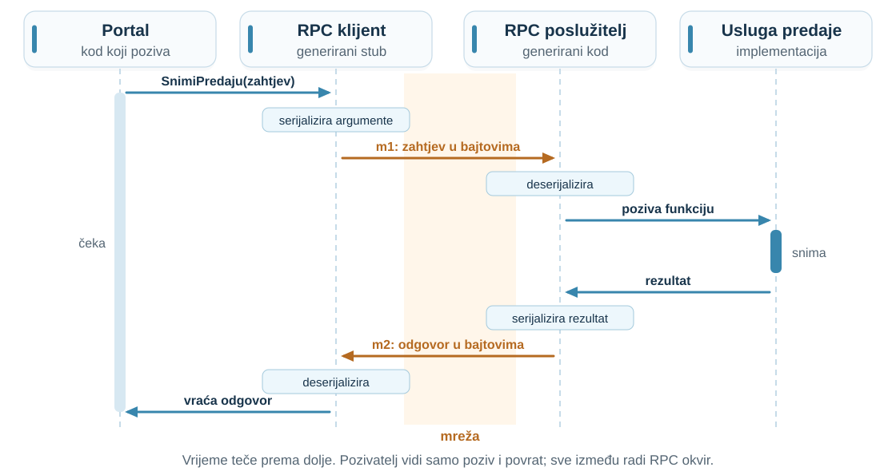
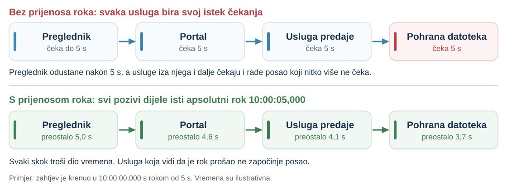
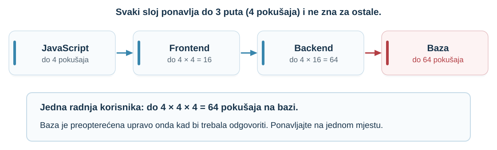
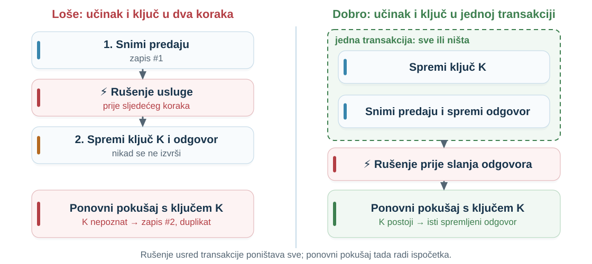

## Zadatak: obavijest poslana dvaput {.exercise-slide}

Nastavnik želi **e-poštu kad stigne predaja**. Usluga e-pošte ponekad **satima ne radi**.

| Pitanje | Smjer odgovora |
|:---|:---|
| Gdje povući granicu? | [Zasebna usluga obavijesti.]{.fragment fragment-index=1} |
| Mora li predaja čekati e-poštu? | [Ne: asinkrona poruka nakon prihvaćanja.]{.fragment fragment-index=2} |
| Ista obavijest dvaput? | [Za e-poštu uglavnom bezopasno; za naplatu ili ocjenu nije.]{.fragment fragment-index=3} |

[**Identifikator predaje u poruci** omogućuje prepoznati duplikat. Danas: kada je ponavljanje bezopasno i kako ga takvim učiniti.]{.fragment fragment-index=4}

::: {.notes}
- **Priča:** Zadatak iz 02 vodi ravno u današnju temu: ponovljena poruka.

- Pitati dvoje-troje studenata za rješenje prije otkrivanja redaka.

- Pitati: zašto bi se obavijest uopće poslala dvaput? Očekivano: predaja nije dobila potvrdu pa je poslala ponovno.

- Dvostruka e-pošta je neugodna; isti obrazac kod naplate ili ocjene nije bezopasan.
:::

## Snimanje predaje ne odgovara {.example-slide}

Portal poziva **uslugu predaje**: kratak poziv `SnimiPredaju(p-2026-0812)` zapisuje predaju u bazu.

- Na zapis se oslanja sve ostalo: popis predaja, provjera projekta, obavijest nastavniku.
- Portal čeka najviše **2 s**. Odgovor **ne stigne**.

**Smije li portal pozvati ponovno?**

::: {.answer-chips}
[**A** Da, odmah]{.answer-chip .answer-a}
[**B** Ne, nikad]{.answer-chip .answer-b}
[**C** Ovisi]{.answer-chip .answer-c}
:::

::: {.notes}
- **Priča:** Otvaramo pitanje na koje odgovaramo na kraju: smije li se udaljeni poziv ponoviti.

- Poveznica s 02: portal je podijeljen na usluge; snimanje predaje je poziv preko granice usluge.

- Glasanje 30 s; pitati po jednog studenta za svaki odgovor.

- Ne otkrivati odgovor. Zapisati argumente na ploču: dva zapisa iste predaje (dvije provjere, dvije obavijesti) ili nijedan zapis, a student misli da je predao.

- Invarijanta iz 01: jedna predaja, najviše jedan prihvaćeni zapis.
:::

## Što trebamo znati da bismo odlučili?

- Po čemu se **udaljeni poziv** razlikuje od lokalnog?
- Kako radi **RPC** i što je **ugovor** između usluga?
- Kako se podaci **serijaliziraju** i kako ugovor mijenjati bez rušenja klijenata?
- Koliko dugo **čekati** i što učiniti kad rok istekne?
- Kako **ponovni pokušaj** učiniti bezopasnim?

::: {.notes}
- **Priča:** Jedno pitanje razbijamo u pet koja čine plan predavanja.

- Predznanje iz 01: istek čekanja, tri povijesti, invarijanta. Iz 02: granica usluge, sinkrono i asinkrono.
:::

## Lokalni i udaljeni poziv

| | Lokalni poziv | Udaljeni poziv |
|:---|:---|:---|
| Trajanje | nanosekunde | milisekunde ili više |
| Ishod | vrati vrijednost ili baci iznimku | uspjeh, pogreška ili **nepoznato** |
| Argumenti | referenca na istu memoriju | kopija pretvorena u bajtove |
| Ispad | pozivatelj i funkcija padaju zajedno | neovisno: djelomični ispad |
| Ponavljanje | nije potrebno | ponekad nužno, ponekad opasno |

**Kod može izgledati isto; ponašanje nije isto.**

::: {.notes}
- **Priča:** Prije alata gledamo zašto udaljeni poziv uopće treba posebnu pažnju.

- Svaki redak već smo vidjeli: latencija iz 02 (oko 5000 puta), djelomični ispad i tri povijesti iz 01.

- Pitati: što ako nakon poziva promijenim objekt koji sam poslao? Lokalno vidi promjenu, udaljeno ne: poslana je kopija.

- Klasičan rad o tome: Waldo i sur., 1994. (navodi ga Kleppmann).

Izvori: [Kleppmann, Distributed Systems, odj. 1.3](https://www.cl.cam.ac.uk/teaching/2122/ConcDisSys/dist-sys-notes.pdf).
:::

## Zahtjev–odgovor: tri ishoda {.visual-definitions}

::: {.definition number="3.1"}
U komunikaciji **zahtjev–odgovor (request–response)** klijent šalje poruku zahtjeva i čeka poruku odgovora koja se na taj zahtjev odnosi.
:::

```js
try {
  const odgovor = await fetch("/predaje", { method: "POST", body: zip,
                                            signal: AbortSignal.timeout(30_000) });
  if (odgovor.ok) prikaziPotvrdu(await odgovor.json());  // 1. uspjeh
  else prikaziPogresku(odgovor.status);                    // 2. pogreška poslužitelja
} catch (e) {
  prikaziNepoznato();                       // 3. nema odgovora: ishod nepoznat
}
```

::: {.notes}
- **Priča:** Najpoznatiji zahtjev–odgovor je HTTP; studenti ga znaju iz Web aplikacija.

- Prva dva ishoda su odgovori. Treći je izostanak odgovora: izgubljen zahtjev, spora obrada ili izgubljen odgovor.

- fetch sam nema rok; AbortSignal.timeout ga postavlja.

- Pitati: što piše korisniku u grani 3? Očekivano: „ne znamo je li predano”, ne „pogreška, pokušajte ponovno”.

Izvori: [Kleppmann, Distributed Systems, odj. 1.3](https://www.cl.cam.ac.uk/teaching/2122/ConcDisSys/dist-sys-notes.pdf).
:::

## RPC: udaljeni poziv koji izgleda lokalno {.retry-overlap}

::: {.definition number="3.2"}
**Poziv udaljene procedure (remote procedure call, RPC)** omogućuje programu da pozove funkciju koja se izvršava u drugom procesu, obično na drugom računalu, kao da je lokalna. RPC okvir pretvara argumente u poruku, šalje je, a iz poruke odgovora vraća rezultat.
:::

- **Stub:** lokalna funkcija s istim potpisom kao udaljena; ne radi posao, nego šalje poruku.
- **Lokacijska transparentnost (location transparency):** sustav skriva gdje se resurs nalazi.
- **Ali:** pad usluge, izgubljena ili zakašnjela poruka i ponovni pokušaj ne mogu se sakriti.

::: {.notes}
- **Priča:** Ručno slaganje HTTP zahtjeva je zamorno; RPC skriva poziv iza obične funkcije.

- Ideja je stara: Sun RPC (1980-e), CORBA, Java RMI, SOAP, Thrift, gRPC (2015).

- Zamka: izgleda lokalno, a nije. Kleppmannova četiri pitanja: pad tijekom poziva, izgubljena poruka, zakašnjela poruka, je li sigurno ponoviti.

Izvori: [Kleppmann, Distributed Systems, odj. 1.3](https://www.cl.cam.ac.uk/teaching/2122/ConcDisSys/dist-sys-notes.pdf).
:::

## Tijek jednog RPC poziva

{fig-alt="Četiri stupca: portal, RPC klijent (stub), RPC poslužitelj i usluga predaje. Poziv SnimiPredaju ide do stuba, stub serijalizira argumente i šalje poruku m1 preko mreže, poslužitelj je deserijalizira i poziva funkciju. Rezultat se serijalizira, šalje kao m2 i vraća pozivatelju, koji cijelo vrijeme čeka." height=520px}

::: {.notes}
- **Priča:** Otvaramo „kutiju”: što se događa između poziva i povrata.

- Pratiti strelice odozgo prema dolje: stub, serijalizacija, poruka m1, deserijalizacija, obrada, isto natrag kao m2.

- Pozivatelj cijelo vrijeme čeka (svijetla traka lijevo).

- Pitati: gdje se poruka može izgubiti? Očekivano: m1 ili m2 u narančastom pojasu. To su povijesti iz 01.

Izvori: prilagođeno prema [Kleppmann, Distributed Systems, slajd 16](https://www.cl.cam.ac.uk/teaching/2122/ConcDisSys/dist-sys-notes.pdf).
:::

## gRPC: ugovor u datoteci `.proto` {.code-slide}

:::: {.columns}
::: {.column width="58%"}
```proto
syntax = "proto3";
package predaja;

service Predaja {
  rpc SnimiPredaju(ZahtjevPredaje)
      returns (OdgovorPredaje);
}

message ZahtjevPredaje {
  string predaja_id = 1;   // isti u svakom pokušaju
  string zadatak = 2;
  int64 velicina_bajtova = 3;
}

message OdgovorPredaje {
  string zapis_id = 1;
  bool vec_snimljeno = 2;  // true: ponovljeni pokušaj
}
```
:::
::: {.column width="42%"}
- **Ugovor** opisuje sučelje neovisno o jeziku: **jezik za opis sučelja (IDL)**.
- Iz `.proto` se **generira** kod stuba i serijalizacije za svaki jezik.
- **Unarni** RPC: jedan zahtjev, jedan odgovor.
- Brojevi `= 1`, `= 2` nisu vrijednosti, nego **brojevi polja**.
:::
::::

::: {.notes}
- **Priča:** Konkretan RPC okvir: gRPC s Protocol Buffersima kao IDL-om.

- Ugovor je ono što timovi dogovaraju; kod se generira, ne piše ručno.

- predaja_id je važan: vratit ćemo se na njega kod ponovnih pokušaja.

- gRPC ima i tokove poruka (streaming); danas samo unarni poziv.

Izvori: [gRPC, Core concepts](https://grpc.io/docs/what-is-grpc/core-concepts/); [Kleppmann, odj. 1.3](https://www.cl.cam.ac.uk/teaching/2122/ConcDisSys/dist-sys-notes.pdf).
:::

## Poziv iz Pythona {.code-slide}

```python
import grpc
import predaja_pb2, predaja_pb2_grpc       # generirano iz predaja.proto

kanal = grpc.insecure_channel("predaja:50051")
stub = predaja_pb2_grpc.PredajaStub(kanal)
zahtjev = predaja_pb2.ZahtjevPredaje(
    predaja_id="p-2026-0812", zadatak="RS-projekt", velicina_bajtova=20_971_520)

try:
    odgovor = stub.SnimiPredaju(zahtjev, timeout=2.0)
except grpc.RpcError as e:
    if e.code() == grpc.StatusCode.DEADLINE_EXCEEDED:
        ...   # ishod nepoznat: predaja je možda snimljena
```

**Izgleda kao poziv funkcije, ali `timeout` i `DEADLINE_EXCEEDED` otkrivaju mrežu.**

::: {.notes}
- **Priča:** Klijentska strana: poziv izgleda lokalno, ali ima dvije „pukotine” kroz koje se vidi mreža.

- Kod je isproban (grpcio 1.63); cijeli primjer s poslužiteljem je u assets/kod za demo.

- Pitati: što staviti u granu s „...”? Ostaviti otvoreno: odgovor nakon dijela o idempotentnosti.
:::

## Serijalizacija: JSON i Protocol Buffers {.dense-table}

::: {.definition number="3.3"}
**Serijalizacija (marshalling)** pretvara podatke iz memorije u niz bajtova za slanje ili spremanje; **deserijalizacija** je obrnuti postupak.
:::

| | JSON | Protocol Buffers |
|:---|:---|:---|
| Zapis | tekst, čitljiv čovjeku | binarni |
| U poruci | **nazivi** polja | **brojevi** polja iz ugovora |
| Ugovor | nije obavezan | obavezan (`.proto`) |
| Naš zahtjev | **79 bajtova** | **30 bajtova** |
| Tipično | preglednik ↔ poslužitelj | usluga ↔ usluga |

::: {.notes}
- **Priča:** Stub mora argumente pretvoriti u bajtove; isti zahtjev u dva formata.

- JSON: {"predaja_id":"p-2026-0812","zadatak":"RS-projekt","velicina_bajtova":20971520}, 79 B.

- Protobuf: 0a 0b „p-2026-0812”, 12 0a „RS-projekt”, 18 80 80 80 0a; 30 B. Izmjereno serijalizacijom.

- Brojke vrijede za ovaj primjer; kod dugog teksta razlika je manja.

- Bez .proto datoteke protobuf poruku teško je razumjeti: primatelj naziv i tip polja saznaje iz definicije.

Izvori: [Protocol Buffers, Encoding](https://protobuf.dev/programming-guides/encoding/).
:::

## Promjena ugovora bez rušenja klijenata

Dodajemo polje `string jezik = 4;`. Usluge se izdaju **neovisno**.

| Situacija | Što se događa |
|:---|:---|
| Stari klijent → novi poslužitelj | [Polje 4 se ne šalje; poslužitelj dobiva **zadanu vrijednost** (prazan niz).]{.fragment fragment-index=1} |
| Novi klijent → stari poslužitelj | [Nepoznato polje se **čuva** i ne ruši parsiranje.]{.fragment fragment-index=2} |
| Uklonimo polje 2, pa broj 2 damo novom polju | [Stari klijent šalje zadatak, novi poslužitelj ga čita kao nešto drugo. **Tiha pogreška.**]{.fragment fragment-index=3} |

**Pravilo:** broj polja se nikad ne mijenja ni ne koristi ponovno; uklonjeni broj se rezervira: `reserved 2;`.

::: {.notes}
- **Priča:** Iz 02 znamo da se usluge izdaju neovisno; ugovor se mijenja dok stari klijenti rade.

- Otkrivati redak po redak; pitati studente prije svakog.

- Kontrast: u JSON-u je preimenovanje polja nekompatibilno (šalje se naziv), u protobufu nije; u protobufu je nekompatibilna promjena broja.

Izvori: [Protocol Buffers, Language Guide (proto 3)](https://protobuf.dev/programming-guides/proto3/); [Proto Best Practices](https://protobuf.dev/best-practices/dos-donts/).
:::

## Istek čekanja ne kaže što se dogodilo

| Što se dogodilo sa `SnimiPredaju` | Je li predaja snimljena? |
|:---|:---|
| zahtjev se izgubio | ne |
| snimanje je sporo i još traje | da, uskoro |
| snimanje je gotovo, odgovor se izgubio | da |

**Ponoviti je sigurno samo u prvom retku, a njega klijent ne može razlikovati od ostalih.**

::: {.notes}
- **Priča:** Podsjetnik na tri povijesti iz 01, sada za naš RPC poziv.

- Kratko: studenti ovo znaju; cilj je postaviti pitanje roka i ponavljanja.
:::

## Rok u gRPC-u {.visual-definitions}

::: {.definition number="3.4"}
**Rok (deadline)** je trenutak nakon kojega klijent više ne čeka odgovor. **Istek vremena čekanja (timeout)** je trajanje do tog trenutka.
:::

- gRPC **ne postavlja rok sam**: bez njega klijent može čekati praktički zauvijek. Uvijek postavite realan rok.
- Kad rok prođe: klijent dobiva **`DEADLINE_EXCEEDED`**.
- Klijent i poslužitelj **neovisno** zaključuju je li poziv uspio; zaključci se ne moraju podudarati.

**Pokus:** snimanje 3 s, rok 2 s. Klijent: `DEADLINE_EXCEEDED`. Poslužitelj: predaja **snimljena**.

::: {.notes}
- **Priča:** Alat koji gRPC daje za pitanje „koliko čekati” i što nam on (ne) govori.

- Timeout = trajanje („2 s”), rok = trenutak („do 10:00:05”). Rok se može proslijediti dalje.

- Pokus je izveden s kodom iz assets/kod; može se pokazati uživo (demo.py).

- Poslužitelj može provjeravati je li poziv otkazan, ali učinjeni posao se ne poništava.

Izvori: [gRPC, Deadlines](https://grpc.io/docs/guides/deadlines/); [gRPC, Core concepts](https://grpc.io/docs/what-is-grpc/core-concepts/).
:::

## Kako odabrati rok i prenijeti ga lancem

{fig-alt="Gornji red: preglednik, portal, usluga predaje i pohrana datoteka; svaka čeka 5 sekundi neovisno. Donji red: isti lanac s apsolutnim rokom 10:00:05,000; preostalo vrijeme pada s 5,0 na 3,7 sekundi." height=390px}

**Odabir:** krenite od izmjerenih latencija usluge, npr. percentil p99,9. Prekratko: lažni istek. Predugo: korisnik i resursi čekaju.

::: {.notes}
- **Priča:** Dvije odluke: koliki rok i kako ga uskladiti kroz lanac usluga iz 02.

- p99,9: otprilike jedan od tisuću ispravnih poziva lažno istekne. Rok je kompromis, ne svojstvo mreže.

- Gore: preglednik odustane, a usluge iza njega i dalje rade posao koji nitko ne čeka.

- Dolje: prijenos roka (deadline propagation); isti apsolutni rok za cijelo stablo poziva. Neke gRPC implementacije to rade automatski.

Izvori: [Brooker, Timeouts, retries, and backoff with jitter](https://aws.amazon.com/builders-library/timeouts-retries-and-backoff-with-jitter/); [Google SRE, pogl. 22](https://sre.google/sre-book/addressing-cascading-failures/).
:::

## Semantike ponovnih pokušaja {.dense-table}

| Jamstvo | Koliko se puta operacija izvrši | Kako se postiže |
|:---|:---|:---|
| **najviše jednom** (at-most-once) | 0 ili 1 | bez ponavljanja **ili** poslužitelj prepoznaje ponovljeni zahtjev i ne izvršava ga |
| **barem jednom** (at-least-once) | 1 ili više, ako stigne odgovor | klijent ponavlja do potvrde |
| **učinak točno jednom** (exactly-once) | možda više puta, ali učinak kao jednom | klijent ponavlja **+** idempotentnost ili prepoznavanje duplikata |

**Učinak točno jednom = barem jednom (klijent ponavlja) + najviše jednom (poslužitelj ne izvršava duplikat).**

Bez odgovora klijent **ne zna** je li operacija izvršena.

::: {.notes}
- **Priča:** Kad rok istekne, biramo jamstvo: koliko se puta operacija smije izvršiti.

- Jamstvo govori o broju izvršavanja, ne o broju pokušaja. „Najviše jednom” ne znači nužno jedan pokušaj.

- ONC RPC (RFC 5531, odj. 5): klijent pri ponovnom slanju koristi isti identifikator transakcije (xid), a poslužitelj pamti obrađene zahtjeve i ne izvršava ih ponovno („some degree of execute-at-most-once”). Isto radi ključ idempotentnosti.

- Kleppmann opisuje jednostavniji slučaj, po ponašanju klijenta: najviše jednom = ne ponavljaj.

- „Točno jednom” čitati pažljivo: mreža ne jamči jednu obradu; postižemo da ponovljena obrada nema dodatni učinak.

- Pitati: koje jamstvo daje kod sa slajda „Poziv iz Pythona” ako u grani ponovimo poziv? Barem jednom.

Izvori: [RFC 5531, odj. 5](https://www.rfc-editor.org/rfc/rfc5531.html); [Kleppmann, odj. 5.1](https://www.cl.cam.ac.uk/teaching/2122/ConcDisSys/dist-sys-notes.pdf).
:::

## Ponovni pokušaji se množe

{fig-alt="Četiri kartice u nizu: JavaScript do 4 pokušaja, frontend do 16, backend do 64 i baza do 64 pokušaja za jednu radnju korisnika." height=330px}

**Ponavljajte na jednom mjestu**, ograničite broj pokušaja i pričekajte između njih (predavanje 08).

::: {.notes}
- **Priča:** Oluja ponavljanja iz 01 ima i ovaj oblik: svaki sloj „samo malo” ponavlja.

- Googleov primjer: tri sloja, svaki do 3 ponavljanja (4 pokušaja) daje 4³ = 64 pokušaja na bazi.

- Pitati: tko u našem portalu ponavlja? Preglednik, usluga predaje, gRPC kanal. Odlučiti gdje.

Izvori: [Google SRE, pogl. 22](https://sre.google/sre-book/addressing-cascading-failures/); [Brooker](https://aws.amazon.com/builders-library/timeouts-retries-and-backoff-with-jitter/).
:::

## Ponovni pokušaj u gRPC-u {.code-slide}

```json
{"methodConfig": [{
  "name": [{"service": "predaja.Predaja"}],
  "retryPolicy": {
    "maxAttempts": 4,
    "initialBackoff": "0.1s", "maxBackoff": "1s", "backoffMultiplier": 2,
    "retryableStatusCodes": ["UNAVAILABLE"] } }]}
```

- Politika se zadaje **po metodi**; bez nje gRPC u većini slučajeva **ne može sigurno** ponoviti poziv.
- Kad stigne zaglavlje odgovora, poziv je **potvrđen** i više se ne ponavlja.
- **`UNAVAILABLE` ne znači da posao nije obavljen.** Politika ne čini metodu sigurnom; metoda mora biti sigurna sama.

::: {.notes}
- **Priča:** gRPC može ponavljati umjesto nas, ali samo uz izričitu politiku po metodi.

- Politika je tvrdnja programera: „ovu metodu je sigurno ponoviti”.

- Veza se može prekinuti nakon što je poslužitelj obavio posao; zato idempotentnost.

- Konfiguracija je provjerena s grpcio 1.63 (kanal prihvaća grpc.service_config).

Izvori: [gRPC, Retry](https://grpc.io/docs/guides/retry/).
:::

## Idempotentnost {.visual-definitions .dense-table}

::: {.definition number="3.5"}
Operacija je **idempotentna** (idempotent) ako višestruko izvođenje ima isti učinak kao jedno izvođenje. Odgovori se mogu razlikovati.
:::

| Nije idempotentno | Idempotentno |
|:---|:---|
| povećaj brojač „sviđa mi se” | dodaj korisnika u skup „sviđa mi se” |
| dodaj 10 bodova | postavi bodove na 85 |
| snimi još jedan zapis predaje | snimi predaju `p-2026-0812` ako već nije snimljena |

**HTTP:** PUT, DELETE i metode koje samo čitaju (GET) su idempotentne; **POST nije**, a predaja je POST.

::: {.notes}
- **Priča:** Prvi način da ponavljanje bude bezopasno: operacija koja ponavljanjem ništa ne mijenja.

- Matematički f(f(x)) = f(x). Kleppmannov primjer: skup lajkova, a broj je veličina skupa.

- Opći trik: operaciji dati identitet koji ostaje isti u svim pokušajima.

- RFC 9110: klijent smije ponoviti idempotentan zahtjev ako se veza prekine prije odgovora.

Izvori: [Kleppmann, odj. 5.1](https://www.cl.cam.ac.uk/teaching/2122/ConcDisSys/dist-sys-notes.pdf); [RFC 9110, odj. 9.2](https://www.rfc-editor.org/rfc/rfc9110.html).
:::

## Ključ idempotentnosti {.visual-definitions .code-slide}

::: {.definition number="3.6"}
**Ključ idempotentnosti (idempotency key)** je jedinstvena vrijednost koju klijent generira za jednu namjeravanu operaciju i šalje u svakom pokušaju; poslužitelj po njoj prepoznaje ponovljene pokušaje.
:::

```js
const kljuc = crypto.randomUUID();   // jednom, prije prvog pokušaja
fetch("/predaje", { method: "POST", body: zip,
                    headers: { "Idempotency-Key": kljuc } });  // isti ključ u svakom pokušaju
```

- Poslužitelj sprema **odgovor prvog zahtjeva**; ponovljeni zahtjev s istim ključem dobiva isti odgovor.
- Isti ključ, **drukčiji sadržaj** → pogreška. Ključ se čuva barem 24 sata (Stripe).

::: {.notes}
- **Priča:** Drugi način: operaciji damo identitet, a poslužitelj pamti što je s njim već napravio.

- Obećano u 01: zaglavlje Idempotency-Key. Prijedlog standarda IETF-a (nacrt -08), ne usvojeni RFC; obrazac koriste javni API-ji.

- Najčešća pogreška: novi ključ u svakom pokušaju. Poslužitelju to izgleda kao nova predaja.

- U usluzi predaje ključ već imamo: predaja_id, koji portal odabere jednom.

Izvori: [IETF, Idempotency-Key](https://datatracker.ietf.org/doc/draft-ietf-httpapi-idempotency-key-header/); [Stripe, Idempotent requests](https://docs.stripe.com/api/idempotent_requests).
:::

## Ključ i učinak u jednoj transakciji

{fig-alt="Dva stupca. Lijevo: stvori predaju, rušenje, spremanje ključa se nikad ne izvrši, ponovni pokušaj stvara drugu predaju. Desno: spremi ključ K i stvori predaju unutar jedne transakcije, rušenje prije odgovora, ponovni pokušaj nalazi K i dobiva isti spremljeni odgovor." height=390px}

`INSERT ... ON CONFLICT (predaja_id) DO NOTHING`: jedna atomarna naredba, ključ je **`UNIQUE`**.

::: {.notes}
- **Priča:** Ključ pomaže samo ako se sprema zajedno s učinkom.

- Lijevo: rušenje između dva koraka ostavlja učinak bez ključa. Desno: sve ili ništa.

- UNIQUE štiti i od dva istodobna pokušaja; kao etcd u 01: odvojeno „pročitaj pa upiši” nije dovoljno.

- Granica: transakcija u bazi ne obuhvaća e-poštu ni druge vanjske učinke (predavanja 09 i 10).

Izvori: [Kleppmann, odj. 5.1](https://www.cl.cam.ac.uk/teaching/2122/ConcDisSys/dist-sys-notes.pdf).
:::

## Simulator: ponovni pokušaj i ključ

```{=html}
<div class="rr-widget"></div>
<script src="assets/rpc-retry.js"></script>
```

::: {.notes}
- **Priča:** Portal snima predaju i nakon isteka možda ponavlja; u tablici desno vidimo što je stvarno snimljeno.

- Zadano: bez ponavljanja, bez kvara. Jedan pokušaj, jedan zapis, jamstvo „najviše jednom”.

- „Izgubljen odgovor” bez ponavljanja: jedan zapis, ali portal ne zna ishod.

- „Ponavljanje”: drugi pokušaj snima drugi zapis, crveni duplikat u tablici. Jamstvo „barem jednom”.

- Uključiti „ključ K”: drugi pokušaj nalazi K i vraća isti odgovor; u tablici ostaje jedan zapis. Jamstvo „učinak točno jednom”.

- Spora obrada bez ključa: odgovor prvog pokušaja stiže prekasno, a zapis je ipak snimljen; drugi pokušaj snima duplikat.

- Izgubljen zahtjev u svakom pokušaju: nema zapisa ni duplikata; sigurnost bez napretka (01). Kod izgubljenog zahtjeva ključ ništa ne mijenja.
:::

## Natrag na početak: smije li portal ponoviti poziv?

**Odgovor C, ovisi. Sada znamo o čemu:**

| Bez ključa | S ključem `predaja_id`, spremljenim atomarno |
|:---|:---|
| izgubljen odgovor → **drugi zapis iste predaje** | ponovni pokušaj vraća **postojeći zapis** |
| semantika barem jednom | učinak točno jednom |

**Uvijek:** rok za svaki pokušaj, ograničen broj pokušaja s razmakom, ponavljanje na jednom sloju, prijenos roka.

::: {.notes}
- **Priča:** Zatvaramo uvodno pitanje rokom, semantikom i ključem.

- Vratiti se na argumente s ploče iz glasanja.

- Isto za studenta: preglednik s Idempotency-Key smije ponoviti predaju nakon isteka čekanja.
:::

## 🔥 Kako napraviti loš udaljeni poziv

- Poziv **bez roka**.
- Ponavljanje na **svakom sloju**.
- Ponavljanje **POST-a bez ključa**.
- **Novi ključ** u svakom pokušaju.
- Ključ spremljen **nakon** učinka, u zasebnom koraku.
- Promjena ili ponovna upotreba **broja polja** u `.proto`.
- Udaljeni poziv **u petlji** za svaki element (razgovorljivo sučelje).

::: {.notes}
- **Priča:** Suprotan primjer: kako svaki od današnjih alata upotrijebiti krivo.

- Pitati koje su od ovih pogrešaka studenti već vidjeli ili napravili.
:::

## Sažetak

- **Udaljeni poziv:** uspjeh, pogreška ili nepoznat ishod.
- **RPC:** stub i serijalizacija skrivaju poruku; gRPC ugovor je `.proto`.
- **Protocol Buffers:** brojevi polja se ne mijenjaju; uklonjeni se rezerviraju.
- **Rok:** svaki poziv ga treba; prenosi se kroz lanac.
- **Ponovni pokušaj:** barem jednom; množi se po slojevima.
- **Učinak točno jednom:** idempotentnost ili ključ, spremljen atomarno s učinkom.

::: {.notes}
- **Priča:** Skupljamo šest ideja koje koristimo pri svakom pozivu između usluga.

- Pitati jednog studenta da u jednoj rečenici objasni zašto ponovni pokušaj može udvostručiti učinak.
:::

## Osmislite sljedeći korak: dva uređaja i e-pošta {.exercise-slide}

1. Studentica šalje isti ZIP s **laptopa i mobitela**; svaki uređaj generira **svoj ključ**. Koliko predaja nastaje? Što bi bio bolji ključ?
2. Usluga predaje **pošalje e-poštu** nastavniku, a zatim se **sruši** prije spremanja ključa i zapisa. Što se događa pri ponovnom pokušaju?
3. Zašto transakcija u bazi u drugom slučaju **ne pomaže**?

::: {.notes}
- **Priča:** Primjenjujemo ključ i atomarnost na dva slučaja na kojima jednostavno rješenje pada.

- 1: dva ključa = dvije operacije za poslužitelj. Bolji ključ veže se uz namjeru, npr. student + zadatak + sadržaj (sažetak datoteke), ili portal izda identifikator predaje prije prijenosa.

- 2: snimanje se ponovi i nastavnik dobije drugu e-poštu. E-pošta je vanjski učinak izvan transakcije.

- 3: transakcija obuhvaća samo bazu. Rješenje: zapisati „pošalji e-poštu” u bazu u istoj transakciji, a slati kasnije (predavanja 09 i 10).
:::
