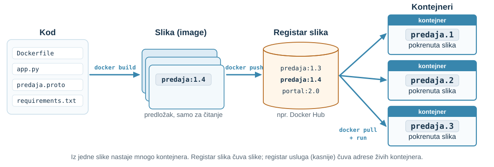
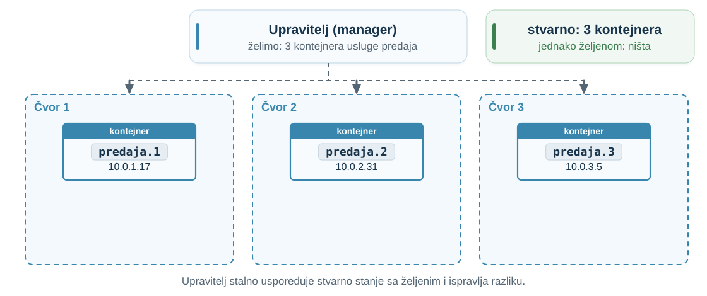
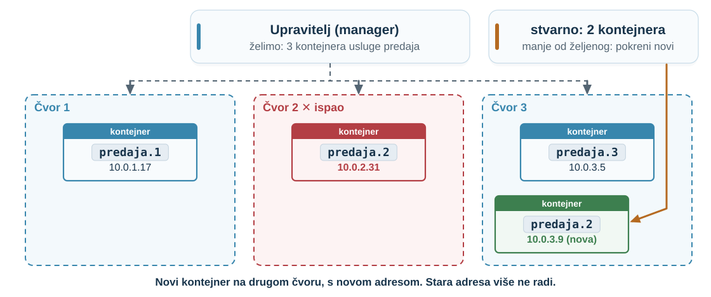
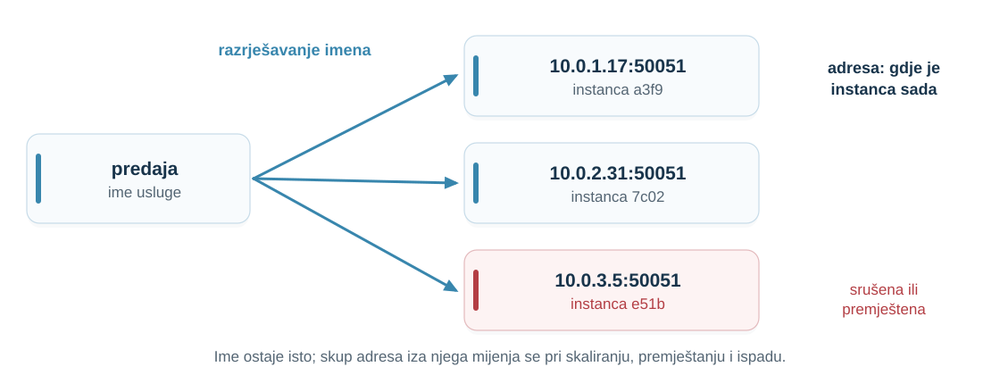
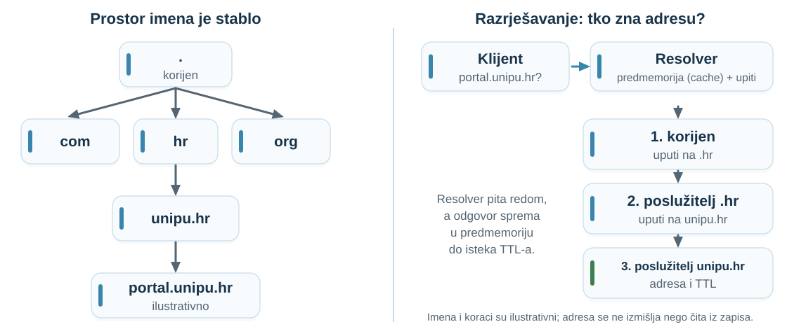
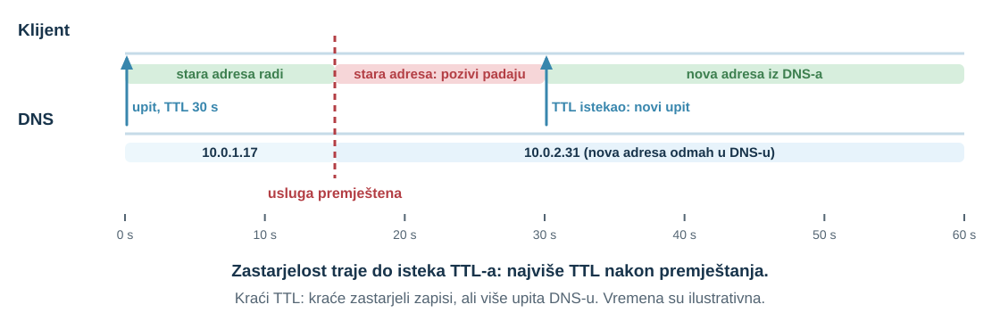
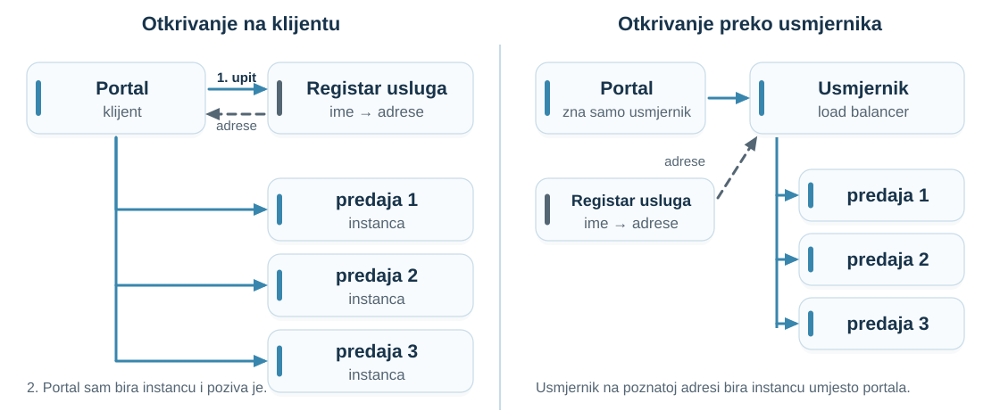
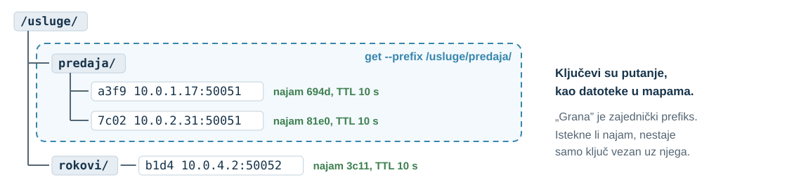

## Zadatak: dva uređaja i e-pošta {.exercise-slide .dense-table}

**Slučaj 1:** studentica pošalje ZIP s laptopa. Ništa se ne događa, pa **isti ZIP** pošalje i s mobitela. Svaki preglednik generirao je **svoj ključ idempotentnosti**.

| Pitanje | Odgovor |
|:---|:---|
| Koliko zapisa nastaje? | [**Dva:** poslužitelj vidi dva ključa, dakle dvije različite operacije.]{.fragment fragment-index=1} |
| Je li to problem? | [Da, ako vrijedi jedna predaja po zadatku: nastavnik vidi dvije i ne zna koja vrijedi.]{.fragment fragment-index=2} |
| Kakav ključ to sprječava? | [Ključ koji opisuje **predaju**, a ne uređaj: npr. student + zadatak + sažetak ZIP-a. Isti ZIP s bilo kojeg uređaja daje isti ključ.]{.fragment fragment-index=3} |

**Slučaj 2:** usluga pošalje nastavniku e-poštu, a zatim se **sruši** prije spremanja zapisa. [Ponovni pokušaj šalje drugu e-poštu. Namjeru „pošalji e-poštu” treba zapisati u istoj transakciji, a slati kasnije (09, 10).]{.fragment fragment-index=4}

::: {.notes}
- **Priča:** Zadatak iz 03 zatvaramo i pretvaramo u današnju temu: čime označavamo stvari da bismo ih kasnije prepoznali.

- Prvo pročitati situaciju, zatim pitati dvoje-troje studenata prije otkrivanja redaka.

- Ključ generiran u pregledniku identificira pokušaj s jednog uređaja, a ne predaju.

- Nova verzija ZIP-a ima drugi sažetak i daje novu predaju; to je ispravno. Druga mogućnost: portal izda identifikator predaje prije prijenosa i oba uređaja ga koriste.

- Slučaj 2: vanjski učinak izvan transakcije; detalji u 09 i 10.

- Prijelaz: ključ predaje je identifikator, ime koje označava točno jednu stvar. Danas gledamo kako usluge pronalaze jedna drugu po imenu, a ne po adresi. Najprije kratko kako Swarm pokreće usluge.
:::

## Od koda do kontejnera

{fig-alt="Kod s Dockerfileom naredbom docker build postaje slika predaja:1.4. Naredba docker push sprema je u registar slika, npr. Docker Hub. Naredbe docker pull i run iz jedne slike pokreću tri kontejnera predaja.1, predaja.2 i predaja.3." height=400px}

**Slika** je predložak samo za čitanje; **kontejner** je pokrenuta instanca slike. **Registar slika** čuva slike, a ne adrese.

::: {.notes}
- **Priča:** Prije Swarma kratko: odakle kontejneri.

- Slika (image): predložak samo za čitanje s uputama za stvaranje kontejnera. Kontejner: pokrenuta instanca slike.

- docker push sprema sliku u registar; docker pull i docker run je dohvaćaju. Docker Hub je javni registar.

- Pazi na riječ „registar”: registar slika čuva slike; registar usluga, kasnije danas, čuva adrese živih kontejnera.

Izvori: [Docker, What is Docker?](https://docs.docker.com/get-started/docker-overview/).
:::

## Docker Swarm: željeno stanje

{fig-alt="Upravitelj želi tri kontejnera usluge predaja i raspoređuje ih na čvorove 1, 2 i 3; svaki kontejner ima vlastitu IP adresu. Stvarno stanje, tri kontejnera, jednako je željenom." height=390px}

**Željeno stanje** = ono što smo zadali: usluga *predaja* u **3 kontejnera**. Upravitelj stalno uspoređuje stvarno stanje sa željenim i ispravlja razliku.

::: {.notes}
- **Priča:** Podsjetnik na Swarm iz 02, ali sada gledamo adrese.

- Upravitelj (manager) drži željeno stanje i raspoređuje zadatke (tasks) na radne čvorove; svaki zadatak je jedan kontejner.

- predaja.1, predaja.2, predaja.3 su tri kontejnera iste slike usluge predaje.

- Svaka replika je kontejner s vlastitom adresom na mreži.

Izvori: [Docker, Swarm mode key concepts](https://docs.docker.com/engine/swarm/key-concepts/).
:::

## Docker Swarm: čvor ispadne

{fig-alt="Čvor 2 je ispao. Upravitelj vidi da stvarno rade dva kontejnera, a želi tri, i pokreće novi kontejner predaja.2 na čvoru 3 s novom adresom 10.0.3.9." height=390px}

**Novi kontejner, nova adresa.** Tko to javlja portalu?

::: {.notes}
- **Priča:** Swarm sam vraća broj replika, ali adresa se promijenila.

- Kad radni čvor postane nedostupan, Swarm njegove zadatke raspoređuje na druge čvorove.

- Pitanje „tko to javlja portalu?” vodi ravno u glasanje na sljedećem slajdu.

Izvori: [Docker, Swarm mode key concepts](https://docs.docker.com/engine/swarm/key-concepts/).
:::

## Gdje je usluga predaje? {.example-slide}

Portal iz predavanja 03 otvara kanal prema **`predaja:50051`**.

- Pred rok usluga predaje radi u **tri replike** na tri čvora Swarma.
- Čvor 2 ispadne; Swarm pokrene repliku **drugdje, s novom adresom**.

**Kako portal treba pronaći uslugu predaje?**

::: {.answer-chips}
[**A** IP adresa u konfiguraciji]{.answer-chip .answer-a}
[**B** Ime i DNS]{.answer-chip .answer-b}
[**C** Registar usluga]{.answer-chip .answer-c}
:::

::: {.vote-explain}
- **A:** portal zna adresu jedne instance, npr. `10.0.1.17:50051`.
- **B:** portal zna samo ime `predaja`; **DNS**, sustav koji imena pretvara u adrese, vraća trenutnu adresu.
- **C:** posebna baza u koju se instance **same upisuju**; portal iz nje čita popis instanci koje rade.
:::

::: {.notes}
- **Priča:** Otvaramo pitanje na koje odgovaramo na kraju: kako pronaći uslugu koja se seli.

- Poveznica s 02 (replike, Swarm) i 03 (gRPC kanal).

- Najprije pročitati tri kratka opisa: B i C detaljno objašnjavamo kasnije, ovdje je dovoljna ideja.

- Glasanje 30 s; pitati po jednog studenta za svaki odgovor. Ne otkrivati odgovor.
:::

## Što trebamo znati da bismo odlučili?

- Po čemu se **ime** razlikuje od **adrese**?
- Kako **DNS** pretvara ime u adresu?
- Koliko dugo smijemo **pamtiti** odgovor?
- Kako klijent saznaje koje **instance** trenutno rade?
- Kako registar sazna da se instanca **srušila**?

::: {.notes}
- **Priča:** Jedno pitanje razbijamo u pet koja čine plan predavanja.
:::

## Primjeri nazivlja: ime, adresa i identifikator {.visual-definitions .dense-table}

::: {.definition number="4.1"}
**Ime** je niz znakova kojim se pozivamo na entitet. **Adresa** je ime mjesta na kojemu ga sada možemo kontaktirati. **Identifikator** označava točno jedan entitet i ne koristi se ponovno.
:::

| Primjer | Vrsta | Kada se mijenja? |
|:---|:---|:---|
| `predaja` | ime usluge | nikad, osim ako uslugu sami preimenujemo |
| `10.0.1.17:50051` | adresa kontejnera | kad Swarm kontejner premjesti ili zamijeni novim |
| `a3f9` | ID kontejnera | nikad za taj kontejner; novi kontejner dobiva novi ID, a `a3f9` se ne daje drugom |
| `p-2026-0812` | identifikator predaje | nikad; ne ovisi o kontejnerima (ključ idempotentnosti iz 03) |

::: {.notes}
- **Priča:** Rječnik: ime kaže što tražimo, adresa gdje je to sada.

- Pitati: je li `portal.unipu.hr` ime ili adresa? Ime; razrješava se u adresu.

- Identifikator predaje iz 03 je ime koje ne smije označiti dvije stvari.

- ID kontejnera vrijedi dok kontejner živi i nikad ne prelazi na drugi kontejner; zato se za pozivanje usluge koristi ime, a ne ID ili adresa.
:::

## Jedno ime, adrese koje se mijenjaju {.visual-definitions}

{fig-alt="Kartica s imenom usluge predaja strelicama je povezana s tri adrese instanci; treća je označena kao srušena ili premještena." height=330px}

::: {.definition number="4.2"}
**Razrješavanje imena (name resolution)** je pretvaranje imena u adresu ili druge podatke potrebne za pristup.
:::

::: {.notes}
- **Priča:** Ako portal drži adresu, svako premještanje mijenja portal; ako drži ime, premještanje je posao razrješavanja.

- Lokacijska transparentnost iz 03, s druge strane: ime skriva gdje je usluga.

- Ni to se ne skriva do kraja: između premještanja i nove adrese klijent ima zastarjelu adresu.
:::

## DNS: stablo imena i razrješavanje

{fig-alt="Lijevo stablo DNS imena: korijen, com, hr, org, unipu.hr, portal.unipu.hr. Desno klijent pita resolver, a resolver redom pita korijen, poslužitelj za hr i poslužitelj za unipu.hr." height=440px}

**Poslužitelji imena** drže dijelove stabla; **resolver** pita redom i pamti odgovore.

::: {.notes}
- **Priča:** Najpoznatiji sustav za razrješavanje imena; prostor imena je stablo.

- Zapis A: ime → IPv4 adresa. Zapis SRV dodaje vrata, prioritet i težinu (RFC 2782).

- Imena i koraci su ilustrativni.

Izvori: [RFC 1034](https://www.rfc-editor.org/rfc/rfc1034.html); [RFC 2782](https://www.rfc-editor.org/rfc/rfc2782.html).
:::

## DNS: predmemorija (cache) i TTL {.visual-definitions}

::: {.definition number="4.3"}
**TTL (time to live)** zapisa u DNS-u određuje koliko dugo resolver ili klijent smije čuvati taj zapis u predmemoriji prije nego što ga treba odbaciti i ponovno pitati DNS.
:::

{fig-alt="Vremenska crta: klijent dobiva adresu s TTL-om 30 s, usluga se premješta u 15 s, pozivi na staru adresu padaju do 30 s, zatim novi upit." height=300px}

**DNS pamti i negativne odgovore** („ime ne postoji”), prema zapisu SOA zone.

::: {.notes}
- **Priča:** Bez predmemorije DNS bi bio spor; s njom adresa može zastarjeti.

- Najdulja zastarjelost: jedan TTL nakon premještanja. Uz nasumične trenutke upita prosječno oko pola TTL-a (procjena).

- Negativno predmemoriranje (RFC 2308): nova usluga može još neko vrijeme „ne postojati” za klijenta koji ju je tražio prerano.

Izvori: [RFC 1034](https://www.rfc-editor.org/rfc/rfc1034.html); [RFC 2308](https://www.rfc-editor.org/rfc/rfc2308.html).
:::

## Simulator: TTL i premještanje usluge

```{=html}
<div class="dt-widget"></div>
<script src="assets/dns-ttl.js"></script>
```

::: {.notes}
- **Priča:** Biramo TTL i gledamo cijenu: neuspjeli pozivi nakon premještanja ili upiti DNS-u.

- Zadano TTL 30 s: neki klijenti još desetke sekundi zovu staru adresu.

- TTL 5 s: kratka zastarjelost, ali pet puta više upita. TTL 0: nema zastarjelosti, ali upit prije svakog poziva.

- TTL 300 s: gotovo nema upita, ali greške traju do kraja simulacije.

- Uključiti „nakon neuspjeha ponovno razriješi ime”: svaki klijent pogriješi jednom, pa se oporavi. Ponovni pokušaj mora biti siguran (03).
:::

## Imena usluga u kontejnerima {.code-slide}

:::: {.columns}
::: {.column width="48%"}
```yaml
services:
  portal:
    image: portal
    environment:
      PREDAJA_ADRESA: "predaja:50051"
  predaja:
    image: predaja
```
:::
::: {.column width="52%"}
- **Compose:** mreža `<projekt>_default`; svaka usluga registrira ime na internom DNS-u.
- **Swarm, VIP:** jedna virtualna adresa, Swarm bira repliku.
- **Swarm, `dnsrr`:** DNS vraća adrese replika, bira klijent.
- **Kubernetes Service:** podovi dolaze i odlaze; klijenti ih ne prate sami.
- **gRPC:** po zadanom DNS, `dns:///predaja:50051`.
:::
::::

::: {.notes}
- **Priča:** Alati iz 02 već imaju razrješavanje imena; zato je `predaja:50051` iz 03 radio.

- Compose primjer iz dokumentacije: web se spaja na `postgres://db:5432`.

- VIP Swarm dodjeljuje kad usluga objavljuje vrata.

- Kubernetes ažurira popis krajnjih točaka kad se skup podova promijeni.

Izvori: [Docker, Networking in Compose](https://docs.docker.com/compose/how-tos/networking/); [Docker, Swarm networks](https://docs.docker.com/engine/swarm/networking/); [Kubernetes, Service](https://kubernetes.io/docs/concepts/services-networking/service/); [gRPC, Name Resolution](https://grpc.io/docs/guides/custom-name-resolution/).
:::

## Otkrivanje usluga {.visual-definitions}

::: {.definition number="4.4"}
**Otkrivanje usluga (service discovery)** je postupak kojim klijent za zadano ime usluge saznaje adrese instanci koje trenutno mogu obraditi zahtjev.
:::

- DNS je nastao za imena koja se **rijetko** mijenjaju; instance u klasteru dolaze i odlaze **svakih nekoliko minuta**.
- **Registar usluga (service registry):** za svako ime usluge popis adresa instanci koje rade.

::: {.notes}
- **Priča:** Kad se instance često mijenjaju, treba nam izvor istine o živim instancama.

- Registar može biti etcd iz 01, ugrađen u platformu (Swarm, Kubernetes) ili zasebna usluga.
:::

## Na klijentu ili preko usmjernika

{fig-alt="Lijevo: portal pita registar i izravno poziva jednu od tri instance. Desno: portal poziva usmjernik, koji dobiva adrese iz registra i prosljeđuje zahtjev." height=420px}

**Na klijentu:** nema dodatnog skoka, ali klijent zna registar. **Preko usmjernika:** klijent zna samo jednu adresu.

::: {.notes}
- **Priča:** Dva obrasca: tko bira instancu.

- Na klijentu: Swarm `dnsrr`, gRPC s popisom adresa. Preko usmjernika: Swarm VIP, Kubernetes Service.

- Pitati: što ako se sruši usmjernik? Postaje kritična komponenta; i on treba replike.

Izvori: [Richardson, Client-side discovery](https://microservices.io/patterns/client-side-discovery.html); [Server-side discovery](https://microservices.io/patterns/server-side-discovery.html).
:::

## Tko upisuje instance u registar?

| | Samoregistracija | Registracija treće strane |
|:---|:---|:---|
| Tko upisuje | instanca sama | registrator (npr. platforma) |
| Kako zna da je živa | instanca **povremeno obnavlja** registraciju | registrator **provjerava zdravlje** |
| Rizik | kod registracije u svakoj usluzi | još jedna komponenta |

**Srušena instanca ne može obrisati vlastiti zapis.**

::: {.notes}
- **Priča:** Registar vrijedi samo ako je točan; tko ga drži točnim?

- Zadnja rečenica vodi u najam: zapis se mora ukloniti sam ako ga nitko ne potvrđuje.

Izvori: [Richardson, Self Registration](https://microservices.io/patterns/self-registration.html); [3rd Party Registration](https://microservices.io/patterns/3rd-party-registration.html).
:::

## Najam (lease) {.visual-definitions .code-slide}

::: {.definition number="4.5"}
**Najam (lease)** je zapis ili pravo koje vrijedi ograničeno vrijeme (TTL) i nestaje ako ga vlasnik na vrijeme ne obnovi.
:::

```bash
etcdctl lease grant 10                       # najam s TTL-om od 10 s
etcdctl put --lease=694d7a1b /usluge/predaja/a3f9 "10.0.1.17:50051"
etcdctl lease keep-alive 694d7a1b            # obnova dok instanca radi
etcdctl get --prefix /usluge/predaja/        # otkrivanje: sve žive instance
```

Najam istekne → etcd **briše sve ključeve** vezane uz njega. Registar se čisti sam.

::: {.notes}
- **Priča:** etcd iz 01 nudi mehanizam koji registru treba: zapis koji nestaje sam.

- Naredbe prema dokumentaciji etcd-a; identifikator najma je ilustrativan.

- Obnova se šalje pozivom LeaseKeepAlive; ako je nema unutar TTL-a, najam istječe.

Izvori: [etcd API, Lease API](https://etcd.io/docs/v3.6/learning/api/).
:::

## etcd kao registar: stablo ključeva

{fig-alt="Stablo ključeva u etcd-u: /usluge/ s granama predaja/ i rokovi/. Pod predaja/ dva ključa instanci s adresama, svaki vezan uz vlastiti najam od 10 sekundi. Istaknuta grana predaja/ je ono što vraća get --prefix /usluge/predaja/." height=300px}

**Registar = grana stabla.** Svaka instanca upiše svoj ključ pod `/usluge/predaja/` s vlastitim najmom; portal čita cijelu granu.

::: {.notes}
- **Priča:** Kako izgleda registar usluga u etcd-u: ključevi kao putanje, kao datoteke u mapama.

- Stablo je dogovor o prefiksima: etcd ključeve drži u ravnom, poredanom prostoru, a `--prefix` čita sve ključeve s istim početkom.

- Srušena instanca: istekne samo njezin najam, nestaje samo njezin ključ; ostatak grane ostaje.
:::

## DynamoDB: TTL nije najam {.dense-table}

| | TTL atribut stavke | DynamoDB Lock Client |
|:---|:---|:---|
| Što je | trenutak nakon kojega stavka više ne treba | najam (zaključavanje) nad tablicom |
| Kada zapis nestaje | DynamoDB ga briše **u roku od nekoliko dana**; do tada ga upiti vraćaju | kad vlasnik prestane slati otkucaje, nakon **trajanja najma** |
| Otkucaj | nema | vlasnik npr. svake 3 s **mijenja broj verzije** zapisa |
| Kako drugi zna da je isteklo | — | zapamti broj verzije i čeka trajanje najma (npr. 10 s); ako se **nije promijenio**, najam je istekao |

**U zapisu nema apsolutnog vremena**, samo trajanje najma: svaki klijent mjeri vlastitom štopericom.

::: {.notes}
- **Priča:** Ista riječ „TTL”, dva vrlo različita jamstva.

- TTL atribut je čišćenje starih podataka: srušena instanca bi danima ostala u registru; istekle stavke treba filtrirati u upitima.

- Lock Client: otkucaj je promjena broja verzije (GUID) u zapisu. Tko čeka, ne gleda sat drugog računala, nego vlastitu štopericu: zato satovi ne moraju biti usklađeni (sinkronizacija satova u 05).

- 10 s i 3 s su vrijednosti iz primjera u dokumentaciji, ne zadane vrijednosti.

Izvori: [DynamoDB TTL](https://docs.aws.amazon.com/amazondynamodb/latest/developerguide/TTL.html); [DynamoDB Lock Client](https://github.com/awslabs/amazon-dynamodb-lock-client).
:::

## Simulator: registar usluga s najmom

```{=html}
<div class="lr-widget"></div>
<script src="assets/lease-registry.js"></script>
```

::: {.notes}
- **Priča:** Simulator je registar usluga iz prethodnih slajdova: tri instance predaje, svaka s najmom koji obnavlja otkucajem (♥). Biramo TTL najma i razmak otkucaja i gledamo srušenu i zastalu instancu.

- Točke su zahtjevi portala; srca su otkucaji instanci prema registru.

- Zadano TTL 10 s, obnova 2 s: srušena B ostaje u registru desetak sekundi, a zahtjevi prema njoj padaju.

- TTL 2 s ili 5 s: brže uklanjanje, više obnova u minuti.

- Obnova jednaka TTL-u: ispravne instance ispadaju iz registra (lažna uklanjanja).

- Uključiti pauzu instance C: s TTL-om 5 s registar je lažno ukloni, ali manje zahtjeva padne; s TTL-om 10 s preživi pauzu, a zahtjevi prema njoj za vrijeme pauze padaju. Nema besplatnog izbora.
:::

## Koliko dug najam?

| Kraći TTL | Dulji TTL |
|:---|:---|
| srušena instanca brže nestaje iz registra | srušena instanca dulje prima zahtjeve |
| češće obnove: više opterećenje registra | rjeđe obnove |
| zastala instanca lakše **lažno** ispadne | podnosi dulje pauze |

**Obnovu slati nekoliko puta unutar TTL-a.** Šutnja i dalje ne razlikuje sporu instancu od srušene (01).

::: {.notes}
- **Priča:** Najam ne uklanja nesigurnost, nego je ograničava na jedan TTL.

- Lažno uklanjanje: instanca se nakon pauze mora ponovno registrirati.

- Poveznica: isti problem kao istek čekanja u 01; otkrivanje ispada u 08.
:::

## Vježba: zastarjela adresa {.exercise-slide}

Portal drži adresu `10.0.1.17:50051` iz predmemorije (TTL 60 s). Instanca je upravo premještena.

1. Koliko dugo portal može zvati staru adresu?
2. Što portal treba učiniti kad poziv ne uspije?
3. Je li ponovni poziv `SnimiPredaju` siguran? Zašto?
4. Što se mijenja ako usluga koristi registar s najmom od 10 s?

::: {.notes}
- **Priča:** Spajamo nazivlje s ponovnim pokušajem iz 03.

- Rad u paru 3 minute, zatim dva para izlažu.

- Očekivano: do 60 s; rok čekanja, ponovno razriješiti ime, ponoviti; siguran samo s ključem predaja_id (03); s najmom srušena instanca nestaje nakon najviše 10 s, ali premještena instanca mora se prijaviti na novoj adresi.
:::

## Natrag na početak: kako portal pronalazi uslugu predaje?

| Odgovor | Kada je dovoljan |
|:---|:---|
| **A** IP adresa u konfiguraciji | jedna instanca koja se nikad ne seli |
| **B** Ime i DNS (Compose, Swarm) | zastarjelost ograničena TTL-om; VIP skriva replike |
| **C** Registar s najmom | instance se same prijavljuju; srušene nestaju nakon najviše jednog TTL-a |

**Uvijek:** rok čekanja, ponovno razrješavanje imena i siguran ponovni pokušaj (03).

::: {.notes}
- **Priča:** Zatvaramo uvodno pitanje: B i C, ovisno o tome koliko se često instance mijenjaju.

- Vratiti se na argumente s ploče iz glasanja.
:::

## 🔥 Kako napraviti loše nazivlje

- IP adrese u kodu ili konfiguraciji.
- Predmemorija **bez TTL-a**.
- TTL od **nekoliko sati** za uslugu koja se seli svaki dan.
- Registracija **bez najma**.
- Najam kraći od uobičajene **pauze**; obnova jednom po TTL-u.
- Nakon neuspjeha **ne razrješavati ime ponovno**.
- Ime koje opisuje mjesto, a ne ulogu: `cvor2-predaja`.

::: {.notes}
- **Priča:** Suprotan primjer: kako svaki od današnjih alata upotrijebiti krivo.

- Pitati koje su od ovih pogrešaka studenti već vidjeli.
:::

## Sažetak

- **Ime** kaže što tražimo, **adresa** gdje je sada, **identifikator** točno jedan entitet.
- **DNS:** stablo imena, resolveri i poslužitelji imena.
- **TTL** ograničava zastarjelost predmemorije; pamte se i negativni odgovori.
- **Kontejneri:** Compose, Swarm, Kubernetes i gRPC daju uslugama imena.
- **Otkrivanje usluga:** registar; instancu bira klijent ili usmjernik.
- **Najam:** srušena instanca nestaje najviše jedan TTL nakon posljednje obnove.

::: {.notes}
- **Priča:** Skupljamo šest ideja koje koristimo kad god jedna usluga traži drugu.

- Pitati jednog studenta da u jednoj rečenici objasni kompromis TTL-a.
:::

## Osmislite sljedeći korak: dva registra {.exercise-slide}

Registar je i sam usluga koja može ispasti. Imamo **dvije kopije** registra.

1. Instanca se registrira u prvoj kopiji, a portal čita iz druge **prije usklađivanja**. Što portal vidi?
2. Kopije se zbog **particije** ne mogu uskladiti. Što tada?
3. Smije li registar odgovarati dok ne zna je li mu popis **aktualan**?

::: {.notes}
- **Priča:** Registar je podatak koji treba replicirati; to vodi u predavanja 06 i 07.

- 1: portal ne vidi novu instancu (zastarjelo čitanje).

- 2 i 3: izbor između dostupnosti i dosljednosti, kao etcd i Cassandra u 01. etcd bira dosljednost: bez većine nema upisa.
:::

## Za vaš projekt: imena i otkrivanje {.use-case-slide}

U **prijavi projekta** pokažite:

- kako usluge **pronalaze** jedna drugu (ime, DNS, registar);
- koliko dugo adresa može biti **zastarjela** i što klijent tada radi;
- što se događa kad se instanca **sruši ili preseli**.

::: {.notes}
- **Priča:** Povezujemo današnje pojmove s prijavom projekta.

- U Composeu i Swarmu imena usluga dolaze besplatno; treba znati što se događa između premještanja i nove adrese.
:::
